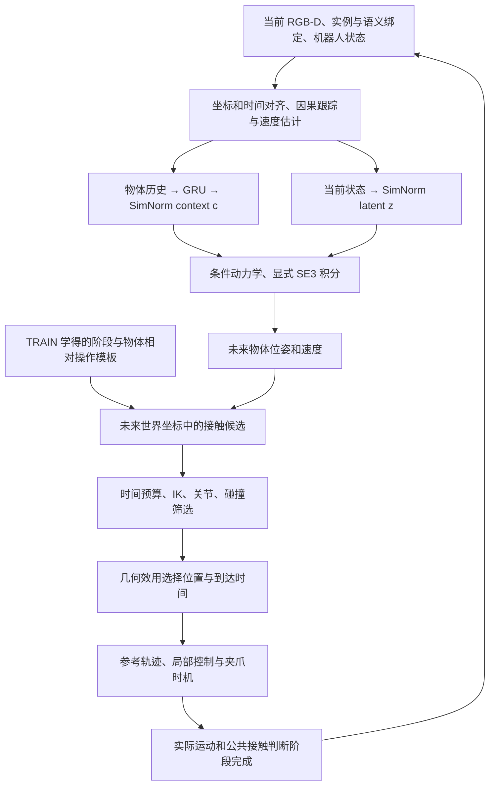

<!-- CONVERSATION_SWITCH_V1102 -->
2026-10-23T14:58:55+08:00：切对话请先读【交接_切换对话_20261023.md】。本轮16任务TRAIN/945 VAL/1920 TEST及完整独审、运动汇总均完成；无本项目训练/评测作业，GPU compute为空，仅hostwatch PID33102运行（核查2026-10-23T14:52:54+08:00）。新归一化状态`runtime/framework/latest_executor_continuation_v1102.json` SHA256 `1d95a0137eecb0ed9f642ce60140028f0e56d9707ba89414afa56475c57523ed`；1100原文件不改，其继承的reporter_active/待独审等旧标志不可当现状。新增论文对照1101：本轮Phys46.56% vs论文Table1 45.9±0.8%，属于执行适配基线，非严格逐数复现。下方历史中“继续TEST/等待审计”均已过期，禁止重复prepare/启动，禁Value/NGFF/FASTER。
<!-- END_CONVERSATION_SWITCH_V1102 -->

<!-- COMPLETE_PIPELINE_V1100 -->
2026-10-22T17:39:35.832073+00:00：本轮Context16任务联合TRAIN671、三组VAL823以及正式TEST全部完成。1920/1920（16任务×40来源×3组）已由1072独审确认，1073真实complete终态；1075运动汇总/1076真实complete且stage exit0。CV175/640=27.34%、Context199/640=31.09%、Phys298/640=46.56%；NativeFalse1248完整保留，motion诊断False638/639/640、unknown0，诊断不作原任务成功阈值。并非所有任务成功率良好。
最新完成检查点runtime/framework/latest_executor_continuation_v1100.json SHA256 082f8de1ca2034fc53977661f848dd9b5e1aea9c35b196bf87499833b3cceb84。正式结果da864e、运动ddab42；TEST_16任务最终结果.txt已由7f0f展示工具实际--write exit0生成，TEST_16任务进度.txt已同步为最终结果入口并归档旧未确认快照。真实对话已发后ack，1073/1074/1076三个exec实际exit0；所有本轮评测/独审/汇总进程自然结束，无后续Native/训练任务待启动，禁止重复prepare/启动。1074已完成退出，原下一01:38仅历史相位，本轮不再期待定时进度；1087旧R09 timer仍禁止恢复。用户否认手动重启，原因未确定，host稳定性监控仍enabled/active。模型/三组/RML/预算未改，禁Value/NGFF/FASTER。TRAIN来源1400个native_generated_hold、200方块来源的口径及VAL原manifest分母详见1083，不可宣称1600原HDF5运动示教重放。
<!-- END_COMPLETE_PIPELINE_V1100 -->

<!-- NATIVE_1920_AUDIT_RUNNING_V1099 -->
2026-10-22T17:29:47.826657+00:00：1920/1920原生评测全部跑齐，16任务×40×3；Native总数CV175/640、Context199/640、Phys298/640，均为待独审确认的运行统计。最后高速取杯0/40、0/40、22/40。1071真实complete终态9669d已保存，正常自然结束，当前零Native/GPU作业。独审1072正在真实执行PID323392/start1925289，1073/1074/1076三PID仍live；1076等待，不可重复启动独审或motion。
检查点runtime/framework/latest_executor_continuation_v1099.json SHA256 7e43e9d6a64ab1b78338de4f6aada1fa853bdcee6409b2cd4ea3f16f8bd6b503。进度TXT已由7e0b实际--write刷新为1920，但仍明确完整独审未确认；最终7f0f展示工具尚未正式生成最终TXT。01:08固定快照1896已真实对话/ack，下一01:38，不重置相位。禁止重复prepare/启动，禁Value/NGFF/FASTER，模型/三组/RML/预算不变。
<!-- END_NATIVE_1920_AUDIT_RUNNING_V1099 -->

<!-- FIXED_PHASE_V1098 -->
2026-10-23T01:09:13.814034+08:00：2026-10-23T01:08:22.070217+08:00固定快照1896/1920（context_geometry199/634，cv_geometry175/635，physmani292/627），15/16任务跑齐，本轮infra0。已真实对话后ack SHA `3b238ba8fd83f6de826d2331a4da1efe701ce0fe3d7b56c17cfe52d75924ea12`；纯展示工具7e0b实际--write exit0，view已保存，完整独审尚未确认。下一2026-10-23T01:38:21.384754+08:00，原相位不重置。
最新检查点`runtime/framework/latest_executor_continuation_v1098.json` SHA256 `d41b99a18a49f18bb729e0dd8779861bd85f1d9c60fee66962af68b811c8bb5b`。当前实测1901/1920，四PID/start与上检查点一致live，唯一1073/1071实际8Native/3GPU/4CPU；禁止重复prepare/启动。1072全1920独审/1075 motion未运行，1076仍等待；1087旧timer禁止自动恢复。模型/三组/RML/预算固定，禁Value/NGFF/FASTER。
<!-- END_FIXED_PHASE_V1098 -->

<!-- FINAL_DISPLAY_READY_V1097 -->
最终纯展示工具已完成/停写：scripts/render_final_TEST_results_view_r10.py SHA256 7f0f5dbdd04a912d5b058019b03da8353e90d637be0e9f68eab08974996cc1d7。root已审源码，peer只读通过，agent一次AST exit0；root当前缺产物预览实际exit0/ready=False/written=False，未写最终TXT，也未启动任何job/审计。证明runtime/framework/final_display_tool_verification_v1097.json SHA256 c3e1d2a6aba9c120fa5395c5917b07ae105ac3d956c5660135eca435b72775fa。完整1071/1073/1072/1076/1075产物真实完成后才可加--write生成TEST_16任务最终结果.txt；只读9固定metadata/result文件，真实16×40×3成功数、运动False/None/0保留，不ack/控制进程，不修改1074或进度TXT。当前运行入口仍1096，禁止重复prepare/启动。
<!-- END_FINAL_DISPLAY_READY_V1097 -->

<!-- FIXED_PHASE_V1096 -->
2026-10-23T00:39:10.088662+08:00：2026-10-23T00:38:22.058292+08:00固定快照1843/1920（context_geometry199/617，cv_geometry175/617，physmani281/609），15/16任务跑齐，本轮infra0。已真实对话后ack SHA `8a6d56e5372d4c3b5ed6935a47fd5f4538ea33bb3995ce08c7cea2a4c1bf8da6`；纯展示工具7e0b实际--write exit0，view已保存，完整独审尚未确认。下一2026-10-23T01:08:21.384754+08:00，原相位不重置。
最新检查点`runtime/framework/latest_executor_continuation_v1096.json` SHA256 `d65a941d53c35d4238bc7003a4fe0d3d533594840aa2c7ad87400c5e826b8f16`。当前实测1843/1920，四PID/start与上检查点一致live，唯一1073/1071实际8Native/3GPU/4CPU；禁止重复prepare/启动。1072全1920独审/1075 motion未运行，1076仍等待；1087旧timer禁止自动恢复。模型/三组/RML/预算固定，禁Value/NGFF/FASTER。
<!-- END_FIXED_PHASE_V1096 -->

<!-- FIFTEEN_TASKS_V1095 -->
2026-10-23T00:27:08.697136+08:00：普通取杯三组各40跑齐，CV0/40=0%、Context0/40=0%、Phys27/40=67.5%，已真实对话；当前1820/1920，15/16任务跑齐，本轮infra0，只余高速取杯。四PID/start与1094相同且live，唯一1073/1071实际8Native/3GPU/4CPU；禁止重复prepare/启动。
检查点`runtime/framework/latest_executor_continuation_v1095.json` SHA256 `27ca5991d3d44ffb7837133b89b24aa4600964c539c3483dc843e86cf0e0496a`。纯展示工具7e0b实际--write exit0，当前TXT为本次任务完成观察；不宣称独审完成。00:08固定1786快照已真实对话/ack，下一00:38:21CST，本次额外通知不改相位。1072全1920独审/1075 motion未运行，1076仍等待；1087旧timer禁止自动恢复。模型/三组/RML/预算固定，禁Value/NGFF/FASTER。
<!-- END_FIFTEEN_TASKS_V1095 -->

<!-- FIXED_PHASE_V1094 -->
2026-10-23T00:11:48.282238+08:00：2026-10-23T00:08:21.953722+08:00固定快照1786/1920（context_geometry199/599，cv_geometry175/599，physmani266/588），14/16任务跑齐，本轮infra0。已真实对话后ack SHA `97d4815ace0acb810658d9a6400f39bd03e92045e412ca7a1179ca9767855e2f`；纯展示工具7e0b实际--write exit0，view已保存，完整独审尚未确认。下一2026-10-23T00:38:21.384754+08:00，原相位不重置。
最新检查点`runtime/framework/latest_executor_continuation_v1094.json` SHA256 `2da64ed75d691824dd6e23425cef96a736d940fc9590af336a110d91c85f135e`。当前实测1793/1920，四PID/start与上检查点一致live，唯一1073/1071实际8Native/3GPU/4CPU；禁止重复prepare/启动。1072全1920独审/1075 motion未运行，1076仍等待；1087旧timer禁止自动恢复。模型/三组/RML/预算固定，禁Value/NGFF/FASTER。
<!-- END_FIXED_PHASE_V1094 -->

<!-- FIXED_PHASE_V1093 -->
2026-10-22T23:43:14.291703+08:00：2026-10-22T23:38:21.990113+08:00固定快照1728/1920（context_geometry199/580，cv_geometry175/580，physmani256/568），14/16任务跑齐，本轮infra0。已真实对话后ack SHA `b3f1c99a12d39b74a16f3f2619fceec8be5f5dc21e20a73dce49e47e3832ddd7`；纯展示工具7e0b实际--write exit0，view已保存，完整独审尚未确认。下一2026-10-23T00:08:21.384754+08:00，原相位不重置。
最新检查点`runtime/framework/latest_executor_continuation_v1093.json` SHA256 `bb16650896c8abecdae37a204840e09d1357159207998bd5f0c0ef63753f58d8`。当前实测1737/1920，四PID/start与上检查点一致live，唯一1073/1071实际8Native/3GPU/4CPU；禁止重复prepare/启动。1072全1920独审/1075 motion未运行，1076仍等待；1087旧timer禁止自动恢复。模型/三组/RML/预算固定，禁Value/NGFF/FASTER。
<!-- END_FIXED_PHASE_V1093 -->

<!-- FOURTEEN_TASKS_V1092 -->
2026-10-22T23:28:11.813658+08:00：高速挂杯三组各40跑齐，CV6/40=15%、Context2/40=5%、Phys12/40=30%，已真实对话；当前1710/1920，14/16任务跑齐，本轮infra0，余普通/高速取杯。四PID/start与1091相同且live，唯一1073/1071实际8Native/3GPU/4CPU；禁止重复prepare/启动。
检查点`runtime/framework/latest_executor_continuation_v1092.json` SHA256 `824cd188f0e4ef9420afe526d305b1d39dc2ed59932a9fe57d3339b6f5f73cd6`。纯展示工具7e0b实际--write exit0，当前TXT为本次任务完成观察；不宣称独审完成。23:08固定1673快照已真实对话/ack，下一23:38:21CST，本次额外通知不改相位。1072全1920独审与1075 motion未运行，1076仍等待；原模型/三组/RML/预算固定，禁Value/NGFF/FASTER。
<!-- END_FOURTEEN_TASKS_V1092 -->

<!-- FIXED_PHASE_V1091 -->
2026-10-22T23:12:28.700071+08:00：23:08固定快照1673/1920（CV175/562=31.1%、Context199/562=35.4%、Phys245/549=44.6%），半小时新增53，13/16任务跑齐，本轮infra0。已真实对话后ack SHA `a62089969e19da3adaaff1a39e4b82de42663675a1c999e53f029ff9179a1d3b`；TXT由最终7e0b展示工具首次显式--write成功，view已保存，始终非独审完成。高速挂杯6/40、2/40、8/29；普通取杯CV/CTX各0/2，其余待评。下一23:38:21CST。
最新检查点`runtime/framework/latest_executor_continuation_v1091.json` SHA256 `3ce477366750c40c14f8d1ef507ed37f74b585b415c192ed94b4aa560c6c5625`。当前实测1681/1920，四PID/start与1089一致live，唯一1073/1071实际8Native/3GPU/4CPU；禁止重复prepare/启动。1072全1920独审/1075 motion未运行，1076仍等待。1087旧report.timer禁止自动恢复；1090纯展示工具已preview/封源，只读status+固定plan、仅显式写root TXT，绝不ack或启动作业。下次bounded du不早16:00:48UTC。模型/三组/RML/预算固定，禁Value/NGFF/FASTER。
<!-- END_FIXED_PHASE_V1091 -->

<!-- FIXED_PHASE_V1089 -->
2026-10-22T22:40:18.938996+08:00：22:38固定快照1620/1920（CV172/545=31.6%、Context198/544=36.4%、Phys240/531=45.2%），半小时新增52，13/16任务跑齐，本轮infra0。已真实对话后ack SHA `8d534d0e7abf9edb9338447497747414271b35c2eab5d5b4b67a431aceaace52`；TXT已更新。高速挂杯3/25、1/24、3/11；两个取杯待评。下一23:08:21CST，相位不重置。
最新检查点`runtime/framework/latest_executor_continuation_v1089.json` SHA256 `938da52e3e9d9f19271f043a1770efddc0eee4ee9c9d3d2a296f40154432be1e`。当前实测1624/1920，1073/1071仍唯一8Native/3GPU/4CPU，四PID/start与1088一致live。禁止重复prepare/启动；1072全1920独审与1075 motion未运行，1076仍等待。1087旧R09 timer已停用及历史入口修正，禁止自动恢复。纯展示renderer候选尚待最终preview/封源，本相位未使用。原模型/三组/RML/预算固定，禁Value/NGFF/FASTER。
<!-- END_FIXED_PHASE_V1089 -->

<!-- DISPLAY_READY_V1090 -->
纯展示工具已完成/停写：scripts/render_current_TEST_progress_view_r10.py SHA256 7e0b6bc4da434a587274e24c616ec5e0ac9fc5846798c478c7a8d1bffe262a68。一次无写1568快照预览exit0，root已审源码及最终两处修复；不是新科学门，未改正式链。证明runtime/framework/display_tool_verification_v1090.json SHA256 e25f9a97eb9a27e40f445dc60ea290e4561e9a9909eb0024cc9b6c0dfaf18ed3。后续可对1074固定快照显式传status-file/status-sha256/observation-utc/expected-completed，并在真实对话后需要时加--write生成固定TEST_16任务进度.txt；只读status+固定plan47da，始终声明完整独审未确认。没有ack/启动/停止功能，不能用count1920冒充1072/1075完成。1089里的旧候选93bd标记仅是当时历史，本次已封最终7e0b。
<!-- END_DISPLAY_READY_V1090 -->

<!-- THIRTEEN_TASKS_V1088 -->
2026-10-22T22:20:05.380116+08:00：普通挂杯三组各40跑齐，CV30/40=75%、Context27/40=67.5%、Phys10/40=25%，已真实对话；当前1587/1920，13/16任务跑齐，本轮infra0，余高速挂杯/普通取杯/高速取杯。1073/1071仍唯一8Native/3GPU/4CPU，四PID/start与1086相同且live。禁止重复prepare/启动。
检查点`runtime/framework/latest_executor_continuation_v1088.json` SHA256 `5f03d40699f21c8fb1de888844e60d565e18913f2f6724f608b4de57444cf352`。1072全1920独审与1075 motion仍未运行，1076等待完整终态。22:08固定1568快照已真实对话/ack，下一22:38:21CST，本次任务完成通知不改相位。1087旧R09 report.timer已实际停用及移除启用链接，三旧TXT历史入口修正且原件归档，禁止自动恢复；关键TEST源码/输入未动。模型/三组/RML/预算固定，禁Value/NGFF/FASTER。
<!-- END_THIRTEEN_TASKS_V1088 -->

<!-- FIXED_PHASE_V1086 -->
2026-10-22T22:09:30.907356+08:00：22:08固定快照1568/1920（CV171/527=32.4%、Context197/527=37.4%、Phys237/514=46.1%），半小时新增58，12/16任务跑齐，本轮infra0。已真实对话后ack SHA `c4b3764d28a14c257f91e998dde70b10a78c27f090ff060e5f44bfe0085adb63`；TXT已更新。普通挂杯30/40、27/40、10/34；高速挂杯2/7、0/7、待评。下一22:38:21CST，相位不重置。
最新检查点`runtime/framework/latest_executor_continuation_v1086.json` SHA256 `d0851cbd1e072ba7b182b0b6aece7227079a8ac19e64acb94c394ea18a1cd495`。当前实测1569/1920；1073/1071仍唯一运行8Native/3GPU/4CPU，四PID/start与1085相同且live。禁止重复prepare/启动；全1920独审1072与motion1075未运行，1076仍等待。1081/83/84证据索引保留，不替代full TEST。13:55UTC bounded盘检系统可用153.33GB、数据3471.8GB，下次du不早14:55UTC。用户否认手动重启、根因未知，1066监测active/enabled NRestarts0；原模型/三组/RML/预算固定，禁Value/NGFF/FASTER。
<!-- END_FIXED_PHASE_V1086 -->

<!-- LEGACY_REPORT_RETIRED_V1087 -->
2026-10-22T14:17:57.586445+00:00：旧our-mani-r05-report.timer已实际disable --now，自动启用和配置timer链接移除（is-enabled=not-found，is-active=failed/return4，不能伪称干净退出）；旧service此前已自然exit0，无kill。旧脚本/unit字节及三TXT原件均完整归档，三旧TXT顶部加历史标识并指向当前16任务/三组报告；不再每20min覆写旧R09 Value行/TEST0/2800。不是恢复Value执行。
回执`runtime/framework/legacy_report_retirement_v1087/retirement_receipt.json` SHA256 `51a0d6cad789984660ee62cde9a18f2d56f562f014cf8ec420b0143e38084e99`。当前四关键进程仍live、实测1584/1920 infra0，next22:38不变。不得自动恢复旧timer；如用户明确要求恢复，需按回执中的绝对runtime unit路径enable --now（配置symlink已移除）。正式源码/输入/Native任务未更改。
<!-- END_LEGACY_REPORT_RETIRED_V1087 -->

<!-- FIXED_PHASE_V1085 -->
2026-10-22T21:39:44.510728+08:00：21:38固定快照1510/1920（CV159/508、Context187/508、Phys230/494），比21:08新增54，12/16任务跑齐，本轮infra0。已真实对话后ack SHA `5927af2a565bb1f72e60c644eb0066e4b11f6c7b68549e8ab7cdce4e456f5ba8`；TXT已更新。下一22:08:21CST，旧相位不重置。当前实测1515/1920，1073/1071仍唯一运行8Native/3GPU/4CPU；四PID/start与1082一致且live。
最新检查点`runtime/framework/latest_executor_continuation_v1085.json` SHA256 `d0d6009b0638e9b609332aea3778cf766ce239ba01009761339b539c88f23e7e`。禁止重复prepare/启动当前或旧namespace。1072全1920独审/1075 motion尚未运行，1076仍等待完整终态。1083 TRAIN/VAL、1084执行器192条验收证据索引已保存，均不替代full TEST；不称16任务全成功/运动全达标/原轨迹全部重放。用户否认手动重启，原因未知，1066服务active/enabled、NRestarts0。三组/671/RML/10s固定，禁Value/NGFF/FASTER。
<!-- END_FIXED_PHASE_V1085 -->

<!-- TWELVE_TASKS_V1082 -->
2026-10-22T21:15:47.802675+08:00：高速垃圾桶三组各40已跑齐，CV17/40=42.5%、Context22/40=55%、Phys18/40=45%，已真实对话；当前1471/1920，12/16任务跑齐，infra0。余四个杯架任务在原1073/1071唯一链运行，实际8/3/4，禁止重复启动/prepare。完整1072独审与1075 motion仍待全1920。
检查点`runtime/framework/latest_executor_continuation_v1082.json` SHA256 `3ef1b19f45e42e67691f9070352967e781035b0149761522faca2f8965a4fc34`。四process身份仍live；1081独立metadata核查1920唯一/1419原样/501无重复无漂移已保存，非full结果审计。21:08固定1456快照已真实chat/ack，下一21:38:21CST，本次任务完成额外通知不改相位。逐任务表`TEST_16任务进度.txt`已更新。模型/三组/RML/10s冻结，禁Value/NGFF/FASTER；用户否认手动重启、根因未知，1066监测持续。
<!-- END_TWELVE_TASKS_V1082 -->

<!-- TRAIN_VAL_INDEX_V1083 -->
最终交付补充证据索引：`runtime/framework/TRAIN_VAL_evidence_index_v1083.json` SHA256 `4830ba5f10ceda09ace7a98c73bcb30eddcacaaa25679bd33ed95108a5b8a27c`。独立agent核对TRAIN671 clean30epochs/672验收、1600父键（1400 native_generated_hold+200 block，不称1600原HDF5轨迹重放）、VAL823实际945/315×3与87/103/98，以及752/745→826/1070冻结关系；root实际重hash20小元数据约31MB全部匹配。823 status不在原release.inputs表，非SHA冲突；当前launch/plan/terminal有原release绑定。此索引不替代执行器验收、full1920独审或motion。当前TEST未触碰，21:38固定相位不变。
<!-- END_TRAIN_VAL_INDEX_V1083 -->

<!-- EXECUTOR_INDEX_V1084 -->
执行器验收证据索引：`runtime/framework/executor_acceptance_evidence_index_v1084.json` SHA256 `b80469ae2b47eac93c571b4b3051fa5b5e0101237c0c6a56590d32a9608f60e2`。745是16任务×原TRAIN固定前4×三组=192实际执行验收；748状态/终态均clean192、自然drain、无打断，root实核8小元数据。Native结果CV21/64、CTX23/64、PHY26/64，其余False全保留；motion全部False仅诊断。752仅允许VAL，非成功率门/实测acc6全通过；正式TEST另需945完整VAL。原作者planning ignore_collisions=True，原生gripper/逐tick成功锁存/动作结束失败读取保持，不能宣称轨迹全部无碰撞、抓取全部成功或16任务全成功。当前TEST不动，后续完整1072/1075仍必需。
<!-- END_EXECUTOR_INDEX_V1084 -->

<!-- ACTIVE_PHASE_V1080 -->
2026-10-22T21:09:58.430217+08:00：1073/1071仍唯一运行，实测1461/1920、本轮infra0，实际8Native/3GPU/4CPU。21:08固定快照1456/1920（CV145/490，Context176/490，Phys226/476）已真实对话，ack c080c40e3ba2024968d7dbc55140aa1eb3db4ca7914422ce778f33bef60ef7f3，下一21:38:21CST。11/16任务跑齐；逐任务TXT已按21:08快照更新，未称完整独审。
最新检查点`runtime/framework/latest_executor_continuation_v1080.json` SHA256 `b803d304b458edd7ac5f721e8d15ed3f2bbb3d6b2131cb46f3721c411e327629`。controller41070/177218、owner41171/178047、report47928/226891、post50264/253239均live；**不要重复prepare/启动**。1072全1920独审与1075 motion仍待全部结束，1076已唯一等待。主机boot726b6813…未再变，用户否认手动重启，根因未证实；1066只读监测user服务active，NRestarts0。三组/原策略与预算不变，禁Value/NGFF/FASTER。
<!-- END_ACTIVE_PHASE_V1080 -->

<!-- ACTIVE_SECOND_REBOOT_V1078 -->
最新真实状态：2026-10-22T20:55:56.788297+08:00 实测1073/1071 TEST运行，1433/1920、本轮infra0，11/16任务跑齐；保留1419，仅续501，实际配额8Native/3GPU/4CPU/ready16。**1070 prepare已exit0；不得重复prepare/启动当前或旧namespace。**
controller PID41070/start177218（session25604），owner41171/start178047；唯一reporter1074 PID47928/start226891（session11860）及post waiter1076 PID50264/start253239（session97422）均live。下次固定21:08:21CST，实际发对话后才ack。
检查点：`runtime/framework/latest_executor_continuation_v1078.json` SHA256 `3a50199142ba2d0410fb4b3422f0dc1f1c798f82ed5735c820b39cb9f1cf0dc9`。1072全1920独审未运行，1075 motion待全量后1076唯一触发；前3新增证据1079已复核。两次重启无伪旧终态，用户说没有手动重启，原因未证实；1066只读主机监测已enabled/active。三组/模型671/RML/预算固定，禁Value/NGFF/FASTER。逐任务见`TEST_16任务进度.txt`。
<!-- END_ACTIVE_SECOND_REBOOT_V1078 -->

<!-- SECOND_PREPARE_V1077 -->
最新真实状态：1070 actual prepare已在原820环境内启动，session8965 /PID38038/start152821，12:33:03UTC实测R；**不得重复prepare/启动**。1073正式controller尚未启动；保留1419/1920，剩501。实际配额拟冻结8Native/3GPU/4CPU/ready16，schema1031且容量资格仍为12/5/6，operator1069记录降低project峰值观察稳定性，不改算法/预算/功率。60CPUtemp与独立peer通过。
检查点：`runtime/framework/latest_executor_continuation_v1077.json` SHA256 `64c491826a22f2586ca69bf7981b921a76047fed8ae8ed70640123277d9fae59`。用户已明确“没有手动重启”；rootcause仍未证实。1066只读host user服务active/enabled每10s fsync温度/功耗/内存。先核8965/38038真实进程及终态，成功后唯一1073→1071，绝不重启旧1058/1056目录。1074/75/76仅源码候选，尚未激活；下一20:38固定相位，禁Value/NGFF/FASTER。
<!-- END_SECOND_PREPARE_V1077 -->

<!-- SECOND_REBOOT_V1065 -->
最新真实状态：20:06:22CST主机第二次非正常重启，旧1058/1056/1060/1062全部dead。1056最后12:04:12UTC保存1419，新增8全部完整（1067审计真实exit0），保留1419、剩501=472未启动+29未知。**当前TEST未运行，新1070prepare/1073尚未启动**，候选源码/CPU测试审中。禁止重启旧namespace、修改旧输出或伪造1056终态。
新检查点：`runtime/framework/latest_executor_continuation_v1065.json` SHA256 `9ac30feeae9ece8e0787058413f64c1a574935101257fdbc980d870f347339c0`。1066只读稳定性user服务已active并enabled，每10秒fsync功耗/温度/内存，未改硬件；20:08快照未生成，不补造，下一20:38固定相位。原模型/RML/三组/10s固定，禁Value/NGFF/FASTER。先核进程再推进。
<!-- END_SECOND_REBOOT_V1065 -->

<!-- REBOOT_PREPARE_V1063 -->
最新真实进度：1055实际prepare已在原820环境内启动，session70538，PID33565/start129126，11:45:54UTC实测R运行。**不得重复prepare或重复启动**；1058正式controller尚未启动，当前1411/1920，剩509。全57CPU/temp及独立审阅通过；1054损伤与1059真实boot记录、fresh954环境检查均落盘。
检查点：`runtime/framework/latest_executor_continuation_v1063.json` SHA256 `e6dcb4fa9e7c2f82572dedf4ad98191f942c4828dfaee65a4852961ded9bdec9`。请先核进程/工具session终态，再读取新setup实际control/lock；prepare成功后仅启动唯一1058→1056(12Native/5GPU/6CPU)。不改旧输出/封存源码，三组/671/RML/原预算固定，禁Value/NGFF/FASTER。下一30min相位20:08CST。1060/61/62仅代码候选，尚未激活。
<!-- END_REBOOT_PREPARE_V1063 -->

<!-- REBOOT_RECOVERY_V1053 -->
最新状态（2026-10-22 19:31 CST）：主机真实重启，旧1043/1041/1044/1046全部进程已消失，当前未恢复TEST。旧status记1413，输出证据核查后可保留1411；仅高速垃圾桶episode469 CV/Context两条文件变为0字节，统一排除、不当作失败、不按成功选择。11/16任务完成，剩余509（含损坏两条）。旧损坏输出与历史全部保留。
新恢复观察：`runtime/framework/latest_executor_continuation_v1053.json`，SHA256 `1536a9390a7c31798d78adf299482f32e273479025a048282fc407fa01b77187`。逐任务当前表：`TEST_16任务进度.txt`。
后续：先落盘独立v1054证据审计，再建立新的第六层崩溃恢复分支；不改旧status/terminal/已封存源码。保持三组与671模型、原来源/策略/预算；禁止Value、NGFF、FASTER。旧1039中的“正在运行”只代表掉电前。19:08相位快照未生成，不能补造。
<!-- END_REBOOT_RECOVERY_V1053 -->

最新续跑检查点：runtime/framework/latest_executor_continuation_v1039.json
SHA256：88a0f8b48af570feca3940aeef9d3cceaf01138498b366837bd1dd349f1cc325
2026-10-22T19:02:58.961217+08:00：新正式1043/1041真实12Native/5GPU/6CPU已运行（session16471，完整导入1409只续511）；唯一1044 reporter75262与1046 host等待器18700均live、准入无错。1044启动快照1409已真实对话并11:01:04 ack，TXT同步，下一19:08固定相位。旧1011/1013自然排空/旧1014和1016私退证据全保留；不得重新prepare/启动此链。实际1031容量独审18/18、415sample unknown0/min余14615MiB已过，实际配额单独冻结。当前原671/RML/fit/三组科学口径不变，禁Value/NGFF/FASTER。

最新续跑检查点：runtime/framework/latest_executor_continuation_v1038.json
SHA256：7942da751f685eddbb1bbd23fb8664033c9bcc96a1ad281dbb24ae3c91e941cd
2026-10-22T18:58:29.198254+08:00：actual1031独审通过18/18、infra0、joint12/5/6、415GPU采样unknown0/minheadroom14615MiB；1040实际prepare exit0完整导入1409仅续511。实际1043 session16471 PID279618/start37037003已启动，其唯一1041 child279719/start37037924在核对冻结输入，未写runtime launch时不得重复启动。1046唯一host等待器session18700已运行，旧1014已私退真实exit0，1044候选等实际1041plan再配置/启动。下一19:08定时相位不变，先真实chat后ack。1037只读同源12时间报告观测吞吐+8%并披露争用，不称机器极限。

最新续跑检查点：runtime/framework/latest_executor_continuation_v1035.json
SHA256：9f30b6eb1e11d20ee0bba0891d647d50ceb4aa06b30f75643f3ef6d4ad1d486c
2026-10-22T18:45:28.071033+08:00：1031首12 TRAIN CPU真实exit0（tool34d62a），Native18例已真实session26674运行，10:44观察12Native active/5PHY所属GPUcontext、late6 CPU也已全clean，尚待全部Native与独立审计，不能称资格已过。旧1409/1920全自然收尾、本轮infra0，只余511；新正式1041尚未prepare/启动。1014仍唯一且1409已真实chat/ack，下一19:08相位不变。1044已16CPUtemp/peer通过惰性；1045/46源码测试审中。

最新续跑检查点：runtime/framework/latest_executor_continuation_v1034.json
SHA256：9cf74ddad42fae0b31e0f95dcbee26737392618a2a719920d6e0b60954f8da73
2026-10-22T18:42:30.563222+08:00：旧1011/1013真实自然排空1409/1920、case infra0，原controller实际partial退出1保留；仅余511。1031 actual prepare已820内exit0，首12 TRAIN CPU/6槽正实际session43975运行，尚未Native/资格放行/新TEST。18:38实际对话1408后状态进1409导致旧ack正确拒绝，root再发1409自然收尾实况后10:40:39真ack；下一19:08不重置。1044 code/16CPUtemp/peer通过仍惰性，1045/46 code审中。1014仍唯一，旧1016已私退nochild；不得重复旧结果/资格/迁移。

最新续跑检查点：runtime/framework/latest_executor_continuation_v1033.json
SHA256：777b5a4876d00583a7a7a6c61f2f50a6eb94dcf2fc5c3b5f3ade49cd397bc06f
2026-10-22T18:36:56.582353+08:00：18:35实际1011只写DRAIN自然排空（请求时1403/1920、本轮infra0），无STOP/中断Native；已私退旧1016等待器并保留真实exit1/no1015child收据。1031及1040–1043 code/CPUtemp/peer通过但actual1031资格尚未开始，拟capacity12Native/5GPU/6CPU，实际正式配额之后独立冻结，绝不重跑已完成结果。1014仍唯一报告器，下一18:38固定相位；1044/45/46仅代码开发。1025–27四层未来TRAIN适配均惰性，不能提前激活。

最新续跑检查点：runtime/framework/latest_executor_continuation_v1030.json
SHA256：560ad25282d92e19d08a6b13b716be3e904bd17cd5a1041392a2402fbfea4921
2026-10-22T18:09:37.124409+08:00：18:08固定快照1349/1920已实际对话/TXT与1014 ack；CV127/453、Context154/452、PhysMani210/444，本轮infra0，半小时新增58≈116/h，对比切换前最近33/半小时为1.76倍观测吞吐（非受控同工作量比较）；下一18:38。1025/1026/1027 code+CPUtemp+peer候选已完成，root源码审中、无材料/lease/Native；当前8/3/4正式TEST继续不动。

最新续跑检查点：runtime/framework/latest_executor_continuation_v1029.json
SHA256：0f38b5cbdf47d8a02c43bc60f73d89f92bc42824ef7dff4ba70eea71b753091a
2026-10-22T18:00:58.784569+08:00：普通移动垃圾桶TEST三组各40已完成，CV20/40=50%、Context18/40=45%、PhysMani20/40=50%，已真实对话并补TXT；仅状态统计，完整1012审计尚未结束。11/16任务跑齐，观察1335/1920本轮infra0，实际1013/1011高并发继续，无重复任务；下一固定18:08不重置。未来TRAIN-only1025/1026/1027候选仅code/CPUtemp开发，不可激活。

最新续跑检查点：runtime/framework/latest_executor_continuation_v1024.json
SHA256：7a0120457fb2fcbd4f37c28fd7ed76c4d201ec03f618d0d276a624b124bc3bfc
2026-10-22T17:40:46.054137+08:00：17:38固定半小时快照1291/1920已实际对话发布并1014 ack；117/432、143/431、203/428，当前infra0、旧902历史6/956历史0；新1011导入1266后新增25，上限8/3/4已实际联合运行。下一18:08，实际稳态吞吐尚待完整半小时。未来TRAIN-only1025guard/1026peg adapter正code-only开发，绝不可提前激活。

最新续跑检查点：runtime/framework/latest_executor_continuation_v1023.json
SHA256：6c11707a426680d2cf5de746fe8dcc70760ce9eae874c144e161e9493b8ba524
2026-10-22T17:28:02.448564+08:00：新正式1013/1011高并发8/3/4已真实运行，完整导入1266仅续654；唯一1014 reporter+1016 waiter已实际启动，旧958/956/959/964真实退役证据保留。1014启动快照已真实对话/ack，下一17:38。无需再prepare/启动任何一条链，按本检查点真实PID/start监控。

最新续跑检查点：runtime/framework/latest_executor_continuation_v1022.json
SHA256：298b98d752d6f3ab3eebbe96cf133367cbf330b531e8b1da6f3c9045b1579b69
2026-10-22T17:17:44.043091+08:00：actual1005资源资格已独审通过12/12、infra0、联合8/3/4、277有效GPU采样unknown0、最小余量16054MiB；actual1010准备session57211进行中，未启动新TEST，旧1266待导入、剩654。下一17:38固定报告。

最新续跑检查点：runtime/framework/latest_executor_continuation_v1021.json
SHA256：01a516d82b4c6730761790bf5d89b5a7523e64fe56d744932940df60add75a14
2026-10-22T17:11:13.720679+08:00：17:08实际对话/TXT及ack完成（1266/1920，113/422、139/422、199/422，本轮infra0），下一17:38；actual1005首8CPU全过退出0，Native session92082已启动首3PHY等待真实GPUcontext，随后5geometry+4CPU；尚未正式高并发TEST。

最新续跑检查点：runtime/framework/latest_executor_continuation_v1020.json
SHA256：9972d597e75e6b2cc64afe73d8bf2b7104d2388b4a83c6957c99e435b67693c9
2026-10-22T17:06:50.511841+08:00：旧956已真实自然排空1266/1920（本轮infra0），958真实partial退出1保留；actual1005 prepare在820内退出0，CPU首8/4槽实际运行session17236，新profile尚未正式TEST激活。剩余654只续跑一次。下次17:08固定报告。

最新续跑检查点：runtime/framework/latest_executor_continuation_v1019.json
SHA256：0292f7c21062023c6fc8a263bd66f9ae4fc40015b9b3e7eba76510d68d0509a0
2026-10-22T17:01:59.373931+08:00：已实际写956 DRAIN（09:00:27UTC，写入前1262/1920），仅等待已有CPU/Native自然结束；新1005资格30回归+独审通过但尚未actual资格。旧964已私退无963子作业。下次17:08固定报告。

最新续跑检查点：runtime/framework/latest_executor_continuation_v1018.json
SHA256：1d73a42e50aef80a3236281780bca9f973f12b7173aa72803686899ad77722b6
2026-10-22T16:50:46.098257+08:00：用户要求提速，正在修正新资格真实TRAIN字段与联合负载时序；当前旧958/956继续，尚未DRAIN/新资格/新档。新1010/1011/1012/1013 CPU回归及peer审通过，1014 reporter候选另审。下一17:08固定更新。

最新续跑检查点：runtime/framework/latest_executor_continuation_v1017.json
SHA256：aef47a3a94bef7015a1ff2a32efc5c6ef164fd29d13605a011c38ab438527b4c
2026-10-22T16:42:54.397757+08:00：16:38半小时快照1235/1920已在真实对话发布；CV108/412、Context134/412、PhysMani193/411，本轮infra0，下一固定17:08。高档联合8Native/3PhysGPU/4CPU实际TRAIN资格代码测试/审阅中，旧链继续、尚未DRAIN，未伪称加速已生效。

最新续跑检查点：runtime/framework/latest_executor_continuation_v1004.json
SHA256：4121101433693142849bb6aa43cc3c9d53061ecc666f2a9cf96e7bf09109d59a
2026-10-22T16:31:58.979478+08:00：16:08固定半小时快照1202/1920已在真实对话发布并于08:31UTC确认；CV103/401、Context131/401、PhysMani189/400，本轮infra0，下一固定16:38。106GB迁移已完成。最新加速请求正在独立新版本实现8Native/3GPU/4CPU/16ready，旧链继续，尚未DRAIN。

最新续跑检查点：runtime/framework/latest_executor_continuation_v1003.json
SHA256：be6f0356188c6cc5310ea1d00fa90fad89acae221fdeca7ac8b65f1430bc5045
2026-10-22T16:31:41.475763+08:00：高速按钮三组各40例已完成并已在真实对话发布：CV7/40、Context19/40、PhysMani4/40；仅状态里程碑，完整独立审计尚待全部TEST。用户要求加速，8Native/3GPU/4CPU新链源码与TRAIN资格验证正在准备，当前958/956继续运行，未DRAIN、未启动新任务。

最新续跑检查点：runtime/framework/latest_executor_continuation_v1001.json
SHA256：3b9c15a5d71ada27048a65ecaa2a7cd341c2d9ca6af98640f130bc781f65db97
2026-10-22T15:42:49.211196+08:00：15:38快照1167/1920（比15:08增加34）已真实对话发布，实际07:41发送后才写959回执，不冒称相位秒点送达。CV100/390、Context124/389、PhysMani187/388，本轮infra0，9/16任务。高速按钮5/30、13/29、2/28仍部分，下一真实对话固定16:08。原958→956、唯一959与唯一964等待器继续；未新启或重复评测。磁盘995已全完成106GB/517文件、8软链闭环核对通过，不重启搬运；当前16任务输入/671/RML保持。健康代理仍原5小metadata范围，窗口08:10UTC、08:05提醒。Value/NGFF/FASTER禁用。

最新续跑检查点：runtime/framework/latest_executor_continuation_v1000.json
SHA256：1f44e68cfb875bb6efb87fdf84ccf05e56d593fdc53fcb4e7c75db5e516cb75f
2026-10-22T15:16:34.381382+08:00：15:08快照1133/1920（比14:38增加35）已真实对话发布，实际07:14发送后才写959回执，明确是快照，不能伪称07:08秒点送达。CV98/378、Context119/378、PhysMani186/377，本轮infra0。9/16任务完整，高速按钮3/18、8/18、1/17仍部分；原958→956、唯一959、唯一964等待器继续，下一固定相位15:38不重置。普通按钮997精确40×3结果23/37/27已入TXT。磁盘995迁移全部106GB/517文件真实rc0、8软链/目标metadata闭环通过，系统盘06:42实际可用158.52GB；勿重启迁移。健康代理仅原5小metadata范围已延至07:40、07:35提醒。固定三组/671/RML，Value/NGFF/FASTER禁用。

最新续跑检查点：runtime/framework/latest_executor_continuation_v999.json
SHA256：57ece7b80e2c970d48b1bb0379cb019de216351608e0e865b49c8aba3b6b99fb
2026-10-22T14:40:38.948332+08:00：14:38相位1098/1920（比14:08增加34）已真实在对话发布；实际06:40发送后才写959回执，不伪称秒点送达。CV96/367、Context114/366、PhysMani185/365，本轮infra0、历史6单列。9/16任务完整，普通按钮997状态观察23/40、37/40、27/40已单独真实发布、TXT本相位吸收入表；当前高速按钮1/7、3/6、0/5仍部分。原958→956、唯一959与唯一964等待器继续，下次真实对话15:08。用户磁盘迁移995已经真实rc0/全闭环106GB517文件8软链，清单磁盘迁移结果_20261022.txt；不再搬运或改当前输入。健康子代理原小metadata范围已延至07:10UTC、07:05提醒。固定三组/671/RML，Value/NGFF/FASTER禁用。

最新续跑检查点：runtime/framework/latest_executor_continuation_v998.json
SHA256：87518420ba833009360af7f063f4ebb5f0948ffd565a8cc85ff77198d62099f5
2026-10-22T14:24:01.460655+08:00：14:23 普通移动按钮按精确pinned-plan任务已完成40×3，root真实在对话发布CV23/40=57.5%、Context37/40=92.5%、PhysMani27/40=67.5%；仅陈述该任务本轮Context高于PhysMani25个百分点，CV低10个百分点，不冒充全局/独立审计结论。997小status观察保存当前1082，未混入高速按钮已开始的新例；TXT只追加明确任务状态。累计9/16任务，本轮infra0，原956继续高速移动按钮push_moving_button_high_speed，959固定下一06:38UTC/14:38，本次不改ack或相位。磁盘995迁移已全部完成106GB、517文件，源8软链与目标metadata独立核对通过；不重跑搬运，原四控制进程继续。三组/671/RML不变，Value/NGFF/FASTER禁用。

最新续跑检查点：runtime/framework/latest_executor_continuation_v996.json
SHA256：549cdba528f235277a467454d64a9082e62bbc91f025338402a5bef0f9b785e0
2026-10-22T14:11:20.196225+08:00：14:08相位1064/1920（比13:38增加35）已真实对话发布；实际06:09发送后才写959回执，不冒称相位秒送达。CV94/355、Context107/355、PhysMani183/354，本轮infra0、历史6单列。8/16任务完整，普通按钮22/35、33/35、25/34仍部分；原958→956、唯一959、唯一964等待器继续，下一真实对话14:38。用户授权磁盘迁移已经995闭环全部完成：8项105.995GB/517文件，exec32023真实rc0，8软链与目标metadata独立核对无误，系统盘可用约159GB；勿重启迁移，完整receipt/journal/script位于/data/xwq/system-disk-migration-20261022T051822Z，用户清单磁盘迁移结果_20261022.txt。健康子代理仅小metadata监测已延至06:40UTC、06:35提醒。固定三组、671、RML不变，Value/NGFF/FASTER禁用。

> 当前入口 v995：用户授权的系统盘迁移已全部完成，exec32023真实rc0；8项共105.995GB/517文件搬到 /data/xwq/system-disk-migration-20261022T051822Z，原8路径软链接精确保留，逐文件SHA与独立元数据核对通过，无临时备份。系统盘可用约159.1GB。不要重跑迁移；查看磁盘迁移结果_20261022.txt。原TEST继续，最新观察1034/1920、本轮infra0，四控制进程原PID/start与启动绑定均正常；下一真实对话14:08。详见runtime/framework/latest_executor_continuation_v995.json（SHA256 da9d657cb30480967d8876bea59d3694fb8fad4eabb67a3ab15eee59bcf16f2e）。

最新续跑检查点：runtime/framework/latest_executor_continuation_v994.json
SHA256：13b73510d2023bc164d58d50ed259598f7eadce22ddb166f39766dd44561d9cb
2026-10-22T13:39:37.993950+08:00：13:38 已真实对话发布1029/1920（比13:08增加35），CV90/344、Context96/343、PhysMani174/342，本轮infra0；05:39实际发送后才写959真实回执，不伪称秒点送达。8/16任务完成，普通按钮18/24、22/23、16/22，仍是部分状态。用户授权的独立迁移进程4079978/start35011825 exec32023继续，7/8项已整项校验并迁完约54.1GB，最后faster_pinned收尾；05:38累计文件SHA已验证102.1GB，系统盘可用107.3GB。保持原958→956、唯一959和唯一964，不重启迁移或复制已搬项；待迁移真实complete+rc0后独立核517目标文件元数据与8原路径symlink，归档脚本/日志与完成TXT。下一真实对话14:08，健康代理只读至06:10UTC并06:05提醒。三组/671/原始数据/实际物理参数不变，Value/NGFF/FASTER禁用。

> 当前入口 v993：用户已授权迁盘并继续 TEST。旧安装包与三个旧权重缓存共约106GB正由唯一进程4079978低优先级迁到 /data/xwq/system-disk-migration-20261022T051822Z，每文件SHA校验后才切换原路径软链接。已完成项以目标 migration.jsonl 为准；不要重启迁移或移动当前原始data/671/环境/活动输出。TEST最近1009/1920、本轮infra0，原四控制进程均正常。下一真实对话13:38。详见 runtime/framework/latest_executor_continuation_v993.json（SHA256 63d66e49725bc6ee9b1215b40eaba2812a0d9ef04b02e13f8c27fc82295b3255）。

最新续跑检查点：runtime/framework/latest_executor_continuation_v992.json
SHA256：8da30da0b5e389f35e4871b6ead126698c16bf26f0fcc01124d5d47d8f87c6ac
2026-10-22T13:10:48.237604+08:00：13:08相位994/1920（比12:38增加35）已真实对话发布，实际送达05:10UTC，随后才写959回执，不伪称相位秒数送达；CV82/332、Context85/331、PhysMani166/331，本轮infra0。8/16任务完整，高速方块990观察3/40、5/40、8/40已独立分task发布，现普通按钮。用户新授权迁移系统盘一些文件到/data并继续测试：仅已做只读du/ls/stat/source盘点，尚未搬动。系统盘约1TB可用53.5GB，数据盘4TB的/data可用3.53TB；/data归root不可直接写，但/data/xwq归ubuntu可写，sudo非交互不可用，不需索取权限。候选旧下载安装包1.37GB、禁用旧.faster-env8.23GB需先查955 files原路径/canonical闭包及实际占用；原始PhysMani/data568.9GB、artifacts/framework218GB和runtime/framework均混有当前依赖，不能整目录搬。900继承463允许未声明兄弟文件变化，声明文件与symlink/祖先身份必须保持。未停止/重启958、956、959、964及Native，三组和671固定，Value/NGFF/FASTER禁用。下一真实对话13:38，健康子代理只读至05:40UTC、05:35提醒。

最新续跑检查点：runtime/framework/latest_executor_continuation_v991.json
SHA256：ad4b5e06cbcefcb754ce994f7133be127fc31d23b524c10c9d12e27ed375d84d
2026-10-22T12:41:20.683782+08:00：12:40 高速移动方块精确40×3已完成，root真实在对话发布CV3/40=7.5%、Context5/40=12.5%、PhysMani8/40=20%，坦诚本轮几何两组低于基线。990按精确pinned-plan任务过滤与小status保存观察，未将普通按钮已完成的CV/Context新例混入高速方块，也未冒充独立case审计；TXT仅追加明确分任务状态。累计962/1920、8/16任务，本轮infra0，现有956继续普通移动按钮push_moving_button。959半小时相位保持05:08UTC（13:08），此次任务里程碑不改ack或重置定时；964仍唯一等待全量TEST。三组/671/RML不变，禁止恢复Value/NGFF/FASTER。

最新续跑检查点：runtime/framework/latest_executor_continuation_v989.json
SHA256：808989c14505a4112316a34f8d4ada19a8cf70e94faa60c11a0d9081bfac0539
2026-10-22T12:39:11.244416+08:00：12:38 已真实对话汇报959/1920（比12:08增加38），CV72/320、Context74/320、PhysMani158/319，本轮infra0、历史6保留；发送后才写959真实回执。快照中高速方块3/40、5/40、8/39，最后PhysMani尚未完成，严格仍7/16任务，不以总数或下一任务预检冒充40×3。原956已预检下一普通移动按钮任务；保持唯一958→956、959报告器与964后处理等待器，下一真实对话13:08。健康子代理已仅工具内存延至05:10UTC，05:05提醒；三组/671/物理RML配置固定，禁止Value/NGFF/FASTER。

最新续跑检查点：runtime/framework/latest_executor_continuation_v988.json
SHA256：0cf891331f1ec27d4a391ee40afc2c6d841dafe379314e86c6dfc99de82d7df9
2026-10-22T12:09:02.118267+08:00：12:08 已真实对话汇报921/1920（比11:38增加38），CV69/308、Context72/307、PhysMani154/306，本轮infra0、历史6单列；真实发送后才写959回执。7/16任务完成，高速方块当前0/28、3/27、4/26，未冒充40×3完成。现有958→956、唯一959、唯一964等待器继续；下一实际对话12:38，健康子代理只读至04:40 UTC并04:35提醒。04:00UTC仅三处实际TEST输出目录的容量观察，54.34GB可用，未删改任何结果。保持三组、671及原物理/RML配置，禁止恢复Value/NGFF/FASTER。

最新续跑检查点：runtime/framework/latest_executor_continuation_v987.json
SHA256：162c958196d3690d2d9cdc0bb4080719ef64e34cb481fe8cd72e1fe01f3c15f8
2026-10-22T11:39:11.838932+08:00：11:38 已真实对话汇报883/1920（比11:08增加38），CV69/295、Context71/295、PhysMani153/293，本轮infra0；真实发送后才写959回执。7/16任务完成，高速方块当前0/15、2/15、3/13，未冒称完整结果。11:18展示子代理仅核对TXT与959小ready，16任务/845旧快照及待评标签均正确，无数据读写或评测。保持唯一958→956 TEST、959报告器、964等待器；下一真实对话12:08，健康监测子代理已顺延04:10 UTC并有04:05提醒。原三组、671模型与物理配置不变，Value/NGFF/FASTER禁用。

最新续跑检查点：runtime/framework/latest_executor_continuation_v986.json
SHA256：03dc6ec45f7882ec0da4b89f5487b60ca3d1f61beea06c6c4f39449cdfa5da00
2026-10-22T11:08:59.047959+08:00：11:08 已真实对话汇报845/1920（比10:38增加36），CV69/282、Context69/282、PhysMani150/281，本轮infra0、历史6单列。实际发送后才写959回执；7/16任务完成，普通方块984状态观察40×3为19/22/32已实际发布，当前高速方块2/2/1。原958→956、唯一959报告器及唯一964后处理等待器继续，不重启，不恢复Value/NGFF/FASTER；下一实际对话11:38。03:00UTC有限范围容量观察54.93GB可用，未清理文件；健康子代理已延至03:40UTC，03:35提醒保留。

最新续跑检查点：runtime/framework/latest_executor_continuation_v985.json
SHA256：1ec8fc0321a102aaf9e73149cdb8d5a3b1d52a042c5dc631128717f8c2a04d0a
2026-10-22T11:03:53.609627+08:00：11:03 普通移动方块三组精确40例已完成，状态汇总CV19/40=47.5%、Context22/40=55%、PhysMani32/40=80%；根代理真实在对话发布并坦诚几何两组低于基线，TXT仅追加明确分任务状态观察，不冒称独立case审计。观测984保存当前840例status快照；累计7/16任务完成，现有956已继续高速移动方块，无新Native启动。959固定相位不变，下一实际对话11:08，禁止提前ack；964仍唯一await_complete_TEST。Value/NGFF/FASTER禁用、同三组、model671固定。

最新续跑检查点：runtime/framework/latest_executor_continuation_v983.json
SHA256：f567dac369ac6fefc63d6b37ea4ae9f3d450964c75579b9036cc1c2d8d733612
2026-10-22T10:38:51.859091+08:00：10:38 已真实在对话窗发布 TEST 809/1920（较10:08增加39），CV 67/270、Context 65/270、PhysMani 143/269，本轮基础设施错误0、历史失败6单列；发布后才写入959真实回执。六任务已完成，普通方块仍是30/30/29例，未冒充每组40例完成。保持现有958→956 TEST、959唯一TXT写入器与964唯一后处理等待器，禁止重复启动和恢复Value/NGFF/FASTER；下一真实对话更新11:08。

最新续跑检查点：runtime/framework/latest_executor_continuation_v982.json
SHA256：807ecde29373865c0d07948c7dce4e21e2808f2543d81c0d7e8525cbc2b278f2
2026-10-22T10:09:31.276343+08:00：10:08固定相位959真实快照770/1920已发对话、后ack7ac5dda2…23b02（delivered02:09:02UTC），16TXT同快照e894967a…5a2c6，半小时+37；CV60/257=23.3%、Context58/257=22.6%、PhysMani132/256=51.6%，本轮infra0/历史6单列。6任务全40×3，普通方块当前17/17/16各需40继续，不能以部分率判全部任务。next10:38CST相位不重置。958/956/959/964原唯一链不重启，964仅meta等待完整1920后一次963；965/966/972根/peer审测试通过仍惰性，notes975只源码事实与unknown限制。01:59:48UTC三TEST目录实查剩55.75GB、未删文件，已纳入此点。三组/671/RML不变，禁Value/NGFF/FASTER，持续至用户STOP。

最新续跑检查点：runtime/framework/latest_executor_continuation_v981.json
SHA256：e92a9bd13766015df6c5cb95ee68f97245f794f896a437140fdc1d2a73a89971
2026-10-22T09:39:15.290189+08:00：09:38固定相位959真实快照733/1920已发对话、后ack13eaf58b…94691（delivered01:38:54UTC），16TXT同快照6ab0ad82…525b，半小时+36；CV53/245=21.6%、Context50/245=20.4%、PhysMani121/243=49.8%，本轮infra0/历史6单列。6/16任务完成，普通方块当前CV3/5、CTX3/5、PHY3/3为部分状态，最终各40；高速投篮全40×3为21/21/14已独立pinned-plan/status核对、观察979保存722原字节、真实任务补充对话已发且未伪造959 ack。此轮新完整表已吸收高速结果并替换旧临时补充。next10:08CST相位不重置；958/956/959/964原唯一链继续，964等完整1920后一次963。965/966/972全部惰性，notes975只源码诊断解释，三组/671/RML不变、禁Value/NGFF/FASTER，持续至STOP。

最新续跑检查点：runtime/framework/latest_executor_continuation_v980.json
SHA256：a905b1d15d7f64225440f4adf04aaf510cfcdeeef126bf45fa48d62e53556bc2
2026-10-22T09:30:44.336408+08:00：高速投篮已精确task分组全40×3：CV21/40=52.5%、Context21/40=52.5%、PhysMani14/40=35%；真实对话+root16TXT补充已发，观察979已保存真实722 status字节（SHAe842acfa…1846），非独立病例审计，最终仍待全957。现6/16任务完成、普通移动方块已经开始，不能以累计720推高速完成（总721时还欠最后PHY，监控按任务键正确等齐）。root通用monitor缓存现含task_progress/complete_task_names，新任务40×3触发会提前退出纯观察watch；published列表前6已更新，避免重复里程碑。958/956/959/964原唯一链继续，09:08正式697 chat/ack已完成，next09:38CST相位不变，任务补充不伪造新959 ack。965/966/972全部惰性、notes975源码解释。三组/671/RML不变，禁Value/NGFF/FASTER，持续至STOP。

最新续跑检查点：runtime/framework/latest_executor_continuation_v978.json
SHA256：b1967e42d9c34693446777606f4ed15c2701c0f8109fd1f200398bb8960d7172
2026-10-22T09:09:28.827695+08:00：09:08固定相位959真实快照697/1920已发对话，随后真实ack71b0d398…ec28（delivered01:08:46UTC），16TXT同快照e421706d…72e3；半小时+31，CV44/233=18.9%、Context41/232=17.7%、PhysMani114/232=49.1%，本轮infra0，历史6单列。5任务全40×3，高速投篮33/32/32各需40继续；next09:38CST相位不重置。958/956/959/964唯一链不重启，964仅meta等完整1920后一次963；965/966/972根/peer测试审通过仍惰性无材料/真门/Native。00:59:21UTC三TEST目录容量实查余56.52GB，无删除；已纳入此检查点。健康agent同内存pinned plan至01:10，可继续同范围延长。三组/671/RML不改、禁Value/NGFF/FASTER，持续至STOP。

最新续跑检查点：runtime/framework/latest_executor_continuation_v977.json
SHA256：589b5183996858ae3d8585b7223a9b617e031336b59d2ab73f573797e5179acb
2026-10-22T08:40:11.198003+08:00：08:38固定相位959真实快照666/1920已发对话，随后真实ack5293153f…22dd1（delivered00:39:56UTC，未伪称相位秒发送），16TXT同快照daab8521…0450；半小时+36，CV39/222=17.6%、Context37/222=16.7%、PhysMani111/222=50.0%，本轮infra0、历史6保留另列。5任务全40×3，高速投篮各22/40继续；next09:08CST相位不重置。958/956/959/964唯一原链不重启，964仅meta等待完整1920后唯一963。965/966/972均根/peer测试审通过仍惰性无材料/真门/Native；notes975只源码解释与未知边界。健康agent现同工具内存pinned plan继续到01:10UTC、01:05提醒，不重读plan/无文件和实验动作。三组/671/RML不改、禁Value/NGFF/FASTER，持续至用户STOP。

最新续跑检查点：runtime/framework/latest_executor_continuation_v976.json
SHA256：8d7e39db897ffb54554b69bc7ac08c4c081b3e8815782974090ea695ba997223
2026-10-22T08:09:04.430219+08:00：08:08固定相位真实959快照630/1920已在对话发送、后ack32a33e37…0227，16TXT同快照417f0321…7cd5，半小时+34；CV33/211、Context30/210、PhysMani107/209，本轮infra0/历史6单列。5任务全40×3，高速投篮继续；原958/956/959四PID含964检查live/bound，next08:38CST。964只metadata等待，完整1920后唯一963，禁止重复启动。965/966/972源/CPU/temp/peer全部通过仍惰性；notes975只源码事实与unknown边界；六旧infra在新956完成3True/3False不筛选，旧584不重跑。容量23:59剩57.4GB三TEST目录，无删除。三组/671/RML不改，禁Value/NGFF/FASTER，持续至STOP。

最新续跑检查点：runtime/framework/latest_executor_continuation_v974.json
SHA256：0a0000dc0267b6f5aad96d86e957c8aceda4702d1645845f8e6e05d4156fc2fd
2026-10-22T08:01:01.859683+08:00：实际TEST 622/1920，本轮infra0，高速投篮继续；958/956/959/964原唯一链不重启，959 next08:08CST。六个历史infra键已于新956全部完成（3True/3False，原584不重跑），状态观察973引真实969保存604字节快照，非独立病例审计；历史6仍保留。965/966/972均根18/18/23 CPU/temp及peer审通过，全惰性未材料未门未Native；新source-only诊断notes975已写，明确892无permit、934未知边界、作者expert与神经Actor不等同，等待真实TRAINtrace，禁止据TEST调参。23:59三证据TEST目录容量检查剩57.4GB，无删除。三组/671/RML不变，禁Value/NGFF/FASTER，持续至STOP。

最新续跑检查点：runtime/framework/latest_executor_continuation_v971.json
SHA256：58e88e0aa1031f015ed0fdae3e4d5d2fc246d7e59455ed86ae8151412e72d5d0
2026-10-22T07:53:48.236481+08:00：实际TEST 614/1920，本轮infra0；958→956、高速投篮继续，959 next08:08CST，964只metadata等待。普通投篮40×3状态结果28/25/26已chat+rootTXT、观察969保存真实字节，最终待957统一审计。新965源fe7478/test7d53b7、966源d314e6/testcfaf15，根18+18 CPU/temp与交叉审通过，无实际材料/门/Native；原11关键物理函数AST不改。新972 remove-capture仅代码/temp开发，892本身无permit参数，入口由新965同PIDlease至cleanup/restore/sidecar保护，旧892/931不改。三组/671/RML不变，禁Value/NGFF/FASTER，继续至STOP。

最新续跑检查点：runtime/framework/latest_executor_continuation_v970.json
SHA256：1eda1a95600e43fc1e51191555a66d89af7fd0ee20f4df363b333c55a17ca9cd
2026-10-22T07:45:59.659201+08:00：普通投篮三组40×3已全齐，CV28/40=70%、Context25/40=62.5%、PhysMani26/40=65%；仅956状态元数据观察969已保存字节快照，非独立病例审计，真实对话并追加root16TXT。此快照总604/1920、本轮infra0；当前高速投篮继续。07:38正式半小时596已chat+ack，959 next08:08CST不重置；964 PID3785762/start33000207/exec29881只等待完整958/956/957后唯一963分析，无child。965/966仅代码/temp开发。monitor新cache包含四PID/start/launchSHA实核；原三组/671/RML不改、禁Value/NGFF/FASTER、持续至STOP。

最新续跑检查点：runtime/framework/latest_executor_continuation_v968.json
SHA256：9fee934e8dc4f42055d971d821a87d05254715f55776e45b2953a92a9cea6b7a
2026-10-22T07:43:35.884300+08:00：958→956 TEST继续；07:38真实596快照/对话/ack已完成，next08:08CST。新963/964根11+19 CPU/temp和交叉审通过，实际964 11file小map已freeze（controlc5734886…2f01/lock362c47c5…e1a5），唯一host等待进程PID3785762/start33000207/exec29881、stage await_complete_TEST、无963child/Native/GPU/TRAIN。完整958/956/9571920后只自动963一次，不得手动重复。新965guard/966 TRAIN入口仅源码/temp开发，老924/934/936不改不激活。原三组/671/RML/失败保留，禁Value/NGFF/FASTER，继续至用户STOP。

最新续跑检查点：runtime/framework/latest_executor_continuation_v967.json
SHA256：9b281474b92a152bc829a2adc5dc4336862b6529645ee8c95896100aa3ffecdb
2026-10-22T07:39:36.283853+08:00：07:38固定相位真实959快照596/1920已在对话发送、再ack，16TXT同快照。CV29/199、Context26/199、PhysMani103/198；本轮infra0、历史6独立另列。当前958→956 Native继续，唯一959更新next08:08CST；不得重复启动或重跑584。新963/964仍仅源码/临时测试候选、在交叉终审，未真实材料或启动；旧929失败保留、旧920/924/936不能直套新链。沿三组/671/RML口径，禁Value/NGFF/FASTER，用户未停继续。

最新续跑检查点：runtime/framework/latest_executor_continuation_v962.json
SHA256：15c3bde1f716a8ed0854c78b48ceaa00695adb02b1b0f0d99747d6828eef7430
2026-10-22T07:32:09.659454+08:00：实际958→956 TEST续跑已进入Native，当前589/1920、本轮infra0、导入584不重跑、历史6失败尝试保留另列。958PID3767383/start32878597/exec35594，956PID3767482/start32879516，launch/plan/status已实写，不再是initial gates。原955control51836554…ca25d/lock78888757…3abf不变。922已只私有STOP、真实8197 rc0，旧TXT/源不改；95914file小map已真实准入并唯一启动PID3771137/独立start32917509/exec1617，sourcee744d3…d71843、lockdb9cc929…8e170；07:28:51新585快照真实对话+ack、16TXT同步，next07:38CST沿原相位。通用monitor cache现已指新958/956/959；旧902checkpoint模板禁止再用。963/964仅新后TEST代码测试中未材料未启动，旧929失败保留，旧920/924/936不可直接套新链；931/934/936惰性。三组/671/策略不改，禁Value/NGFF/FASTER，继续至STOP。

最新续跑检查点：runtime/framework/latest_executor_continuation_v960.json
SHA256：e8b09e61a77f2268d0c1a34479a1e2b3a1c408f2f62e38d4e1a71d578b50277b
2026-10-22T07:24:59.410598+08:00：实际955已在820内freeze成功（control51836554…ca25d/lock78888757…3abf），584全证据保留=753原134+902原450，余1336含6infra fresh接续。实际958已启动PID3767383/start32878597、exec35594，子956 PID3767482/start32879516正在完整初始门，own launch/plan/status尚未写，不能重复启动或把旧902失败当新job失败。旧907/902/929均真实失败退出不重启；新源955/956/957/958根27+17+14CPU/源码审通过，原900/901/671/口径/4-2-2不变。922仍记旧584/infra6；959候选22CPU已作者过、根/peer审中，无实际配置/退休/启动，须等新metadata→私有退休真实922/观察8197退出→freeze小map→真实959准入，守下次07:38CST实际对话+ack。新后TEST运动owner/未来TRAIN门仍待显式适配958/957，勿手动旧920/重启旧929；931/934/936惰性。禁Value/NGFF/FASTER，继续至STOP。

最新续跑检查点：runtime/framework/latest_executor_continuation_v953.json
SHA256：b4e4d29a2d804052d6075e630713e4bef330c3f22a8c84a57443f2bf05cabb4a
2026-10-22T07:09:58.900464+08:00：实际07:00输入拓扑基础设施故障后，907/902已自然DRAIN退出，584完整结果（旧134+新450）全保留、failed6，余1336含6失败key待fresh目录。907与929均真实requires_concrete_repair，不造成功、不重启旧runtime。07:08实际584/infra6已对话/ack、TXT故障状态同步，下次07:38CST。952及闭合same-bytes954已在新实际820 namespace纯CPU核6418 OS原SHA及原900的130292全拓扑点检查通过；具体历史edge仍未知，不改宿主/旧锁/科学代码。新955/956/core、957auditor、958controller、959reporter仅代码/CPU测试在做，尚无新材料/新TEST/Native；全584三层实证保留，motion/TRAIN消费者需显式新链移交。三组冻结，禁Value/NGFF/FASTER，继续至STOP。

最新续跑检查点：runtime/framework/latest_executor_continuation_v950.json
SHA256：572e9564be1ebe63fbf5089bcf2556106dfb8545f7860c8b814fda63eb992825
2026-10-22T06:38:43.972750+08:00：现有907→902正式TEST继续，当前559/1920、infra0；最新实际半小时快照558（CV17/186、Context21/186、Phys95/186，半小时+34、一小时+70）已由根真实对话并ack，next2026-10-21T23:08:21.384754+00:00。922唯一TXT观察器；929等全量907/906后唯一自动920，勿手动重复。931/934/936仅已审未原生验证候选，仍惰性无材料/无实际门、预检或Native；未来完整TEST+920后另行冻结原TRAIN父源/671/820/同PID924许可。三组/模型/口径冻结，禁Value/NGFF/FASTER，继续至用户STOP。

最新续跑检查点：runtime/framework/latest_executor_continuation_v949.json
SHA256：d088e19eadebef4e160d6ebb6ad49853cda60616d5a289309b2fb783875527b7
2026-10-22T06:08:40.197849+08:00：现有907→902正式TEST继续，当前524/1920、infra0；最新实际半小时快照524（CV8/175、Context12/175、Phys86/174，半小时+36、一小时+71）已由根真实对话并ack，next2026-10-21T22:38:21.384754+00:00。922唯一TXT观察器；929等全量907/906后唯一自动920，勿手动重复。931/934/936仅已审未原生验证候选，仍惰性无材料/无实际门、预检或Native；未来完整TEST+920后另行冻结原TRAIN父源/671/820/同PID924许可。三组/模型/口径冻结，禁Value/NGFF/FASTER，继续至用户STOP。

最新续跑检查点：runtime/framework/latest_executor_continuation_v948.json
SHA256：e86aa681ca59312d4f517764bc699eb82add0ac8c80c67954439b64b0b8a17c0
2026-10-22T05:38:42.748403+08:00：现有907→902正式TEST继续，当前489/1920、infra0；最新实际半小时快照488（CV2/163、Context2/163、Phys78/162，半小时+35、一小时+69）已由根真实对话并ack，next2026-10-21T22:08:21.384754+00:00。922唯一TXT观察器；929等全量907/906后唯一自动920，勿手动重复。931/934/936仅已审未原生验证候选，仍惰性无材料/无实际门、预检或Native；未来完整TEST+920后另行冻结原TRAIN父源/671/820/同PID924许可。三组/模型/口径冻结，禁Value/NGFF/FASTER，继续至用户STOP。

最新续跑检查点：runtime/framework/latest_executor_continuation_v946.json
SHA256：afad585004ce8dcd608bba2dbab62338c55aaf578ddf17506a6da2896cdae7c7
2026-10-22T05:08:46.462659+08:00：现有907→902正式TEST继续，当前454/1920、infra0；最新实际半小时快照453（CV1/151、Context1/151、Phys76/151，半小时+34、一小时+70）已由根真实对话并ack，next2026-10-21T21:38:21.384754+00:00。922唯一TXT观察器；929等全量907/906后唯一自动920，勿手动重复。931/934/936仅已审未原生验证候选，仍惰性无材料/无实际门、预检或Native；未来完整TEST+920后另行冻结原TRAIN父源/671/820/同PID924许可。三组/模型/口径冻结，禁Value/NGFF/FASTER，继续至用户STOP。

最新续跑检查点：runtime/framework/latest_executor_continuation_v945.json
SHA256：2b2ccf3cd29e5e905e62e1bfe400fc9a7da64ac325cb60fcf133be714b8af808
2026-10-22T04:38:44.381053+08:00：现有907→902正式TEST继续，当前419/1920、infra0；最新实际半小时快照419（CV1/140、Context1/140、Phys73/139，半小时+36、一小时+70）已由根真实对话并ack，next2026-10-21T21:08:21.384754+00:00。922唯一TXT观察器；929等全量907/906后唯一自动920，勿手动重复。931/934/936仅已审未原生验证候选，仍惰性无材料/无实际门、预检或Native；未来完整TEST+920后另行冻结原TRAIN父源/671/820/同PID924许可。三组/模型/口径冻结，禁Value/NGFF/FASTER，继续至用户STOP。

最新续跑检查点：runtime/framework/latest_executor_continuation_v944.json
SHA256：76bff8e85e9ecc94f5bdbce81b25eb8293c770dc13ed5a7fb3802a6eab1ae5ae
2026-10-22T04:09:07.428857+08:00：现有907→902正式TEST继续，当前384/1920、infra0；最新实际半小时快照383（CV1/128、Context1/128、Phys69/127，半小时+34、一小时+69）已由根真实对话并ack，next2026-10-21T20:38:21.384754+00:00。922唯一TXT观察器；929等全量907/906后唯一自动920，勿手动重复。931/934/936仅已审未原生验证候选，仍惰性无材料/无实际门、预检或Native；未来完整TEST+920后另行冻结原TRAIN父源/671/820/同PID924许可。三组/模型/口径冻结，禁Value/NGFF/FASTER，继续至用户STOP。

最新续跑检查点：runtime/framework/latest_executor_continuation_v943.json
SHA256：22e602b3e8b7869623263c317ec2284594119ce6c8cd27ef4128b4084e56b573
2026-10-22T03:53:56.902183+08:00：现有907→902 TEST继续，当前367/1920、infra0；第三普通套环40×3已跑齐，CV0/40、Context0/40、Phys19/40，已按状态统计真实对话并更新16任务简表（942观察366快照），非独立case放行。当前高速套环；03:38定时349快照已对话/ack，下一04:08CST仍须真实922快照→重生简表→对话→单独ack，不提前ack。922原TXT/源不改；929全量后唯一自动920。931/934/936惰性未原生验证，三组/模型/口径冻结，禁Value/NGFF/FASTER，继续至STOP。

最新续跑检查点：runtime/framework/latest_executor_continuation_v941.json
SHA256：29aaa29f7039df25ff7c743c1872095d16e57c38fe1750abd5cd02cd6eea2cc7
2026-10-22T03:43:25.400242+08:00：现有907→902 TEST继续，当前355/1920、infra0；03:38实际349快照已对话/ack，next20:08:21UTC=04:08CST。新增根拥有的TEST_16任务进度.txt（349快照、16行/合计/率核对，待评非0%）已给用户链接；每半小时从实际922一致TXT/status重生简表，不写ack、不手改922源/TXT。940保存了实际922历史来源前缀误写909的展示问题与原样证据，只影响标签，不影响counts；原冻结formatter未改，简表省去错误内部标签。929唯一待全量后自动920；931/934/936仍惰性无材料/无Native，三组/模型/口径冻结，禁Value/NGFF/FASTER，继续至STOP。

最新续跑检查点：runtime/framework/latest_executor_continuation_v939.json
SHA256：a8344e3cb587442e4b7ea02121ee4ee709bd46bd54db70b5c17a1f17ce7abda9
2026-10-22T03:38:58.751482+08:00：现有907→902正式TEST继续，当前350/1920、infra0；最新实际半小时快照349（CV1/117、Context1/116、Phys67/116，半小时+35、一小时+70）已由根真实对话并ack，next2026-10-21T20:08:21.384754+00:00。922唯一TXT观察器；929等全量907/906后唯一自动920，勿手动重复。931/934/936仅已审未原生验证候选，仍惰性无材料/无实际门、预检或Native；未来完整TEST+920后另行冻结原TRAIN父源/671/820/同PID924许可。三组/模型/口径冻结，禁Value/NGFF/FASTER，继续至用户STOP。

最新续跑检查点：runtime/framework/latest_executor_continuation_v938.json
SHA256：6b4ddf62f053f2bb1c6f9304c8fc2abf45c7d09c1ebe520bda2389c0cf114aba
2026-10-22T03:09:46.176990+08:00：现有907→902正式TEST继续，当前316/1920、infra0；最新实际半小时快照314（CV1/105、Context1/105、Phys61/104，半小时+35、一小时+71）已由根真实对话并ack，next2026-10-21T19:38:21.384754+00:00。922唯一TXT观察器；929等全量907/906后唯一自动920，勿手动重复。931/934/936仅已审未原生验证候选，仍惰性无材料/无实际门、预检或Native；未来完整TEST+920后另行冻结原TRAIN父源/671/820/同PID924许可。三组/模型/口径冻结，禁Value/NGFF/FASTER，继续至用户STOP。

最新续跑检查点：runtime/framework/latest_executor_continuation_v937.json
SHA256：89f64d16a093811ff4f3433db4bee6c5681b4f001b409da33ba7332b2412b8bf
2026-10-22T02:39:51.608189+08:00：现有907→902正式TEST继续，当前281/1920、infra0。02:38实际快照279（CV1/94、Context1/93、Phys55/92；半小时+36、一小时+70）已由根真实对话并ack，next19:08:21UTC=03:08CST。922唯一TXT观察器，929等完整907/906后唯一自动920，勿手动重复。934被动tap19CPU、936两peg独立TRAIN入口18CPU/根复跑/源码审/14实源pin核对完成，均惰性无材料/无实际门或Native；只准未来完整TEST+920后另行冻结固定原TRAIN源/671/820/同PID924许可。931取杯候选亦无激活。当前三组/模型/口径冻结，禁Value/NGFF/FASTER，继续至用户STOP。

最新续跑检查点：runtime/framework/latest_executor_continuation_v935.json
SHA256：7f57e0354bec044121f7fa5e310e0575b34e07111a4b9e2b957b15e39531f175
2026-10-22T02:25:15.693787+08:00：现有907→902 TEST继续，当前263/1920、infra0；02:08实际243快照已对话ack，下一02:38CST。934仅新惰性TRAIN碰撞tap及独立19CPU测试，根复跑/全源码审通过；未创建entry或执行材料，未调用实际guard/preflight/Native，不能称修复或Native合格。792已存套环16几何TRAIN案例262 lift拒绝全fraction0、具体branch/pair未知；790穿环16几何TRAIN中14停follow、93拒绝含82fraction0，未证因果。源码差异不直接当bug，不改当前冻结链。929仍待全量TEST/906后自动920，勿手动重复；931/934候选将来另行材料且只在完整TEST+920后推进。三组/模型/口径保持，禁Value/NGFF/FASTER，继续至用户STOP。

最新续跑检查点：runtime/framework/latest_executor_continuation_v933.json
SHA256：9921d9cf8f136c43dac83ef6e9860eed6f39a70ef7984ea3835b3243db834079
2026-10-22T02:09:25.898527+08:00：907→902正式TEST现有作业继续，当前245/1920、infra0、保留旧134。普通/高速穿环各三组40例全齐，状态统计分别CV0/40、Context0/40、Phys30/40与CV1/40、Context1/40、Phys19/40；当前进入普通套环。02:08实际快照243已对话并ack，半小时+34、一小时+68，next18:38:21UTC=02:38CST；922唯一TXT观察器。929等待全量907/906后自动且仅一次运行920，勿手动重复。931已审候选仍无材料/无实际guard/preflight/Native；三组/模型/口径冻结，禁Value/NGFF/FASTER，继续至用户STOP。

最新续跑检查点：runtime/framework/latest_executor_continuation_v932.json
SHA256：53f773f2d35778045e33b70430aeb1da86135d8b4f59d11e5cf3b0ad0050a03b
2026-10-22T01:44:08.779144+08:00：用户要求继续TEST，现有907→902正在跑，当前216/1920、infra0，保留旧134，max4Native/2Phys。01:38:21快照209（CV1/70、Context1/70、Phys44/69，半小时+34/一小时+69）已真实对话并ack，next18:08:21UTC=02:08CST。922唯一活动TXT观察器；929唯一未来920后处理owner正在await_complete_TEST，不得手动重复920。931取杯TRAIN诊断候选已16CPU fake/peer/根全审，14source/7predicate/17body实指纹核对，但未创建材料/未调用任何实际guard/preflight/Native；要等全量TEST与920后另行准备。当前三组/模型/口径冻结，禁止Value/NGFF/FASTER，继续至用户STOP。

最新续跑检查点：runtime/framework/latest_executor_continuation_v930.json
SHA256：b0ea6b1410530f9c0574c8ade450e8ff539f4c63922eb8782898b6b97e3cc4da
2026-10-22T01:16:04.364458+08:00：现有907→902正式TEST继续，当前184/1920、infra0，4Native/最多2Phys，保留旧134例；922唯一活动结果观察器，01:08实际快照175已对话ack，next17:38:21UTC=01:38CST。929只读后处理controller已15项CPU测试/peer/根全审，真实小锁冻结并启动PID3451264，stage=await_complete_TEST；全量907/906成功后自动且仅一次调用920运动摘要。不要手动重复920，不重启任何现有owner；929仅私有锁/标准host分析，不声称820继承，未起Native/GPU/TRAIN。924仍惰性、未来TRAIN hook未做。三组/模型/口径均冻结，禁止Value/NGFF/FASTER，继续至用户STOP。

最新续跑检查点：runtime/framework/latest_executor_continuation_v928.json
SHA256：bd91b152cce3e192ffb3c0ee136e6f19441ebdd8130e7d7eda4f4f810d11bd7d
2026-10-22T01:10:18.767767+08:00：现有907→902正式TEST继续，当前177/1920、infra0，上限4Native/2Phys；已保留旧134例，无用户STOP。01:08:21定时实际对话175/1920（CV1/59、Context1/58、Phys38/58，半小时+35）已由根发送并ack，next17:38:21UTC=01:38CST。922唯一活动结果观察器、TXT为TEST_结果更新_并发修正版.txt；920/924已测试根审但保持惰性。新929仅在开发只读后TEST运动自动后处理controller，未freeze/未启动，不影响当前测试。限量耗时诊断927已保存，预检供给偏紧但不作因果加速/硬件上限判断。不重训、不恢复Value/NGFF/FASTER，继续至用户STOP。

最新续跑检查点：runtime/framework/latest_executor_continuation_v925.json
SHA256：0560f7f2f0a1844e10697583069bef12710ed5724a84386deebc56a9ffaabf1e
2026-10-22T00:49:09.116728+08:00：用户最新指令“OK 继续TEST”。现有907→902正式TEST并发续跑152/1920、infra0，保留旧134例不重跑，上限4Native/2Phys；922观察器唯一活动，00:38:21定时实际对话已ack，next17:08:21UTC（01:08北京时间）。920完整TEST运动摘要与924后TEST资源门的新版本代码/独立CPU测试及根审已完成（20/17项），保持惰性，未运行实际摘要/未来TRAIN/新hook；当前冻结TEST不受影响。完整16VAL表已给用户，继续至STOP，禁止Value/NGFF/FASTER。

最新续跑检查点：runtime/framework/latest_executor_continuation_v919.json
SHA256：00842f17bdca457df64117c9d4525d24c6f74131266fc3f5b67f63f4da8bf956
2026-10-22T00:37:06.856655+08:00：已真实完成915冻结并启动907→902正式TEST并发续跑，保留旧134例；当前139/1920、infra0，4Native/最多2PhysMani，模型/三组/RML/原任务成功口径不变。922唯一活动观察器已通过实际元数据门，30项CPU测试通过，修复旧753 plan缺协议字段的读取问题；909私有观察器已退出，未停止测试。新TXT为TEST_结果更新_并发修正版.txt，实际00:35:47快照已对话并ack，next16:38:21UTC。完整16VAL表已再次给用户；继续至用户STOP，禁止Value/NGFF/FASTER。

最新续跑检查点：runtime/framework/latest_executor_continuation_v918.json
SHA256：9d499ec050718d3a678cb6e11cde0324503fabe348005cd7708e10ffd0e8a55e
2026-10-22T00:14:23.128593+08:00：原TEST自然DRAIN保留134/1920，infra0；旧827/753/830已退出，无用户全局STOP。真实六TRAIN并发4Native/2Phys与独立904资源资格已通过（149有效GPU采样/unknown0，最少剩18876MiB）；尚未启动新TEST。下一步review915并在820内freeze控制后启动907→902→906，再909接管原半小时节奏；next16:38UTC。完整16VAL与首TEST普通穿环120报告已保存；不重训，不恢复Value/NGFF/FASTER，继续至用户STOP。

最新续跑检查点：runtime/framework/latest_executor_continuation_v912.json
SHA256：87aec94a2698736d653c661d5c490ca3446f89b035744378f88452ca2a7b31e8
2026-10-21T23:58:50.452666+08:00：为用户要求提TEST并发，已向原753发自然DRAIN；已完成134/1920全部保留，infra0，用户STOP不存在。旧active/checking自然结束，不取消；原827会真实进入requires_concrete_repair且无terminal，不造终态。下一步独立六TRAIN资源资格验证4Native/2Phys，再同模型/三组/同policy续余TEST。当前新TRAIN/TEST尚未启动，完整16项VAL与首TEST任务报告均已归档，继续至用户STOP。

最新续跑检查点：runtime/framework/latest_executor_continuation_v911.json
SHA256：b8c6e2f6601e2b4eece93c625cf3761e4eb471ec22ab7a31e7289c1f287351c0
2026-10-21T23:52:47.047963+08:00：完整16任务VAL945已独立放行，CV87/315、Context103/315、PhysMani98/315，完整运动847已归档。现有827/753正在正式TEST：130/1920，新增基础设施错误0；不重复启动。830唯一报告器运行中，最近实际对话快照20261021T233821.708341已ack，下一次2026-10-21T16:08:21.384754+00:00。坚持三组与冻结模型/口径，禁止Value/NGFF/FASTER；继续至用户STOP。

最新续跑检查点：runtime/framework/latest_executor_continuation_v905.json
SHA256：ce987ce0fbc7da5e9b030f05e1a5e94d882f797ee983cc1c591772f935c6ce86
2026-10-21T23:25:06.775171+08:00：完整16任务VAL945已独立放行，CV87/315、Context103/315、PhysMani98/315，完整运动847已归档。现有827/753正在正式TEST：114/1920，新增基础设施错误0；不重复启动。830唯一报告器运行中，最近实际对话快照20261021T230821.720400已ack，下一次2026-10-21T15:38:21.384754+00:00。坚持三组与冻结模型/口径，禁止Value/NGFF/FASTER；继续至用户STOP。

最新续跑检查点：runtime/framework/latest_executor_continuation_v898.json
SHA256：9c4be586aa64f90ba7b6de64965695eae594418a270b3179b5b9afe071767365
2026-10-21T22:44:00.085312+08:00：完整16任务VAL945已独立放行，CV87/315、Context103/315、PhysMani98/315，完整运动847已归档。现有827/753正在正式TEST：91/1920，新增基础设施错误0；不重复启动。830唯一报告器运行中，最近实际对话快照20261021T223821.720543已ack，下一次2026-10-21T15:08:21.384754+00:00。坚持三组与冻结模型/口径，禁止Value/NGFF/FASTER；继续至用户STOP。

最新续跑检查点：runtime/framework/latest_executor_continuation_v897.json
SHA256：68ed22da55ea685852af2671d713b5a0aae3ffad67148bee5adbcbe08fe1f32c
2026-10-21T22:11:06.980787+08:00：完整16任务VAL945已独立放行，CV87/315、Context103/315、PhysMani98/315，完整运动847已归档。现有827/753正在正式TEST：71/1920，新增基础设施错误0；不重复启动。830唯一报告器运行中，最近实际对话快照20261021T220821.703542已ack，下一次2026-10-21T14:38:21.384754+00:00。坚持三组与冻结模型/口径，禁止Value/NGFF/FASTER；继续至用户STOP。

最新续跑检查点：runtime/framework/latest_executor_continuation_v896.json
SHA256：2296acd8e796d225065f94b172ceb2d832aea7c05798459ef7394ca1e8e7c0e8
2026-10-21T21:41:42.395717+08:00：完整16任务VAL945已独立放行，CV87/315、Context103/315、PhysMani98/315，完整运动847已归档。现有827/753正在正式TEST：55/1920，新增基础设施错误0；不重复启动。830唯一报告器运行中，最近实际对话快照20261021T213821.714045已ack，下一次2026-10-21T14:08:21.384754+00:00。坚持三组与冻结模型/口径，禁止Value/NGFF/FASTER；继续至用户STOP。

最新续跑检查点：runtime/framework/latest_executor_continuation_v895.json
SHA256：66afec55a2ac90f279e3b9dc0f5db7fd627ee705bdde4e50ca7a24b119202489
2026-10-21T21:28:19.672068+08:00：完整16任务VAL945已独立放行，CV87/315、Context103/315、PhysMani98/315，完整运动847已归档。现有827/753正在正式TEST：46/1920，新增基础设施错误0；不重复启动。830唯一报告器运行中，最近实际对话快照20261021T210821.719573已ack，下一次2026-10-21T13:38:21.384754+00:00。坚持三组与冻结模型/口径，禁止Value/NGFF/FASTER；继续至用户STOP。

最新续跑检查点：runtime/framework/latest_executor_continuation_v894.json
SHA256：9df5e4f68acf3565b6231d80a5a856da5c8ebe110c863c0298f5f54c5faa8a9c
2026-10-21T21:10:17.124873+08:00：完整16任务VAL945已独立放行，CV87/315、Context103/315、PhysMani98/315，完整运动847已归档。现有827/753正在正式TEST：37/1920，新增基础设施错误0；不重复启动。830唯一报告器运行中，最近实际对话快照20261021T210821.719573已ack，下一次2026-10-21T13:38:21.384754+00:00。坚持三组与冻结模型/口径，禁止Value/NGFF/FASTER；继续至用户STOP。

最新续跑检查点：runtime/framework/latest_executor_continuation_v891.json
SHA256：855aea7bc85c6d8bc5d0c0381f891e2d0f5b75ce2e306f32b2d15f8ff830a2a2
2026-10-21T20:40:01.923158+08:00：完整16任务VAL945已独立放行，CV87/315、Context103/315、PhysMani98/315，完整运动847已归档。现有827/753正在正式TEST：19/1920，新增基础设施错误0；不重复启动。830唯一报告器运行中，最近实际对话快照20261021T203821.705504已ack，下一次2026-10-21T13:08:21.384754+00:00。坚持三组与冻结模型/口径，禁止Value/NGFF/FASTER；继续至用户STOP。

最新续跑检查点：runtime/framework/latest_executor_continuation_v889.json
SHA256：8a96c685b4f924ed770b8fc12482d6fef98f46498761f9e09946be129afeb9e4
2026-10-21T20:24:41.443578+08:00：完整16任务VAL945已独立放行，CV87/315、Context103/315、PhysMani98/315，完整运动847已归档。现有827/753正在正式TEST：10/1920，新增基础设施错误0；不重复启动。830唯一报告器运行中，最近实际对话快照20261021T200821.713873已ack，下一次2026-10-21T12:38:21.384754+00:00。坚持三组与冻结模型/口径，禁止Value/NGFF/FASTER；继续至用户STOP。

最新续跑检查点：runtime/framework/latest_executor_continuation_v886.json
SHA256：203f8d6ade0048ff765e454aaac8523b8f11780f1adce74c3d342f559e3d60f2
2026-10-21T20:10:09.004999+08:00：完整16任务VAL945已独立放行，CV87/315、Context103/315、PhysMani98/315，完整运动847已归档。现有827/753正在正式TEST：2/1920，新增基础设施错误0；不重复启动。830唯一报告器运行中，最近实际对话快照20261021T200821.713873已ack，下一次2026-10-21T12:38:21.384754+00:00。坚持三组与冻结模型/口径，禁止Value/NGFF/FASTER；继续至用户STOP。

最新续跑检查点：runtime/framework/latest_executor_continuation_v885.json
SHA256：94e46b4d1a48ac3c9b6aa47f390d88d2be3678051a9f87f3a533a1c34aeb1b94
2026-10-21T20:07:44.749282+08:00：完整16任务VAL945/945已通过824独立审计，CV87/315、Context103/315、PhysMani98/315。完整945运动847已生成并写入TXT。现有827已自动进入正式TEST1920，唯一753 owner PID3230473/start28803482；不得重复启动。830报告器PID3231469/start28817267/session1188已启用，下一次真实对话更新2026-10-21T12:08:21.384754+00:00，先发对话再ack。VAL822最终快照已实际对话并ack，已正常结束。保持三组、原模型与冻结口径，禁止Value/NGFF/FASTER；取杯两组0%等效果问题仍未解决。

最新续跑检查点：runtime/framework/latest_executor_continuation_v884.json
SHA256：0cf6d6e955554caa8755c1637a7ca5ba9b70cd7d154bf47e1f5f827908ade546
2026-10-21T19:39:38.381195+08:00：16项VAL完成945/945，CV87/315、Context103/315、PhysMani98/315；新增基础设施错误0。现有827仍在独立824审计，TEST未启动。824持续运行，已定位冻结证据约10.47亿次重复目录lstat的有限开销，实际剩余时间未知；不得热改冻结源码或重复启动作业。30分钟真实对话已更新至2026-10-21T11:38:21.399610+00:00，下一次2026-10-21T12:08:21.384754+00:00。继续三组，禁止Value/NGFF/FASTER。

最新续跑检查点：runtime/framework/latest_executor_continuation_v882.json
SHA256：bc510eb919306a45964304482cb274d8ea5e4a58f692ceada5f350dc3aa16dda
2026-10-21T19:10:56.300828+08:00：16项VAL已完成945/945，CV87/315、Context103/315、PhysMani98/315；新增基础设施错误0。现有827正运行完整独立824审计，TEST尚未启动。823已正常结束，不重复启动；继续统一三组，禁止Value/NGFF/FASTER。30分钟真实对话已更新至19:08，下一次19:38。完整16项TXT已更新，取杯两组0%问题仍未解决。

# 2026-10-21 18:38 更新：定时结果已发，正式VAL继续

最新入口 `runtime/framework/latest_executor_continuation_v881.json`，SHAd1978143b64d11e78f88566b7a270e4631d93e7033a32f9f0977557051815249；`runtime/framework/latest_executor_continuation_v880.json`及历史保留。唯一827/823与session78970继续，未重启；实查PID/start、心跳正常，UTC2026-10-21T10:38:50.288256+00:00。当前VAL932/945，新infra0，无STOP/DRAIN；任务`remove_cups_from_rotating_frame_high_speed`为47/60。

最近定时snapshot `20261021T183821.400120`：
VAL更新（2026-10-21 18:38:21（北京时间））：完成 932/945，基础设施 failed 0。
CV+几何 成功/已完成 87/311；Context+几何 成功/已完成 103/310；PhysMani 成功/已完成 96/311。
当前为部分进度，非最终结果。
每30分钟定时更新
TXT：/home/ubuntu/桌面/our-mani/VAL_结果更新.txt
root真实对话发送后已ack UTC2026-10-21T10:38:50.123562+00:00；下一2026-10-21T11:08:21.384754+00:00。822 PID2815814/session32387唯一写半小时TXT；834 watch PID2846283/session50430；不得自动ack、手改reporter TXT或重启旧775/772。

已发布核验15完整任务、295原来源/885case，分任务TXT SHA8c08e9fa71a427b4f47a1fb0abd2b642f6f49ace21b6838973a648fdd05f30ee。已发布报告不可重跑覆盖；当前任务全齐后用已审833写新`runtime/framework/formal_VAL_env_resume_v823/sixteenth_task_actual_results_v877.json`，路径目前仍待完成才生成。高速按钮v846已发布15%/70%/30%；motion838仍仅十任务591case。新完整运动工具847/851和TRAIN审阅857/858详情及SHA见最新JSON，均无活动源码/参数变更；TRAIN诊断不计入VAL。

三组固定，禁Value/NGFF/FASTER，671模型/eb8policy/RML3/12/1000保持；原生False保留、acc6仅诊断。完整945→824→826/756→原753 TEST1920→754继续，TEST未启动读取，830待真实release+TESTstage+lock后激活，旧818禁用。按原半小时间隔发送真实对话后再ack。继续至用户停止，不以交接结束工作。

---

# 2026-10-21 18:09 更新：定时结果已发，正式VAL继续

最新入口 `runtime/framework/latest_executor_continuation_v880.json`，SHAa39ff2e67f8a8771ff691f59d6a7e9368ab5f52c0e4e561b3fee998836a05bc9；`runtime/framework/latest_executor_continuation_v879.json`及历史保留。唯一827/823与session78970继续，未重启；实查PID/start、心跳正常，UTC2026-10-21T10:09:24.573500+00:00。当前VAL919/945，新infra0，无STOP/DRAIN；任务`remove_cups_from_rotating_frame_high_speed`为34/60。

最近定时snapshot `20261021T180821.398560`：
VAL更新（2026-10-21 18:08:21（北京时间））：完成 918/945，基础设施 failed 0。
CV+几何 成功/已完成 87/306；Context+几何 成功/已完成 103/306；PhysMani 成功/已完成 92/306。
当前为部分进度，非最终结果。
每30分钟定时更新
TXT：/home/ubuntu/桌面/our-mani/VAL_结果更新.txt
root真实对话发送后已ack UTC2026-10-21T10:09:24.422137+00:00；下一2026-10-21T10:38:21.384754+00:00。822 PID2815814/session32387唯一写半小时TXT；834 watch PID2846283/session50430；不得自动ack、手改reporter TXT或重启旧775/772。

已发布核验15完整任务、295原来源/885case，分任务TXT SHA8c08e9fa71a427b4f47a1fb0abd2b642f6f49ace21b6838973a648fdd05f30ee。已发布报告不可重跑覆盖；当前任务全齐后用已审833写新`runtime/framework/formal_VAL_env_resume_v823/sixteenth_task_actual_results_v877.json`，路径目前仍待完成才生成。高速按钮v846已发布15%/70%/30%；motion838仍仅十任务591case。新完整运动工具847/851和TRAIN审阅857/858详情及SHA见最新JSON，均无活动源码/参数变更；TRAIN诊断不计入VAL。

三组固定，禁Value/NGFF/FASTER，671模型/eb8policy/RML3/12/1000保持；原生False保留、acc6仅诊断。完整945→824→826/756→原753 TEST1920→754继续，TEST未启动读取，830待真实release+TESTstage+lock后激活，旧818禁用。按原半小时间隔发送真实对话后再ack。继续至用户停止，不以交接结束工作。

---

# 2026-10-21 17:39 更新：定时结果已发，正式VAL继续

最新入口 `runtime/framework/latest_executor_continuation_v879.json`，SHA57ce23013cb4f7b73f08f5dd03d9a36e69525c6a9128427597ae2a12c87676b7；`runtime/framework/latest_executor_continuation_v878.json`及历史保留。唯一827/823与session78970继续，未重启；实查PID/start、心跳正常，UTC2026-10-21T09:39:33.481202+00:00。当前VAL906/945，新infra0，无STOP/DRAIN；任务`remove_cups_from_rotating_frame_high_speed`为21/60。

最近定时snapshot `20261021T173821.400478`：
VAL更新（2026-10-21 17:38:21（北京时间））：完成 906/945，基础设施 failed 0。
CV+几何 成功/已完成 87/302；Context+几何 成功/已完成 103/302；PhysMani 成功/已完成 89/302。
当前为部分进度，非最终结果。
每30分钟定时更新
TXT：/home/ubuntu/桌面/our-mani/VAL_结果更新.txt
root真实对话发送后已ack UTC2026-10-21T09:39:33.322796+00:00；下一2026-10-21T10:08:21.384754+00:00。822 PID2815814/session32387唯一写半小时TXT；834 watch PID2846283/session50430；不得自动ack、手改reporter TXT或重启旧775/772。

已发布核验15完整任务、295原来源/885case，分任务TXT SHA8c08e9fa71a427b4f47a1fb0abd2b642f6f49ace21b6838973a648fdd05f30ee。已发布报告不可重跑覆盖；当前任务全齐后用已审833写新`runtime/framework/formal_VAL_env_resume_v823/sixteenth_task_actual_results_v877.json`，路径目前仍待完成才生成。高速按钮v846已发布15%/70%/30%；motion838仍仅十任务591case。新完整运动工具847/851和TRAIN审阅857/858详情及SHA见最新JSON，均无活动源码/参数变更；TRAIN诊断不计入VAL。

三组固定，禁Value/NGFF/FASTER，671模型/eb8policy/RML3/12/1000保持；原生False保留、acc6仅诊断。完整945→824→826/756→原753 TEST1920→754继续，TEST未启动读取，830待真实release+TESTstage+lock后激活，旧818禁用。按原半小时间隔发送真实对话后再ack。继续至用户停止，不以交接结束工作。

---

# 2026-10-21 17:10 更新：定时结果已发，正式VAL继续

最新入口 `runtime/framework/latest_executor_continuation_v878.json`，SHA9dea3666a66fd7c7aa2730145a8fcf4b28e102108a5926001f893cecae9ae994；`runtime/framework/latest_executor_continuation_v876.json`及历史保留。唯一827/823与session78970继续，未重启；实查PID/start、心跳正常，UTC2026-10-21T09:10:40.754780+00:00。当前VAL893/945，新infra0，无STOP/DRAIN；任务`remove_cups_from_rotating_frame_high_speed`为8/60。

最近定时snapshot `20261021T170821.399533`：
VAL更新（2026-10-21 17:08:21（北京时间））：完成 893/945，基础设施 failed 0。
CV+几何 成功/已完成 87/298；Context+几何 成功/已完成 103/298；PhysMani 成功/已完成 86/297。
当前为部分进度，非最终结果。
每30分钟定时更新
TXT：/home/ubuntu/桌面/our-mani/VAL_结果更新.txt
root真实对话发送后已ack UTC2026-10-21T09:10:40.593889+00:00；下一2026-10-21T09:38:21.384754+00:00。822 PID2815814/session32387唯一写半小时TXT；834 watch PID2846283/session50430；不得自动ack、手改reporter TXT或重启旧775/772。

已发布核验15完整任务、295原来源/885case，分任务TXT SHA8c08e9fa71a427b4f47a1fb0abd2b642f6f49ace21b6838973a648fdd05f30ee。已发布报告不可重跑覆盖；当前任务全齐后用已审833写新`runtime/framework/formal_VAL_env_resume_v823/sixteenth_task_actual_results_v877.json`，路径目前仍待完成才生成。高速按钮v846已发布15%/70%/30%；motion838仍仅十任务591case。新完整运动工具847/851和TRAIN审阅857/858详情及SHA见最新JSON，均无活动源码/参数变更；TRAIN诊断不计入VAL。

三组固定，禁Value/NGFF/FASTER，671模型/eb8policy/RML3/12/1000保持；原生False保留、acc6仅诊断。完整945→824→826/756→原753 TEST1920→754继续，TEST未启动读取，830待真实release+TESTstage+lock后激活，旧818禁用。按原半小时间隔发送真实对话后再ack。继续至用户停止，不以交接结束工作。

---

# 2026-10-21 16:53 更新：定时结果已发，正式VAL继续

最新入口 `runtime/framework/latest_executor_continuation_v876.json`，SHA1b63c88985a11590c4ecc762d24258cfef84426ec2fa46300427f405a3effdd0；`runtime/framework/latest_executor_continuation_v875.json`及历史保留。唯一827/823与session78970继续，未重启；实查PID/start、心跳正常，UTC2026-10-21T08:53:43.545906+00:00。当前VAL886/945，新infra0，无STOP/DRAIN；任务`remove_cups_from_rotating_frame_high_speed`为1/60。

最近定时snapshot `20261021T163821.399800`：
VAL更新（2026-10-21 16:38:21（北京时间））：完成 880/945，基础设施 failed 0。
CV+几何 成功/已完成 87/294；Context+几何 成功/已完成 103/293；PhysMani 成功/已完成 86/293。
当前为部分进度，非最终结果。
每30分钟定时更新
TXT：/home/ubuntu/桌面/our-mani/VAL_结果更新.txt
root真实对话发送后已ack UTC2026-10-21T08:40:05.257363+00:00；下一2026-10-21T09:08:21.384754+00:00。822 PID2815814/session32387唯一写半小时TXT；834 watch PID2846283/session50430；不得自动ack、手改reporter TXT或重启旧775/772。

已发布核验15完整任务、295原来源/885case，分任务TXT SHA8c08e9fa71a427b4f47a1fb0abd2b642f6f49ace21b6838973a648fdd05f30ee。已发布报告不可重跑覆盖；当前任务全齐后用已审833写新`runtime/framework/formal_VAL_env_resume_v823/sixteenth_task_actual_results_v877.json`，路径目前仍待完成才生成。高速按钮v846已发布15%/70%/30%；motion838仍仅十任务591case。新完整运动工具847/851和TRAIN审阅857/858详情及SHA见最新JSON，均无活动源码/参数变更；TRAIN诊断不计入VAL。

三组固定，禁Value/NGFF/FASTER，671模型/eb8policy/RML3/12/1000保持；原生False保留、acc6仅诊断。完整945→824→826/756→原753 TEST1920→754继续，TEST未启动读取，830待真实release+TESTstage+lock后激活，旧818禁用。按原半小时间隔发送真实对话后再ack。继续至用户停止，不以交接结束工作。

---

# 2026-10-21 16:40 更新：定时结果已发，正式VAL继续

最新入口 `runtime/framework/latest_executor_continuation_v875.json`，SHA5e7d840c939896063e44c131d86442eda548302f0023dd48c5d66b2a7a9a7fe4；`runtime/framework/latest_executor_continuation_v874.json`及历史保留。唯一827/823与session78970继续，未重启；实查PID/start、心跳正常，UTC2026-10-21T08:40:05.422795+00:00。当前VAL880/945，新infra0，无STOP/DRAIN；任务`remove_cups_from_rotating_frame`为55/60。

最近定时snapshot `20261021T163821.399800`：
VAL更新（2026-10-21 16:38:21（北京时间））：完成 880/945，基础设施 failed 0。
CV+几何 成功/已完成 87/294；Context+几何 成功/已完成 103/293；PhysMani 成功/已完成 86/293。
当前为部分进度，非最终结果。
每30分钟定时更新
TXT：/home/ubuntu/桌面/our-mani/VAL_结果更新.txt
root真实对话发送后已ack UTC2026-10-21T08:40:05.257363+00:00；下一2026-10-21T09:08:21.384754+00:00。822 PID2815814/session32387唯一写半小时TXT；834 watch PID2846283/session50430；不得自动ack、手改reporter TXT或重启旧775/772。

已发布核验14完整任务、275原来源/825case，分任务TXT SHA8cd33214b95077dc2a68e639b4eb744621a2eeb8b75ba661768ceb40bc628c2d。已发布报告不可重跑覆盖；当前任务全齐后用已审833写新`runtime/framework/formal_VAL_env_resume_v823/fifteenth_task_actual_results_v869.json`，路径目前仍待完成才生成。高速按钮v846已发布15%/70%/30%；motion838仍仅十任务591case。新完整运动工具847/851和TRAIN审阅857/858详情及SHA见最新JSON，均无活动源码/参数变更；TRAIN诊断不计入VAL。

三组固定，禁Value/NGFF/FASTER，671模型/eb8policy/RML3/12/1000保持；原生False保留、acc6仅诊断。完整945→824→826/756→原753 TEST1920→754继续，TEST未启动读取，830待真实release+TESTstage+lock后激活，旧818禁用。按原半小时间隔发送真实对话后再ack。继续至用户停止，不以交接结束工作。

---

# 2026-10-21 16:09 更新：定时结果已发，正式VAL继续

最新入口 `runtime/framework/latest_executor_continuation_v874.json`，SHAe5bee04b5464335af8221e1cdb3e99bedb85ed2107ef0275e167f91781b668ed；`runtime/framework/latest_executor_continuation_v873.json`及历史保留。唯一827/823与session78970继续，未重启；实查PID/start、心跳正常，UTC2026-10-21T08:09:44.951739+00:00。当前VAL866/945，新infra0，无STOP/DRAIN；任务`remove_cups_from_rotating_frame`为41/60。

最近定时snapshot `20261021T160821.398609`：
VAL更新（2026-10-21 16:08:21（北京时间））：完成 866/945，基础设施 failed 0。
CV+几何 成功/已完成 87/289；Context+几何 成功/已完成 103/289；PhysMani 成功/已完成 82/288。
当前为部分进度，非最终结果。
每30分钟定时更新
TXT：/home/ubuntu/桌面/our-mani/VAL_结果更新.txt
root真实对话发送后已ack UTC2026-10-21T08:09:44.788513+00:00；下一2026-10-21T08:38:21.384754+00:00。822 PID2815814/session32387唯一写半小时TXT；834 watch PID2846283/session50430；不得自动ack、手改reporter TXT或重启旧775/772。

已发布核验14完整任务、275原来源/825case，分任务TXT SHA8cd33214b95077dc2a68e639b4eb744621a2eeb8b75ba661768ceb40bc628c2d。已发布报告不可重跑覆盖；当前任务全齐后用已审833写新`runtime/framework/formal_VAL_env_resume_v823/fifteenth_task_actual_results_v869.json`，路径目前仍待完成才生成。高速按钮v846已发布15%/70%/30%；motion838仍仅十任务591case。新完整运动工具847/851和TRAIN审阅857/858详情及SHA见最新JSON，均无活动源码/参数变更；TRAIN诊断不计入VAL。

三组固定，禁Value/NGFF/FASTER，671模型/eb8policy/RML3/12/1000保持；原生False保留、acc6仅诊断。完整945→824→826/756→原753 TEST1920→754继续，TEST未启动读取，830待真实release+TESTstage+lock后激活，旧818禁用。按原半小时间隔发送真实对话后再ack。继续至用户停止，不以交接结束工作。

---

# 2026-10-21 15:39 更新：定时结果已发，正式VAL继续

最新入口 `runtime/framework/latest_executor_continuation_v873.json`，SHAd1ae2d064242d90027c8677496244b1b11444a3514db024fe112508154286e95；`runtime/framework/latest_executor_continuation_v872.json`及历史保留。唯一827/823与session78970继续，未重启；实查PID/start、心跳正常，UTC2026-10-21T07:39:26.183443+00:00。当前VAL853/945，新infra0，无STOP/DRAIN；任务`remove_cups_from_rotating_frame`为28/60。

最近定时snapshot `20261021T153821.397991`：
VAL更新（2026-10-21 15:38:21（北京时间））：完成 853/945，基础设施 failed 0。
CV+几何 成功/已完成 87/285；Context+几何 成功/已完成 103/284；PhysMani 成功/已完成 81/284。
当前为部分进度，非最终结果。
每30分钟定时更新
TXT：/home/ubuntu/桌面/our-mani/VAL_结果更新.txt
root真实对话发送后已ack UTC2026-10-21T07:39:26.026753+00:00；下一2026-10-21T08:08:21.384754+00:00。822 PID2815814/session32387唯一写半小时TXT；834 watch PID2846283/session50430；不得自动ack、手改reporter TXT或重启旧775/772。

已发布核验14完整任务、275原来源/825case，分任务TXT SHA8cd33214b95077dc2a68e639b4eb744621a2eeb8b75ba661768ceb40bc628c2d。已发布报告不可重跑覆盖；当前任务全齐后用已审833写新`runtime/framework/formal_VAL_env_resume_v823/fifteenth_task_actual_results_v869.json`，路径目前仍待完成才生成。高速按钮v846已发布15%/70%/30%；motion838仍仅十任务591case。新完整运动工具847/851和TRAIN审阅857/858详情及SHA见最新JSON，均无活动源码/参数变更；TRAIN诊断不计入VAL。

三组固定，禁Value/NGFF/FASTER，671模型/eb8policy/RML3/12/1000保持；原生False保留、acc6仅诊断。完整945→824→826/756→原753 TEST1920→754继续，TEST未启动读取，830待真实release+TESTstage+lock后激活，旧818禁用。按原半小时间隔发送真实对话后再ack。继续至用户停止，不以交接结束工作。

---

# 2026-10-21 15:10 更新：定时结果已发，正式VAL继续

最新入口 `runtime/framework/latest_executor_continuation_v872.json`，SHAe12723560319b8dc5650e4608c2a1cafa2fffd4f3f0bc41989831d02d67c478a；`runtime/framework/latest_executor_continuation_v868.json`及历史保留。唯一827/823与session78970继续，未重启；实查PID/start、心跳正常，UTC2026-10-21T07:10:02.651441+00:00。当前VAL839/945，新infra0，无STOP/DRAIN；任务`remove_cups_from_rotating_frame`为14/60。

最近定时snapshot `20261021T150821.397978`：
VAL更新（2026-10-21 15:08:21（北京时间））：完成 839/945，基础设施 failed 0。
CV+几何 成功/已完成 87/280；Context+几何 成功/已完成 103/279；PhysMani 成功/已完成 77/280。
当前为部分进度，非最终结果。
每30分钟定时更新
TXT：/home/ubuntu/桌面/our-mani/VAL_结果更新.txt
root真实对话发送后已ack UTC2026-10-21T07:09:16.499233+00:00；下一2026-10-21T07:38:21.384754+00:00。822 PID2815814/session32387唯一写半小时TXT；834 watch PID2846283/session50430；不得自动ack、手改reporter TXT或重启旧775/772。

已发布核验14完整任务、275原来源/825case，分任务TXT SHA8cd33214b95077dc2a68e639b4eb744621a2eeb8b75ba661768ceb40bc628c2d。已发布报告不可重跑覆盖；当前任务全齐后用已审833写新`runtime/framework/formal_VAL_env_resume_v823/fifteenth_task_actual_results_v869.json`，路径目前仍待完成才生成。高速按钮v846已发布15%/70%/30%；motion838仍仅十任务591case。新完整运动工具847/851和TRAIN审阅857/858详情及SHA见最新JSON，均无活动源码/参数变更；TRAIN诊断不计入VAL。

三组固定，禁Value/NGFF/FASTER，671模型/eb8policy/RML3/12/1000保持；原生False保留、acc6仅诊断。完整945→824→826/756→原753 TEST1920→754继续，TEST未启动读取，830待真实release+TESTstage+lock后激活，旧818禁用。按原半小时间隔发送真实对话后再ack。继续至用户停止，不以交接结束工作。

---

# 2026-10-21 14:39 更新：定时结果已发，正式VAL继续

最新入口 `runtime/framework/latest_executor_continuation_v868.json`，SHA7f66eb55aace80f16aefb4bf7a6128338dae4f92a4d5e2064dde00437de9eef6；`runtime/framework/latest_executor_continuation_v867.json`及历史保留。唯一827/823与session78970继续，未重启；实查PID/start、心跳正常，UTC2026-10-21T06:39:16.763586+00:00。当前VAL825/945，新infra0，无STOP/DRAIN；任务`remove_cups_from_rotating_frame`为0/60。

最近定时snapshot `20261021T143821.398293`：
VAL更新（2026-10-21 14:38:21（北京时间））：完成 825/945，基础设施 failed 0。
CV+几何 成功/已完成 87/275；Context+几何 成功/已完成 103/275；PhysMani 成功/已完成 73/275。
当前为部分进度，非最终结果。
每30分钟定时更新
TXT：/home/ubuntu/桌面/our-mani/VAL_结果更新.txt
root真实对话发送后已ack UTC2026-10-21T06:39:16.596719+00:00；下一2026-10-21T07:08:21.384754+00:00。822 PID2815814/session32387唯一写半小时TXT；834 watch PID2846283/session50430；不得自动ack、手改reporter TXT或重启旧775/772。

已发布核验14完整任务、275原来源/825case，分任务TXT SHA8cd33214b95077dc2a68e639b4eb744621a2eeb8b75ba661768ceb40bc628c2d。已发布报告不可重跑覆盖；当前任务全齐后用已审833写新`runtime/framework/formal_VAL_env_resume_v823/fifteenth_task_actual_results_v869.json`，路径目前仍待完成才生成。高速按钮v846已发布15%/70%/30%；motion838仍仅十任务591case。新完整运动工具847/851和TRAIN审阅857/858详情及SHA见最新JSON，均无活动源码/参数变更；TRAIN诊断不计入VAL。

三组固定，禁Value/NGFF/FASTER，671模型/eb8policy/RML3/12/1000保持；原生False保留、acc6仅诊断。完整945→824→826/756→原753 TEST1920→754继续，TEST未启动读取，830待真实release+TESTstage+lock后激活，旧818禁用。按原半小时间隔发送真实对话后再ack。继续至用户停止，不以交接结束工作。

---

# 2026-10-21 14:09 更新：定时结果已发，正式VAL继续

最新入口 `runtime/framework/latest_executor_continuation_v867.json`，SHA3583a619862d812586f3801c6436804b8b88e1e9dcd4876e8c671a242ab3b178；`runtime/framework/latest_executor_continuation_v866.json`及历史保留。唯一827/823与session78970继续，未重启；实查PID/start、心跳正常，UTC2026-10-21T06:09:07.233784+00:00。当前VAL810/945，新infra0，无STOP/DRAIN；任务`put_rubbish_in_moving_bin_high_speed`为39/54。

最近定时snapshot `20261021T140821.398098`：
VAL更新（2026-10-21 14:08:21（北京时间））：完成 809/945，基础设施 failed 0。
CV+几何 成功/已完成 84/270；Context+几何 成功/已完成 99/270；PhysMani 成功/已完成 70/269。
当前为部分进度，非最终结果。
每30分钟定时更新
TXT：/home/ubuntu/桌面/our-mani/VAL_结果更新.txt
root真实对话发送后已ack UTC2026-10-21T06:09:07.077133+00:00；下一2026-10-21T06:38:21.384754+00:00。822 PID2815814/session32387唯一写半小时TXT；834 watch PID2846283/session50430；不得自动ack、手改reporter TXT或重启旧775/772。

已发布核验13完整任务、257原来源/771case，分任务TXT SHAad21069a5af10c27ad8869bbeda580446da40674dfc6c30535ba7bb96ed33007。已发布报告不可重跑覆盖；当前任务全齐后用已审833写新`runtime/framework/formal_VAL_env_resume_v823/fourteenth_task_actual_results_v863.json`，路径目前仍待完成才生成。高速按钮v846已发布15%/70%/30%；motion838仍仅十任务591case。新完整运动工具847/851和TRAIN审阅857/858详情及SHA见最新JSON，均无活动源码/参数变更；TRAIN诊断不计入VAL。

三组固定，禁Value/NGFF/FASTER，671模型/eb8policy/RML3/12/1000保持；原生False保留、acc6仅诊断。完整945→824→826/756→原753 TEST1920→754继续，TEST未启动读取，830待真实release+TESTstage+lock后激活，旧818禁用。按原半小时间隔发送真实对话后再ack。继续至用户停止，不以交接结束工作。

---

# 2026-10-21 13:39 更新：定时结果已发，正式VAL继续

最新入口 `runtime/framework/latest_executor_continuation_v866.json`，SHA08ad701c0a3bfbaa5d1fc022a754108c1f99f453b27015c70e2545b36cc644a2；`runtime/framework/latest_executor_continuation_v864.json`及历史保留。唯一827/823与session78970继续，未重启；实查PID/start、心跳正常，UTC2026-10-21T05:39:28.538294+00:00。当前VAL794/945，新infra0，无STOP/DRAIN；任务`put_rubbish_in_moving_bin_high_speed`为23/54。

最近定时snapshot `20261021T133821.399303`：
VAL更新（2026-10-21 13:38:21（北京时间））：完成 794/945，基础设施 failed 0。
CV+几何 成功/已完成 83/265；Context+几何 成功/已完成 96/265；PhysMani 成功/已完成 67/264。
当前为部分进度，非最终结果。
每30分钟定时更新
TXT：/home/ubuntu/桌面/our-mani/VAL_结果更新.txt
root真实对话发送后已ack UTC2026-10-21T05:38:47.617852+00:00；下一2026-10-21T06:08:21.384754+00:00。822 PID2815814/session32387唯一写半小时TXT；834 watch PID2846283/session50430；不得自动ack、手改reporter TXT或重启旧775/772。

已发布核验13完整任务、257原来源/771case，分任务TXT SHAad21069a5af10c27ad8869bbeda580446da40674dfc6c30535ba7bb96ed33007。已发布报告不可重跑覆盖；当前任务全齐后用已审833写新`runtime/framework/formal_VAL_env_resume_v823/fourteenth_task_actual_results_v863.json`，路径目前仍待完成才生成。高速按钮v846已发布15%/70%/30%；motion838仍仅十任务591case。新完整运动工具847/851和TRAIN审阅857/858详情及SHA见最新JSON，均无活动源码/参数变更；TRAIN诊断不计入VAL。

三组固定，禁Value/NGFF/FASTER，671模型/eb8policy/RML3/12/1000保持；原生False保留、acc6仅诊断。完整945→824→826/756→原753 TEST1920→754继续，TEST未启动读取，830待真实release+TESTstage+lock后激活，旧818禁用。按原半小时间隔发送真实对话后再ack。继续至用户停止，不以交接结束工作。

---

# 2026-10-21 13:12 更新：定时结果已发，正式VAL继续

最新入口 `runtime/framework/latest_executor_continuation_v864.json`，SHA13b14291683aa6eace95b778408a0106670509fb0aca87d80328dca59be1eb56；`runtime/framework/latest_executor_continuation_v862.json`及历史保留。唯一827/823与session78970继续，未重启；实查PID/start、心跳正常，UTC2026-10-21T05:12:51.925640+00:00。当前VAL780/945，新infra0，无STOP/DRAIN；任务`put_rubbish_in_moving_bin_high_speed`为9/54。

最近定时snapshot `20261021T130821.398425`：
VAL更新（2026-10-21 13:08:21（北京时间））：完成 777/945，基础设施 failed 0。
CV+几何 成功/已完成 81/259；Context+几何 成功/已完成 94/259；PhysMani 成功/已完成 66/259。
当前为部分进度，非最终结果。
每30分钟定时更新
TXT：/home/ubuntu/桌面/our-mani/VAL_结果更新.txt
root真实对话发送后已ack UTC2026-10-21T05:09:54.080997+00:00；下一2026-10-21T05:38:21.384754+00:00。822 PID2815814/session32387唯一写半小时TXT；834 watch PID2846283/session50430；不得自动ack、手改reporter TXT或重启旧775/772。

已发布核验13完整任务、257原来源/771case，分任务TXT SHAad21069a5af10c27ad8869bbeda580446da40674dfc6c30535ba7bb96ed33007。已发布报告不可重跑覆盖；当前任务全齐后用已审833写新`runtime/framework/formal_VAL_env_resume_v823/fourteenth_task_actual_results_v863.json`，路径目前仍待完成才生成。高速按钮v846已发布15%/70%/30%；motion838仍仅十任务591case。新完整运动工具847/851和TRAIN审阅857/858详情及SHA见最新JSON，均无活动源码/参数变更；TRAIN诊断不计入VAL。

三组固定，禁Value/NGFF/FASTER，671模型/eb8policy/RML3/12/1000保持；原生False保留、acc6仅诊断。完整945→824→826/756→原753 TEST1920→754继续，TEST未启动读取，830待真实release+TESTstage+lock后激活，旧818禁用。按原半小时间隔发送真实对话后再ack。继续至用户停止，不以交接结束工作。

---

# 2026-10-21 12:58 更新：定时结果已发，正式VAL继续

最新入口 `runtime/framework/latest_executor_continuation_v862.json`，SHAaa2aea8ab99df1452e5efecbb080a04f5fea674a5edc9ad3de984c3effa71d8c；`runtime/framework/latest_executor_continuation_v861.json`及历史保留。唯一827/823与session78970继续，未重启；实查PID/start、心跳正常，UTC2026-10-21T04:58:19.985589+00:00。当前VAL772/945，新infra0，无STOP/DRAIN；任务`put_rubbish_in_moving_bin_high_speed`为1/54。

最近定时snapshot `20261021T123821.398360`：
VAL更新（2026-10-21 12:38:21（北京时间））：完成 762/945，基础设施 failed 0。
CV+几何 成功/已完成 80/254；Context+几何 成功/已完成 94/254；PhysMani 成功/已完成 66/254。
当前为部分进度，非最终结果。
每30分钟定时更新
TXT：/home/ubuntu/桌面/our-mani/VAL_结果更新.txt
root真实对话发送后已ack UTC2026-10-21T04:39:21.284684+00:00；下一2026-10-21T05:08:21.384754+00:00。822 PID2815814/session32387唯一写半小时TXT；834 watch PID2846283/session50430；不得自动ack、手改reporter TXT或重启旧775/772。

已发布核验13完整任务、257原来源/771case，分任务TXT SHAad21069a5af10c27ad8869bbeda580446da40674dfc6c30535ba7bb96ed33007。已发布报告不可重跑覆盖；当前任务全齐后用已审833写新`runtime/framework/formal_VAL_env_resume_v823/fourteenth_task_actual_results_v863.json`，路径目前仍待完成才生成。高速按钮v846已发布15%/70%/30%；motion838仍仅十任务591case。新完整运动工具847/851和TRAIN审阅857/858详情及SHA见最新JSON，均无活动源码/参数变更；TRAIN诊断不计入VAL。

三组固定，禁Value/NGFF/FASTER，671模型/eb8policy/RML3/12/1000保持；原生False保留、acc6仅诊断。完整945→824→826/756→原753 TEST1920→754继续，TEST未启动读取，830待真实release+TESTstage+lock后激活，旧818禁用。按原半小时间隔发送真实对话后再ack。继续至用户停止，不以交接结束工作。

---

# 2026-10-21 12:39 更新：定时结果已发，正式VAL继续

最新入口 `runtime/framework/latest_executor_continuation_v861.json`，SHAe57c0a08ea5b0e413738441d3faf9510f78aa80077b4f0e70b0b11548e3ad79e；`runtime/framework/latest_executor_continuation_v860.json`及历史保留。唯一827/823与session78970继续，未重启；实查PID/start、心跳正常，UTC2026-10-21T04:39:54.970976+00:00。当前VAL763/945，新infra0，无STOP/DRAIN；任务`put_rubbish_in_moving_bin`为52/60。

最近定时snapshot `20261021T123821.398360`：
VAL更新（2026-10-21 12:38:21（北京时间））：完成 762/945，基础设施 failed 0。
CV+几何 成功/已完成 80/254；Context+几何 成功/已完成 94/254；PhysMani 成功/已完成 66/254。
当前为部分进度，非最终结果。
每30分钟定时更新
TXT：/home/ubuntu/桌面/our-mani/VAL_结果更新.txt
root真实对话发送后已ack UTC2026-10-21T04:39:21.284684+00:00；下一2026-10-21T05:08:21.384754+00:00。822 PID2815814/session32387唯一写半小时TXT；834 watch PID2846283/session50430；不得自动ack、手改reporter TXT或重启旧775/772。

已发布核验12完整任务、237原来源/711case，分任务TXT SHA6700fb8477d480afab1593c07a63843a348d438d92dd570c29e359e5b81bef01。已发布报告不可重跑覆盖；当前任务全齐后用已审833写新`runtime/framework/formal_VAL_env_resume_v823/thirteenth_task_actual_results_v855.json`，路径目前仍待完成才生成。高速按钮v846已发布15%/70%/30%；motion838仍仅十任务591case。新完整运动工具847/851和TRAIN审阅857/858详情及SHA见最新JSON，均无活动源码/参数变更；TRAIN诊断不计入VAL。

三组固定，禁Value/NGFF/FASTER，671模型/eb8policy/RML3/12/1000保持；原生False保留、acc6仅诊断。完整945→824→826/756→原753 TEST1920→754继续，TEST未启动读取，830待真实release+TESTstage+lock后激活，旧818禁用。按原半小时间隔发送真实对话后再ack。继续至用户停止，不以交接结束工作。

---

# 2026-10-21 12:10 更新：定时结果已发，正式VAL继续

最新入口 `runtime/framework/latest_executor_continuation_v860.json`，SHA53f78a8e03e7abd6e062b0db774366e5d2382ce0af5561ff7e9ce138f9a0d6ed；`runtime/framework/latest_executor_continuation_v859.json`及历史保留。唯一827/823与session78970继续，未重启；实查PID/start、心跳正常，UTC2026-10-21T04:10:46.862882+00:00。当前VAL748/945，新infra0，无STOP/DRAIN；任务`put_rubbish_in_moving_bin`为37/60。

最近定时snapshot `20261021T120821.399336`：
VAL更新（2026-10-21 12:08:21（北京时间））：完成 746/945，基础设施 failed 0。
CV+几何 成功/已完成 77/249；Context+几何 成功/已完成 91/249；PhysMani 成功/已完成 66/248。
当前为部分进度，非最终结果。
每30分钟定时更新
TXT：/home/ubuntu/桌面/our-mani/VAL_结果更新.txt
root真实对话发送后已ack UTC2026-10-21T04:09:13.377266+00:00；下一2026-10-21T04:38:21.384754+00:00。822 PID2815814/session32387唯一写半小时TXT；834 watch PID2846283/session50430；不得自动ack、手改reporter TXT或重启旧775/772。

已发布核验12完整任务、237原来源/711case，分任务TXT SHA6700fb8477d480afab1593c07a63843a348d438d92dd570c29e359e5b81bef01。已发布报告不可重跑覆盖；当前任务全齐后用已审833写新`runtime/framework/formal_VAL_env_resume_v823/thirteenth_task_actual_results_v855.json`，路径目前仍待完成才生成。高速按钮v846已发布15%/70%/30%；motion838仍仅十任务591case。新完整运动工具847/851和TRAIN审阅857/858详情及SHA见最新JSON，均无活动源码/参数变更；TRAIN诊断不计入VAL。

三组固定，禁Value/NGFF/FASTER，671模型/eb8policy/RML3/12/1000保持；原生False保留、acc6仅诊断。完整945→824→826/756→原753 TEST1920→754继续，TEST未启动读取，830待真实release+TESTstage+lock后激活，旧818禁用。按原半小时间隔发送真实对话后再ack。继续至用户停止，不以交接结束工作。

---

# 2026-10-21 11:40 更新：11:38结果已发，垃圾桶TRAIN只读审阅完成

最新入口 `runtime/framework/latest_executor_continuation_v859.json`，SHA158e09463bfa2382208584aeea8c35fa2844d14ca7ea86148da1881fad7f06d7；v856及历史均保留。唯一827/823、session78970继续，root实查PID/start及心跳正常（UTC2026-10-21T03:40:45.529742+00:00）。当前VAL731/945、普通垃圾桶20/60，新infra0，无STOP/DRAIN。未重启任何作业。

11:38 snapshot `20261021T113821.397204`：730/945，CV76/244、Context89/243、Phys64/243，新infra0，root真实对话后已ack UTC2026-10-21T03:39:19.808643+00:00；下一2026-10-21T04:08:21.384754+00:00（北京时间12:08:21）。822 PID2815814/session32387唯一写`VAL_结果更新.txt`；834 watch PID2846283/session50430。两个exec session刚独立空轮询，78970/32387均仍运行；不得自动ack、手写reporter TXT或重启旧775/772。

12完整VAL任务237来源/711case已核验。高速按钮v846已发布：CV3/20=15%、Context14/20=70%、Phys6/20=30%；v846 SHA4b9f9edb6250013e6f0ff99ff62055e7691fc7870322248db18e15430320e736，不得覆盖重跑。分任务TXT SHA6700fb8477d480afab1593c07a63843a348d438d92dd570c29e359e5b81bef01，旧分数和六/十任务运动节完整保留。普通垃圾桶完整60齐后用已审833写唯一新v855（最新JSON给路径），当前未生成。

并行TRAIN只读审阅857最终SHA804d0ce5cc7b8cfbcf86f1d33ea92bd1a5f495e50f643a0b377c543f1681001b，root审阅858 SHAf4ef07091ecf92890c0e3a720d00bc831126b1375b82c5280dd8d03d855ea251。原790固定TRAIN两任务各4来源×3，共24旧例/191消费输入SHA；普通三组3/4，高速2/4、3/4、1/4；15成功9预算耗尽、native fatal0。未证实硬适配bug：门条件/净空高度/捕获guard是已核策略差异，碰撞pair与物理原因未知；F2最终CV fraction0=1、Context=17，勿用旧候选972d...。没有新native/预检/训练/资格仿真，无VAL或TEST诊断调参，无活动源码或计划改变；四来源不是泛化估计，TRAIN formal policy witness原契约None不冒充VAL证据。857的“later separately authorized”只是报告措辞，不构成新审批规则；用户持续授权有效，无需重复问权限。

三组固定、禁Value/NGFF/FASTER；671模型、eb8policy与RML3/12/1000保持。motion838仅十任务591case，847/851已审代码未真实main；完整945→824→826/756→原753 TEST1920→754继续，TEST未启动/读取。830须真实release+TESTstage+lock后配置，旧818禁用。持续至用户停止，不以交接结束工作。

---

# 2026-10-21 11:10 更新：11:08定时结果已发，普通垃圾桶VAL继续

最新入口 `runtime/framework/latest_executor_continuation_v856.json`，SHA23513ca1f11d843a9cd0f234e5e04a43cdc060e0871e1825b5c39a0f77314c27；v854及历史均保留。唯一827/823、session78970持续运行，root实查PID/start与心跳正常（UTC2026-10-21T03:10:11.900320+00:00）。写时VAL714/945、普通垃圾桶3/60，新infra0，无STOP/DRAIN。

11:08 snapshot `20261021T110821.397031`：713/945，CV73/238、Context87/238、Phys60/237，新infra0。root真实对话发送后已ack，UTC2026-10-21T03:09:26.250045+00:00；下一2026-10-21T03:38:21.384754+00:00（北京时间11:38:21）。822 PID2815814/session32387继续唯一写`VAL_结果更新.txt`，834 watch PID2846283/session50430；不得自动ack、手改reporter TXT或重启旧775/772。

12完整任务237来源/711case已核验。高速按钮v846 SHA4b9f9edb6250013e6f0ff99ff62055e7691fc7870322248db18e15430320e736，三组同源20：3/20=15%、14/20=70%、6/20=30%，全部新823，已真实chat发布。分任务TXT SHA6700fb8477d480afab1593c07a63843a348d438d92dd570c29e359e5b81bef01，旧十一项与运动节完整保留。禁止重复审计覆盖v846；普通垃圾桶60齐后用833写唯一新v855，路径详见最新JSON，当前未生成。

固定三组，禁Value/NGFF/FASTER；模型671与eb8policy/RML3/12/1000保持。原生False和motionFalse均保留，acc6不是成功或TEST gate。motion838仍仅十任务591case；847/851已封版审阅、各12 CPU fake通过而未真实main（审阅849/852）。完整945→824→826/756→原753 TEST1920→754继续，TEST尚未启动/读取；830等真实release+TESTstage+source lock后配置，旧818禁用。持续推进至用户停止，不以交接结束任务。

---

# 2026-10-21 11:06 更新：高速按钮完整VAL已发布，普通垃圾桶继续

最新入口 `runtime/framework/latest_executor_continuation_v854.json`，SHAc78463ce610f06f03cd5aeb1ecf5e53f8438a1b3e8deaaf8d8aff8cdf7b31869；v853及历史保留。唯一827/823、session78970继续，实查PID/start及心跳正常（UTC2026-10-21T03:06:44.983848+00:00）。写时VAL713/945，新infra0，普通垃圾桶2/60，无STOP/DRAIN。固定三组、禁Value/NGFF/FASTER；模型671、eb8policy、作者RML3/12/1000保持。

第12项高速按钮60/60已通过真实833只读审计：`runtime/framework/formal_VAL_env_resume_v823/twelfth_task_actual_results_v846.json`，SHA4b9f9edb6250013e6f0ff99ff62055e7691fc7870322248db18e15430320e736。相同20原来源，CV3/20=15%、Context14/20=70%、Phys6/20=30%；原生终止失败均0，预算未成功17/6/14，infra/cleanup均0，全部60来自新823。未知geometry phase保持unknown，预测碰撞拒绝不等于真实物理碰撞或因果解释。root已实际对话发布三组完整结果，分任务TXT更新为12任务237来源/711case，SHA6700fb8477d480afab1593c07a63843a348d438d92dd570c29e359e5b81bef01；原十一项分数及六/十任务运动节内容未改。禁止覆盖v846或重跑此任务。

普通垃圾桶继续VAL；其完整60前不出全分母分数，齐后用833写唯一新`runtime/framework/formal_VAL_env_resume_v823/thirteenth_task_actual_results_v855.json`（目前不存在）再更新TXT。motion838仍仅十任务591case；847/851完整VAL/TEST工具已封版审阅及各12CPU fake通过，仍未真实main，按849/852和最新JSON中的门条件运行，不能提前读TEST。

最近定时10:38 snapshot `20261021T103821.398037`，695/945、72/232、84/232、56/231，已真实chat+ack；下一2026-10-21T03:08:21.384754+00:00（北京时间11:08:21）。完整任务即时发布不重置半小时deadline。822 PID2815814/session32387唯一写`VAL_结果更新.txt`，834 watch PID2846283/session50430；不得自动ack或覆盖reporter TXT。

链仍945→824→826/756→原753 TEST1920→754；TEST尚未启动/读取，830等真实release+TESTstage+source lock后配置，旧818禁用。继续至用户停止，写交接不结束工作。

---

# 2026-10-21 10:39 更新：10:38定时结果已发，高速按钮继续

最新入口 `runtime/framework/latest_executor_continuation_v853.json`，SHA0466a14b018d30f7b5221c2251a13e6e1d83f3cec7fe63e36e3582adbda045b8；v850及全部更早记录保留。唯一827/823与session78970继续，无重启；root实查PID/start、心跳正常（UTC2026-10-21T02:39:22.528189+00:00）。当前VAL696/945，高速按钮45/60，新infra0，无STOP/DRAIN。

10:38 snapshot `20261021T103821.398037`：695/945，CV72/232、Context84/232、Phys56/231，新infra0。root真实对话发送后已ack，UTC2026-10-21T02:38:47.329883+00:00；下一2026-10-21T03:08:21.384754+00:00（北京时间11:08:21）。822 PID2815814/session32387唯一写`VAL_结果更新.txt`；834 watch PID2846283/session50430继续。旧19530不可轮询，不得自动ack或手改reporter TXT。

已核验11完整任务217原来源/651case，分任务TXT及v842不变；高速按钮全60前不报完整任务分数，全齐后用833写唯一新`runtime/framework/formal_VAL_env_resume_v823/twelfth_task_actual_results_v846.json`并追加TXT。motion838只覆盖10任务591case。847/851完整VAL/TEST只读运动工具均已封版、根与独立审阅及各12 CPU fake通过；审阅849/852详见最新JSON，当前没有真实main/新运动产物，847需真实824release，851需真实754+827+753终态，不能提前读TEST。

固定三组，禁Value/NGFF/FASTER；671模型与eb8policy/RML3/12/1000保持，原生False与motionFalse均保留，acc6仅诊断。945→824→826/756→原753 TEST1920→754链不变，TEST尚未启动/读取；830等真实release+TESTstage+source lock再配置，旧818禁用。继续推进至用户停止，写交接不结束工作。

---

# 2026-10-21 10:09 更新：10:08结果已发送，VAL及后续完整统计准备继续

最新入口 `runtime/framework/latest_executor_continuation_v850.json`，SHA53f8251fc525ad1818a003a5c3e557c10f3fc48dc3ed695e010ed28aaf2ffe41；v848及历史记录保留。唯一827/823、session78970继续，实查PID/start及<15秒心跳正常（UTC2026-10-21T02:09:33.719984+00:00）。写时VAL679/945、新infra0，高速按钮28/60，无STOP/DRAIN。固定三组，禁Value/NGFF/FASTER；671模型、eb8policy、作者RML3/12/1000不变。

10:08定时snapshot `20261021T100821.398123`：678/945，CV72/227、Context79/226、Phys55/225，新infra0；root已实际对话发送，ack UTC2026-10-21T02:08:54.378752+00:00。下一2026-10-21T02:38:21.384754+00:00（北京时间10:38:21）。822 reporter唯一写`VAL_结果更新.txt`，PID2815814/session32387；834 watch PID2846283/session50430；均未重启，不能自动ack或手写reporter TXT。

11完整任务217来源/651case已核验，分任务TXT SHA031fabf09c64b24caf042a9004aa186c5c195a094d56ef0ac156f9f5cdfa4151；普通按钮v842已发布，不能重跑。高速按钮60齐后用已审833写唯一新`runtime/framework/formal_VAL_env_resume_v823/twelfth_task_actual_results_v846.json`，当前尚不能生成完整任务分数。motion838仍仅十任务591case。

新增只读完整运动统计均已封版、根与独立审阅通过、各12项CPU fake测试通过，未真实main、无新汇总：847全VAL945工具source SHA65bbcae3ac2a3ebb569fb7083292561ba205dc36b2e8fd6def14053a286792f3，审阅849 SHA1a0f22fab7ef7b3018ab3a51bb9cbf154d9e598823cb1c685fbf4b28feff666d；851全TEST1920工具source SHAd31fb9cad92f3346ccdd55290f72c853365719de5f883ca9ff33e3710d4839eb，审阅852 SHA4aa385ba53f4337564ed9668a758b6343cdb051327deaa328e4f11a71c856a8a。847须真实824完整release后带实际SHA运行；851须真实754完整结果+827完成+753真1920终态后带实际SHA运行，不能提前读TEST。三组原生False、motionFalse、0tick均保留，未记录指标unknown；851明确原753/754没有逐child namespace收据，不补造。详见最新JSON。

执行链仍完整945→824→826/756→原753 TEST1920→754；TEST尚未启动/读取。830定时observer等真实release+TESTstage+source lock后配置，旧818禁用。根继续工作至用户停止，写交接不结束任务。

---

# 2026-10-21 09:39 更新：09:38定时结果已发，正式VAL继续

最新入口 `runtime/framework/latest_executor_continuation_v848.json`，SHA3b6287d974a7ab2015c4a75b60764ddb5459053c7464e8c439e452b9b1ed0e41；v844及更早记录保留。唯一827/823、session78970持续运行，未重启。实查PID/start与心跳正常，检查UTC2026-10-21T01:39:21.680507+00:00。当前VAL662/945，新infra0，高速按钮11/60，无STOP/DRAIN。三组、冻结模型、作者RML3/12/1000及原任务成功口径保持；禁Value/NGFF/FASTER。

09:38 snapshot `20261021T093821.397749`：661/945，CV70/221、Context75/220、Phys54/220，新infra0。root实际对话已发，ack UTC2026-10-21T01:38:39.001302+00:00；下一2026-10-21T02:08:21.384754+00:00（北京时间10:08:21）。822 PID2815814/session32387持续唯一写`VAL_结果更新.txt`，root不得手写覆盖；834只读watch PID2846283/session50430继续。

已核验11完整任务217来源/651case；分任务TXT与v842普通按钮结果不变。高速按钮完整60前不生成全分母报告；全齐后用已审833写唯一新`runtime/framework/formal_VAL_env_resume_v823/twelfth_task_actual_results_v846.json`。motion838仍只含10任务591case，不能称完整VAL运动统计。新847完整VAL只读运动汇总代码在开发/审查，不启动native或TEST、不改冻结源，当前不可运行main。

继续945→824独立完整放行→826/756→原753 TEST1920→754；TEST尚未启动/读取。830 observer等真实release+TESTstage+TESTlock后配置，旧818禁用。写交接不结束工作；持续监控直至用户停止。

---

# 2026-10-21 09:23 更新：普通按钮完整VAL已核验，高速按钮继续

最新入口 `runtime/framework/latest_executor_continuation_v844.json`；v843更早记录保留。唯一827/823与820私有环境、session78970均未重启。写时VAL652/945，新infra0、native2/GPU1，无STOP/DRAIN。普通按钮60/60已通过真实只读833审计，v842已存在，禁止重跑覆盖。

第11项证据：`runtime/framework/formal_VAL_env_resume_v823/eleventh_task_actual_results_v842.json`，SHAe3bdd33d47644793291744463409203a48c8df54448ffb8166e0b842140c38cb。三组同源20，CV15/20=75%、Context19/20=95%、Phys7/20=35%；native fatal均0、预算内未成功5/1/13。真实1旧772＋59新823，旧两次OS环境失败单独保留，不额外加入原分母。root已实际chat给出三组结果，更新分任务TXT至11完整任务217来源/651case，最新SHA031fabf09c64b24caf042a9004aa186c5c195a094d56ef0ac156f9f5cdfa4151；原十项分数与6/10任务运动统计数值保留，十任务运动节明确排除第11及以后。不要把motion838说成11任务，它仍是固定591case。

高速按钮当前1/60，已开始VAL；全60前不出完整分数。未来全齐用833写唯一新`runtime/framework/formal_VAL_env_resume_v823/twelfth_task_actual_results_v846.json`（尚不生成），再更新表。新native成功与False均保留；不改执行器/model/policy或用VAL调参。

最近定时snapshot仍09:08：643/945，68/214、71/215、51/214，实际chat+ack已完；下一 2026-10-21T01:38:21.384754+00:00（北京时间09:38:21）。822独立reporter PID2815814/start24104357、session32387，834只读watch PID2846283/start24348367、session50430；不要自动ack、不要写报告器TXT、旧19530已结束。

固定三组、禁Value/NGFF/FASTER；671模型与eb8policy/RML3/12/1000保持。完整945→824→826/756→原753 TEST1920→754自动编排不变，TEST未启动读取，830 observer未配置；旧818不适用。原生成功/失败按原任务，motion6不筛成功/TEST gate（840源审/全False纯内存对照已证active用531）；任何部分任务报告均不是945release。根继续推进，不以交接结束任务。

---

# 2026-10-21 09:09 更新：09:08结果已发并ack，普通按钮接近全齐

最新入口 `runtime/framework/latest_executor_continuation_v843.json`；v841及更早记录保留。唯一827 PID2841183/start24313176、823 PID2841600/start24316362、session78970继续，最新实查PID与<15秒心跳正常。写时VAL644/945（导入591、新完成53），新infra0、native2/GPU1，无STOP/DRAIN。普通按钮53/60，尚未全齐；只在60全齐后运行已审833，写新`runtime/framework/formal_VAL_env_resume_v823/eleventh_task_actual_results_v842.json`，严禁提前全分母、覆盖已有报告或重启旧775/772。

09:08定时快照20261021T090821.396894：643/945，CV68/214、Context71/215、Phys51/214、failed0。已实际chat，ack sent2026-10-21T01:09:08.170558Z。下一真实chat/TXT 2026-10-21T01:38:21.384754+00:00（北京时间09:38:21）。822独立reporter PID2815814/start24104357、session32387；834只读watch PID2846283/start24348367、session50430；发后才ack，不自动ack、不改750、不覆写其TXT，旧19530已退出。

十任务成功表与838运动统计均已存在：197同源×3=591，nativeFalse全保留；TXT当前SHAffd77d4e42222af3c17e809611d1ba787f318246f17b1ec372741446f83c8213。高速挂杯v816完整60=1/20、1/20、2/20，不能再当59或重跑。838六任务复现2289数值最大差0，完整运动速度/加速度峰值分布见固定JSON。

仅三组、禁Value/NGFF/FASTER；671模型/eb8policy/三组共用RML保持，原native判成功，运动6诊断不筛分或放行（840已代码/纯内存核查当前链用common531而非旧16运动门）。继续完整945→824→826/756→原753 TEST1920→754；TEST尚未开始读取。830只读TEST observer备妥未配置，须实际full824release＋TEST阶段/756锁后再启动，旧818不适用。根继续，不以本交接结束任务。

---

# 2026-10-21 08:39 更新：08:38结果已实际发送并ack，VAL继续

最新入口 `runtime/framework/latest_executor_continuation_v841.json`，旧v839/v836保留。唯一827 PID2841183/start24313176、823 PID2841600/start24316362，session78970；最新核两者PID身份正确、心跳均<15秒。写时VAL626/945，导入591／新完成35，新infra0、native2/GPU1，无STOP/DRAIN。当前普通按钮35/60，未全齐不出完整任务分数；以后全齐用833另写v842（路径见JSON），不覆盖已存在的v816。

08:38定时快照20261021T083821.396840：625/945，CV66/209、Context64/208、Phys49/208，failed0；已实际chat，ack sent2026-10-21T00:38:54.832805Z。下一真实chat/TXT：2026-10-21T01:08:21.384754+00:00（北京时间09:08:21）。822独立reporter PID2815814/start24104357、session32387；834只读watch PID2846283/start24348367、session50430。发后才ack，不覆写报告器TXT、不轮询已退出19530。

新增只读门审查v840 SHA163d27844620870d8ab06caaa7cee7efbef4da6988f15c359aa9a455e9e2dc67：实际824/826/728函数均绑定common531；完整945且证据/原policy/RML合规即可TEST，无native成功率门、无measured6过滤。旧three_method_release16里旧运动门仍存在但当前链不调用；945份全nativeFalse/motionFalse的纯内存代理对照也放行，此对照不是实际release或TEST数据。所有冻结源未改。

十任务完整表和838运动统计维持（197同源×3=591，nativeFalse全保留，六任务2289值精确复现）；TXT SHAffd77d4e42222af3c17e809611d1ba787f318246f17b1ec372741446f83c8213。仅三组，禁Value/NGFF/FASTER，671模型／eb8policy／共用RML保持。继续945→824→826/756→原753 TEST1920→754；TEST尚未开始读取，830 observer未配置未激活，旧818不适用。根继续监控，不以交接结束。

---

# 2026-10-21 08:11 更新：十任务运动统计已追加，VAL继续

最新入口 `runtime/framework/latest_executor_continuation_v839.json`；v836/832保留。唯一827/823和820私有环境链未变，session78970；写时VAL610/945，新infra0、native2/GPU1，仅cv_geometry/context_geometry/physmani、禁Value/NGFF/FASTER。模型671、eb8物理policy、三组共用RML3/12/1000未改。

08:08定时快照20261021T080821.396784：608/945，CV60/203、Context60/203、Phys49/202；已实际chat，ack sent2026-10-21T00:08:51.964939Z。下一真实chat/TXT：2026-10-21T00:38:21.384754+00:00（北京时间08:38:21）。822 PID2815814/start24104357、session32387继续，834只读watch PID2846283/start24348367、session50430继续；不自动ack，不轮询已退出19530。

十任务591个有效case的运动统计838已真实只读核完，SHA e6d6d43108f403044a7f07689f297034e919851395eb64a267cf25500d019ebd；路径`runtime/framework/formal_VAL_env_resume_v823/completed_ten_task_motion_summary_v838.json`。每组197同源、nativeFalse全保留，saved-window median/p95/max，同一旧802口径；原6任务2289数值精确复现最大差0；6纯CPU tests+compile。root审源后仅追加TXT，最新`VAL_分任务结果.txt` SHAffd77d4e42222af3c17e809611d1ba787f318246f17b1ec372741446f83c8213，原六任务节与十任务成功表均保留。加速度6诊断各197/197至少一窗false，不筛成功或放行；jerk/delta/path仍unknown不补0。

第十项高速挂杯v816已存在且完整60：1/20、1/20、2/20；勿覆盖重跑。普通按钮未全齐时不发布完整任务分数；未来全齐用纯只读833生成新报告。完整945→824放行→826/756→原753全TEST1920→754依旧由827自动编排；TEST未启动读取。830 observer备妥未配置，须full824 release与实际TEST阶段/源锁后另启，旧818不适用。

系统可用约65GiB；既有591VAL输出约703MiB，当前样例case约0.2–1.2MB，未因93%使用率擅删任何文件。根继续监控与完成任务，不以交接结束。

---

# 2026-10-21 07:47 更新：高速挂杯完整60例已核验，VAL继续运行

最新入口：`runtime/framework/latest_executor_continuation_v836.json`（替代v832的task10 pending信息，保留历史不改）。唯一827 PID2841183/start24313176、823 PID2841600/start24316362、exec_session78970仍运行；VAL写时595/945，新infra0，native2／GPU1。仅三组，禁Value/NGFF/FASTER；不重启旧775/772、不重复591导入结果。

高速挂杯正式同源20×3=60全齐，独立只读833审计产物：`runtime/framework/formal_VAL_env_resume_v823/tenth_task_actual_results_v816.json`，SHA e5a0726f074a6544952477b625ac28ec35453d61c444ccb0a4e185f0fa64ccf4。CV1/20=5%、Context1/20=5%、Phys2/20=10%；原生终止失败均0，200tick预算内未成功19/19/18，不能声称性能全修好。59真实772+1真实823记录，旧环境失败单独保留，不额外塞入分母。833源最终SHA73c2c0cc…0053e，30CPU fake+compile通过，root实审后真实main核完60；状态原bytes嵌入，live status路径不当冻结输入。v816已存在，绝不重跑覆盖。

`VAL_分任务结果.txt`已更新10任务197来源／591case，SHA0df5f609566aff685f7eb768893961cddf040462e6bd5aebe7a0a71da4dc0461；原九行和802六任务运动节逐字保留。实际chat已给完整第十项结果；实时总量继续看半小时TXT。下一定时actualchat 2026-10-21T00:08:21.384754+00:00（北京时间08:08:21），822 reporter PID2815814/start24104357、session32387继续；07:38快照已真实chat+ack。新只读进度watch834 PID2846283/start24348367、session50430，仅读823/827/822，不读TEST、不改作业、不自动ack；旧19530已结束。

继续完整945→824→826/756→原753 TEST1920→754。830 TEST只读observer已备未配置未激活，须真实完整release与TEST阶段/源锁后再启，不启旧818。671模型／eb8policy／共用RML与v831真实3组TRAIN环境资格保持；TEST仍未启动读取。根保持继续，不以交接结束任务。

---

# 2026-10-21 07:39 更新：环境实测恢复，唯一新VAL已运行（用户继续有效）

最新入口：`runtime/framework/latest_executor_continuation_v832.json`。原775/772已排空退出，禁止重启；不是用户停下。旧v819保留历史故障证据。

已完成精确私有OS快照、6418文件全字节检查、完整公共库目录/原生显示/主机PID与设备可见性验证；原TRAIN同源方块三组CPU3/3及native3/3成功，真实资格见v831。host不降级、不改旧锁/模型/物理policy，不把这个单任务canary说成16任务性能全部修好。

真实825配置已冻结（control435d684…fa36，lock45cc322…7258）；唯一827 PID2841183/start24313176，exec_session78970；唯一823 PID2841600/start24316362，同私有mount、同hostPID/net。写时VAL 591/945，导入591=原753的95+772的496，新roster354=3环境故障+351未执行；当前新infra0、native2、GPU1。旧591不重跑、不筛nativeFalse，3旧infra完整保留。新输出/日志按823实际plan的evidence_runtime逐行定位，绝不改造旧PID/argv证据。

822独立报告器PID2815814/start24104357，session32387，已原子改源为823/827；继续唯一写`VAL_结果更新.txt`。07:38定时快照20261021T073821.397686已实际发chat并ack；下一2026-10-21T00:08:21.384754+00:00（北京时间08:08:21）。发后才ack，不自动ack。旧19530 monitor已退出。

仅cv_geometry/context_geometry/physmani，禁Value/NGFF/FASTER；671统一1600 TRAIN/16任务/30epoch模型和eb8policy未变，RML3/12/1000全三组一致，运动指标统一报、原生判成功。三组canary不计VAL。完成945→824独立放行→826/756→原753全TEST1920→754。TEST尚未启动或读取；未启用的新830观察器适配此链，旧818已不适用，不要激活。

分任务TXT仍9完整任务；高速挂杯当前59/60，不生成v816直到缺的episode8_physmani真实完成并核完60份。同源三层证据的只读833工具正在准备。根继续监控与真实任务，不以写交接结束。

---

# 2026-10-21 07:06 更新：系统依赖漂移，正在具体修复（用户继续授权仍有效）

最新入口：`runtime/framework/latest_executor_continuation_v819.json`。不要按旧v817重启775或772。

当前旧VAL已排空：591/945完整，3项环境校验失败，active=0；775为requires_concrete_repair。高速挂杯仍59/60，v816不存在，分任务TXT保留9个完整任务。旧775/772/776/watch均已退出；这次不是用户喊停。

自动更新在06:53:50–55改变4个冻结OS文件。完整109904文件审计只有这4件漂移，模型及647控制源码未变；不修改旧锁、不把3项infra当任务失败、不重复591已有结果。旧文件材料已齐，v820正做6418个OS文件的精确快照及私有bwrap环境；host不降级。823/825/827和824/826是正在开发、尚未激活的新接续控制，目标仅补跑354项（3项环境失败+351未跑）。所有native重启须完整环境、控制及必要TRAIN验证后由root具体激活。

唯一新活跃报告器为旧750代码、state `runtime/framework/formal_VAL_report_v822`，PID2815814/start24104357，exec_session32387；继续写`VAL_结果更新.txt`，下一实际chat为07:08CST（23:08UTC），发后才ack。旧monitor session19530已结束，不要轮询它。root持续修复，不因本交接结束任务。

固定cv_geometry/context_geometry/physmani，禁止Value/NGFF/FASTER。671模型和eb8物理policy保留；TEST未启动未读取，须完整945独立放行后再进TEST。更多实际SHA、失败key、进程身份及agent分工见v819。

---

> **未来TEST只读观测准备与接续 v817（最新优先，2026-10-21 05:41:19 北京时间）**：入口=`runtime/framework/latest_executor_continuation_v817.json`，旧v813保留。本轮仅新JSON＋两md，`VAL_分任务结果.txt`保持普通挂杯812全20同源17/20、15/20、3/20及共9任务177来源／531case；高速挂杯第10项仍partial，816尚不存在，不编造完整分数。新增未启用818报告器／tests（两SHA见v817），28纯CPU fake与compile通过，root已只读审关键实现并对照754／531、未发现当前可证schema不兼容；无配置、无实例、未读真实TEST，无资格／放行／成功率贡献。未来仅在真实完整773 VAL release、实际775进入formal_TEST_1920、756源锁已存在且用户继续有效／无STOP时，才可按v817精确schema和CLI另建`runtime/framework/formal_TEST_report_v818/source.json`并启动唯一818，独立输出`TEST_结果更新.txt`；这是观测准备，不启动TEST或改变775。实际源码要求完整VAL与775阶段双门后才读TEST运行元数据，owner1920不能代替754＋775终态；保留xx:08／xx:38 UTC相位，VAL final next=None时从history最后非空继承或显式deadline，错过按1800秒顺延。只生成独立snapshot／chat_ready，root实际chat后才ack；global／原775／818 STOP与信号优先，仅停观察器。写时772（2026-10-21T05:41:18.833264+08:00）**550/945、导入95／新完成455、infra0、active2、GPU1**，高速挂杯继续；四PID-start均原身份live、global／775／772 STOP与DRAIN均无，775仍formal_VAL_945。最近05:38快照`20261021T053821.396814`已实际chat＋ack（sent2026-10-20T21:38:50.645337+00:00）：548/945、CV54/183、Context53/183、Phys47/182；下一 **22:08:21UTC／2026-10-21 06:08:21北京时间**。671统一1600 TRAIN／30epoch模型、eb8／RML、795及815未启用候选、775完整VAL→773→774／756→原753新TEST1920→754冻链不变，仅三组禁Value／NGFF／FASTER。用户继续有效，root继续监控，不以写交接结束；未操作作业／flags／执行源／配置／模型或读TEST。

> **第九任务普通挂杯完整VAL与接续 v813（最新优先，2026-10-21 05:09:00 北京时间）**：入口=`runtime/framework/latest_executor_continuation_v813.json`；`VAL_分任务结果.txt`新增原20同源普通挂杯 **CV17/20（85%）、Context15/20（75%）、PhysMani3/20（15%）**，812证据SHA=`58a533dd1c5b42f6d356e84ff8c6fae79961b9e5dce46deb288ae6b0beb5a784`；成功／native fatal／预算为17/0/3、15/0/5、3/0/17，infra0／cleanup不完整0，root已实际chat报告完整任务（精确秒未知，不充当05:08定时ack）。CV最终phase hang15／align1／verify3／acquire1，Context hang15／align2／acquire2／transport1；casewide forecast准入拒绝59／67（各8case），不能当真实碰撞或归最终phase，baseline unknown。前8表行保留，9任务共177来源／531case仅subset非945 release；802运动节仍只前6任务117来源／351case，修正“不含后续任务”范围措辞、数值及767披露不变。新增814纯TRAIN取杯只读证据：16条geometry均预算耗尽，10通过qualified close却无acquire完成、4未过close门、2停approach；完整子谓词／具体实现bug／物理因果未知。815候选观察器与tests SHA见v813，12 CPU fake及compile由root确认通过，只限原调用和public operands；无runner、未启用／接入／排队／native验证，无资格率或VAL／TEST贡献，不宣称修好。写时772快照（2026-10-21T05:09:00.432478+08:00）**532/945、导入95／新完成437、infra0、active2、GPU1**，当前place_cups_on_rotating_frame_high_speed；775 exec98293／778 watch exec19530和四PID-start原身份live。实际最近reporter ack=`20261021T050821.396859`（sent2026-10-20T21:08:57.907319+00:00），最近ready与ack相同；下一 **2026-10-20T21:38:21.384754+00:00／2026-10-21 05:38:21北京时间**，未预写未来发送。795候选未运行，671统一1600 TRAIN／30epoch模型、policy eb8／原RML及775完整VAL→773→774／756→原753新TEST1920→754冻链不变，TEST未读未开，仅三组禁Value／NGFF／FASTER；用户继续有效，root继续监控不结束。仅4文档，未改原reporter TXT、源码／配置／模型／flags或操作作业。

> **第八任务高速方块完整VAL与接续 v810（最新优先，2026-10-21 03:43:01 北京时间）**：入口=`runtime/framework/latest_executor_continuation_v810.json`；`VAL_分任务结果.txt`新增原20同源高速方块 **CV1/20（5%）、Context3/20（15%）、PhysMani0/20（0%）**（806证据SHA见v810）；成功／native fatal／预算为1/0/19、3/0/17、0/0/20，infra0／cleanup不完整0。Block最终phase为CV acquire17／approach2／transport1、Context acquire16／approach1／transport3；专属sweep拒绝135／143（各18case），另forecast_required2／3、全部准入137／146，不能混作真实碰撞、core原因或最终phase归因，baseline字段unknown。前7任务不变，8任务共157来源／471case，仅subset非945 release；802运动节仍原六任务117来源／351case，数值和文本未改。只读核查Context671：stride2只抽TRAIN锚点、窗口内与native逐tick均50ms，history5–20帧覆盖.20–.95s，1.1s预测22推进＋current共23状态、共用history_inputs／normalize；16路由和既有TRAIN缓存／ring196时间点／block73帧相符，无具体时间契约错误证据，未新跑native、未创建809或候选、不用VAL分数调参。root已实际chat提及807一维路径进度解释，精确发送秒未知不捏造。当前772快照（2026-10-21T03:43:00.179482+08:00）**479/945、导入95／新完成384、infra0、active2、GPU1**，普通挂杯继续；775 exec98293／778 watch exec19530及四PID-start不变。03:08及03:38快照均已实际chat＋ack，最近`20261021T033821.398639`（sent19:39:41.075420UTC）476/945、CV40/160、Context39/159、Phys42/157；同次root已报高速方块完整5%／15%／0%与8任务齐，下一 **20:08:21UTC／2026-10-21 04:08:21北京时间**。795候选未运行，671统一1600 TRAIN／30epoch模型、policy eb8／原RML及775完整VAL→773→774／756→原753新TEST1920→754冻链不变，TEST未读未开，仅三组禁Value／NGFF／FASTER；用户继续有效，root继续监控不结束。仅4文档，未改原reporter TXT、执行源／配置／flags／模型或操作作业。

> **TRAIN运动解释补充与接续 v808（最新优先，2026-10-21 02:46:16 北京时间）**：入口=`runtime/framework/latest_executor_continuation_v808.json`；`VAL_分任务结果.txt`仅在802运动节补3句并链接`runtime/framework/train_motion_peak_attribution_v807.json`（SHA见v808），原7任务结果／VAL六任务351 case运动数值与分母不变。核807范围为790既有TRAIN的3个普通任务首source×三组9条解释性选例，不是192总体或VAL／TEST：本地原生PyRep simRMLPos dofs=1，3／12／1000约束按七关节差累计Euclidean长度的路径进度（speed含vel_correction），不是逐关节实测硬上限；9例峰值当前窗口均为相应execute首tick的physmani_path，仅解释性归因、物理原因unknown，不混VAL351。observer不含reset／pre-alignment settling，不能推断其影响不存在；v6 qdot每execute聚合无peak tick，jerk／path／delta仍unknown。root将稍后简述807，本交接未代记其已chat或reporter ack。当前772快照（2026-10-21T02:46:16.105293+08:00）**434/945、导入95／新完成339、infra0、active2、GPU1**，高速方块继续；775 exec98293／778 watch exec19530及四PID-start不变。02:38快照`20261021T023821.397556`已实际chat＋ack（sent18:38:50.326598UTC）：428/945、CV36/144、Context36/143、Phys42/141，当时高速方块0/7、1/6、0/4仅部分；下一 **19:08:21UTC／2026-10-21 03:08:21北京时间**。806保留后续第8任务、本次未写；795候选未运行，671统一模型／eb8／原RML及775完整VAL→773→774／756→原753新TEST1920→754冻链不变，TEST未读未开，仅三组禁Value/NGFF/FASTER；用户继续有效，root继续监控不结束。仅4文档，未改原reporter TXT／codeflags／动作或操作作业。

> **第七任务普通方块完整VAL与接续 v805（最新优先，2026-10-21 02:25:40 北京时间）**：入口=`runtime/framework/latest_executor_continuation_v805.json`；`VAL_分任务结果.txt`保留前6表行并在802运动节前增加普通方块原20同源×三组：**CV14/20（70%）、Context9/20（45%）、PhysMani13/20（65%）**，803证据SHA见v805。成功／native fatal／预算分别14/0/6、9/0/11、13/0/7，infra0／cleanup不完整0。Block专属`geometry_intents.phase`为CV acquire6／transport14、Context acquire11／transport9；`public_block_RML_target_sweep_collision`拒绝CV107（11case）／Context191（17case），另`forecast_required`2／3，全部准入拒绝109／194，**不能把总拒绝当碰撞或混作core forecast原因，也不归最终phase**，baseline字段unknown。主表7任务共137来源／411case，仅subset、非945 release；运动节范围仅明确为主表前6任务，原351case／117source及全部运动数值不变。root已实际commentary报告运动诊断解释（各117至少一超6、只诊断、原成功口径不改），未捏造精确发送timestamp或reporter ack。当前772快照（2026-10-21T02:25:40.601466+08:00）**416/945、导入95／新完成321、infra0、active2、GPU1**，高速方块继续；775 exec98293／778 watch exec19530及四PID-start不变。01:38及02:08快照均已实际chat＋ack；最近`20261021T020821.398625`（sent18:09:01.795295UTC）为401/945、CV34/135、Context35/134、Phys38/132，下一 **18:38:21UTC／2026-10-21 02:38:21北京时间**。795未运行，统一模型／RML／policy eb8及775完整VAL→773→774／756→原753新TEST1920→754冻链不变，TEST未读未开，仅三组禁Value/NGFF/FASTER；用户继续有效，root继续监控不结束。仅4文档更新，未改原reporter TXT／codeflags或操作作业。

> **六任务独立运动节与接续 v804（最新优先，2026-10-21 01:31:42 北京时间）**：入口=`runtime/framework/latest_executor_continuation_v804.json`；`VAL_分任务结果.txt`原6任务结果逐字保留，仅末尾追加802独立运动节。证据=`runtime/framework/formal_VAL_resume_v772/completed_six_task_motion_summary_v802.json`（SHA见v804），与同117来源×三组351 case完全一致、每case等权的已记录峰值分布，非全部时间窗总体、非物理子步瞬时峰值。速度median／p95／max（rad/s）：CV2.797／3.323／4.047、Context2.784／3.347／4.636、Phys3.099／3.941／6.476；50ms窗口估算加速度（rad/s²）分别52.247／58.849／72.638、52.246／54.333／68.415、49.020／65.253／78.115。三组各117/117 case至少一窗口原acceleration_passed=False（6+1e-6诊断），**仅诊断，不扣native22／26／29成功、不改任务判成功或筛case**；原规划3／12／1000非实测硬上限，jerk／jointdelta／路径未记录为unknown，767硬10s／渐进夹爪共同适配仍明示。仅轻核802 SHA并读已保存值，未重跑case／重算物理；运动结果本次未代root记已chat／ack，root另行报告。当前772快照（2026-10-21T01:31:41.446118+08:00）**367/945、导入95／新完成272、infra0、active2、GPU1**，普通方块继续；775 exec98293／778 watch exec19530及四PID-start不变。最近01:08快照`20261021T010821.397310`已chat＋ack，下一 **17:38:21UTC／2026-10-21 01:38:21北京时间**。795候选未运行，统一671模型／eb8／原RML及完整773 VAL→774／756→原753新TEST1920→754冻链不变，TEST未读未开，仅三组禁Value/NGFF/FASTER；v803保留给后续第7任务、此处未写。用户继续有效，root继续监控不以交接结束；仅4文档更新，未改原reporter TXT／codeflags或操作job。

> **第六任务高速投篮完整VAL与接续 v801（最新优先，2026-10-21 01:19:01 北京时间）**：入口=`runtime/framework/latest_executor_continuation_v801.json`；`VAL_分任务结果.txt`保留前5任务并增加高速投篮原20条同源×三组：**CV7/20（35%）、Context13/20（65%）、PhysMani3/20（15%）**，证据=`runtime/framework/formal_VAL_resume_v772/sixth_task_actual_results_v799.json`（SHA见v801）。成功／native fatal／预算分别7/0/13、13/0/7、3/0/17，infra0／cleanup不完整0；CV phase lift6／verify6／acquire4／deposit4，Context verify13／acquire7；case-wide拒绝56／29不归phase、不当实际碰撞，baseline相关字段unknown，**成功只认原native，不认verify**。6任务共117来源／351条，仅子集、非945 release。当前772快照（2026-10-21T01:18:59.446998+08:00）**355/945、导入95／新完成260、infra0、active2、GPU1**，已进入普通移动方块，真实active见v801；775 exec98293／778 watch exec19530及四PID-start不变。01:08快照`20261021T010821.397310`已实际chat＋ack（sent17:09:13.147801UTC）：346/945、CV22/116、Context26/116、Phys28/114；下一 **17:38:21UTC／2026-10-21 01:38:21北京时间**。root已实际报告普通球75／65／20与高速球35／65／15，持续监控不结束；671统一1600／30、eb8／RML／775完整VAL→773→774／756→原753新TEST1920→754冻结链不变，795候选仍静态未运行，TEST未读未开，仅三组禁Value/NGFF/FASTER。仅4文档更新，未改原reporter TXT／代码flags／模型或操作作业。

> **跨午夜正式VAL接续 v800（最新优先，2026-10-21 00:40:12 北京时间）**：入口=`runtime/framework/latest_executor_continuation_v800.json`。00:08快照`20261021T000821.395958`已实际chat＋ack（sent16:09:09.544700UTC）：303/945、CV16/102、Context16/101、Phys26/100；最近00:38快照`20261021T003821.395262`也已实际chat＋ack（sent16:38:38.425917UTC）：326/945、CV18/109、Context21/109、Phys27/108。当时高速投篮部分为CV3/12、Context8/12、Phys1/11，**未全任务、非最终率、非945 release**。下一 **17:08:21UTC／2026-10-21 01:08:21北京时间**。当前772快照（2026-10-21T00:40:11.797968+08:00）**327/945、导入95／新完成232、infra0、active2、GPU1**，高速投篮继续；真实active见v800。775 exec98293／778只读watch exec19530及772／775／776／778四PID-start身份核活不变，勿重复启动。5项已全齐任务及普通投篮75%／65%／20%的797证据、`VAL_分任务结果.txt`保持，两TXT本次均未改；795仍仅静态准备未启动。671统一1600 TRAIN／30epoch不重训，模型／policy eb8／原RML及完整773 VAL→774／756→原753新TEST1920→754链冻结不变；TEST未读未开，仅三组且禁Value/NGFF/FASTER。用户继续有效，root继续监控，不能以交接结束；本次仅3交接文件，未改codeflags或操作作业。

> **第五任务普通投篮完整VAL与接续 v798（最新优先，2026-10-20 23:55:18 北京时间）**：入口=`runtime/framework/latest_executor_continuation_v798.json`；`VAL_分任务结果.txt`保留前4任务并增加普通投篮20条同源×三组：**CV15/20（75%）、Context13/20（65%）、PhysMani4/20（20%）**，证据=`runtime/framework/formal_VAL_resume_v772/fifth_task_actual_results_v797.json`（SHA见v798）。成功／native failure／预算分别15/0/5、13/0/7、4/0/16，infra0／cleanup不完整0；最终phase CV verify14／deposit4／lift2，Context verify12／deposit4／lift2／acquire2，**verify不等于成功，只认原native**。全程forecast拒绝27／16不归最终phase、不当实际碰撞；baseline phase／拒绝unknown。5任务共97来源／291条，子任务结果非945独立release，TEST未开。当前772快照（2026-10-20T23:55:17.690886+08:00）**294/945、导入95／新完成199、infra0、active2、GPU1**，已进入高速投篮；775 exec98293／778 watch exec19530及四PID不变。23:08及23:38报告均已实际chat＋ack；最近`20261020T233821.395288`（sent15:39:17.530255UTC）为283/945、CV13/95、Context12/95、Phys25/93，下一 **16:08:21UTC／2026-10-21 00:08:21北京时间**。795候选仍只静态准备、锁保护4candidate、未启动且被当前链阻止；671统一1600／30不重训，原模型／RML／policy eb8及775完整VAL→773→774／756→原753新TEST1920→754冻结链不变，TEST未读未开，仅三组禁Value/NGFF/FASTER。用户继续有效，root继续监控不以交接结束；本次仅4文档，未改code／flags或操作作业。

> **未来TRAIN诊断仅静态准备与接续 v796（最新优先，2026-10-20 22:41:46 北京时间）**：入口=`runtime/framework/latest_executor_continuation_v796.json`；新增静态准备记录=`runtime/framework/train_ring_diagnostic_preparation_v795.json`及精确4candidate锁=`artifacts/framework/multitask_r10/train_public_collision_diagnostic_v787_setup/diagnostic_inputs.json`，两SHA与4源码字节已核实并见v796。仅为未来原TRAIN普通套环CV `episode101`（790零基group6的首source，按固定顺序、非按结果挑选）保存CPU／native argv纯数据；独立out仍未创建，**未main／prepare／preflight／排队／native**。775／772仍存活，因此`launch_blocked_now=True`，全正式VAL→TEST优先且STOP优先；该锁只保护4候选，不代替原TRAIN科学锁，未加入当前775链，执行源／模型／policy不变。当前772快照（2026-10-20T22:41:46.252235+08:00）**244/945、导入95／新完成149、infra0、active2、GPU1**，普通投篮继续；775 exec98293／778 watch exec19530及四PID不变。22:38快照`20261020T223821.396196`已实际chat＋ack（sent14:40:00.825634UTC）：当时242/945、CV3/81、Context3/81、Phys22/80；普通投篮两几何组各3/4只是部分结果，不能当最终率。下一 **15:08:21UTC／23:08:21北京时间**。`VAL_分任务结果.txt`仍仅4项完整任务，本次未改；671统一1600／30不重训、RML／policy eb8及完整775→773→774／756→原753新TEST1920→754冻结链不变，TEST未读未开，仅三组禁Value/NGFF/FASTER。用户继续有效，root持续监控，不以交接结束；仅改3交接文件，未操作作业／代码flags或重复case审计。

> **第四任务高速套环已齐与TRAIN窄审计 v794（最新优先，2026-10-20 22:26:52 北京时间）**：入口=`runtime/framework/latest_executor_continuation_v794.json`；根目录`VAL_分任务结果.txt`已保留前三项并增加高速套环原VAL **19×三组＝57条**：CV **0/19**、Context **0/19**、PhysMani **3/19**，证据=`runtime/framework/formal_VAL_resume_v772/fourth_task_actual_results_v793.json`（SHA见v794）。成功／native failure／预算分别0/0/19、0/0/19、3/0/16；ours全lift，case-wide forecast拒绝320／323仅为入场拒绝事件，**不是真实碰撞，事件phase及pair未知**；baseline phase／拒绝未知，不能当0。四任务共77来源／231条，保留原20／20／18／19分母、不混TRAIN，非945 release。TRAIN窄审计=`runtime/framework/train_ring_lift_target_audit_v792.json`：16条lift的phase_origin恒定，262个逐动作intent／admission索引对应拒绝全fraction0，实测最大关节偏移.0008502～.0014634rad；重建目标world Δz约20.865～20.885cm，**不是实测TCP位移且无逐tickTCP**；作者w2_init_pose固定，并非10cm公式，该差异不能认定bug。pair仍unknown，783／787未启用。当前772快照（2026-10-20T22:26:50.478144+08:00）**234/945、导入95／新完成139、infra0、active2、GPU1**，已进入普通投篮，真实active见v794；775 exec98293／778 watch exec19530及四PID不变。22:08快照`20261020T220821.394896`已实际chat＋ack（222/945，CV0/74、Context0/74、Phys21/74），下一 **14:38:21UTC／22:38:21北京时间**。671统一1600／30不重训、RML／policy eb8及775完整VAL→773→774／756→原753新TEST1920→754链冻结不变；仅三组禁Value/NGFF/FASTER、TEST未读未开。用户继续有效，root不停，不以写交接结束；本次仅4文档，未改源码／flags或操作作业。

> **分任务VAL TXT与TRAIN总盘点 v791（最新优先，2026-10-20 21:42:20 北京时间）**：入口=`runtime/framework/latest_executor_continuation_v791.json`；新增根目录`VAL_分任务结果.txt`，与原30分钟`VAL_结果更新.txt`并存，静态只列已全齐普通Buzz20／高速Buzz20／普通套环18的同源三组结果，绑定769／781／785 SHA，不混TRAIN、不补分母、不报paper均值std，时钟与原native口径指向767；实时总体请看原TXT。新TRAIN inventory=`runtime/framework/train_executor_failure_inventory_v790.json`（SHA见v791）：192＝16×3×4，**70成功／12 native failure／110预算耗尽／infra0**，原fresh TRAIN来源／namespace／同冻结协议与证据保留，无参数更新，不是VAL分数。最终phase与全程目标拒绝分开记录，不能把case-wide拒绝归到最终phase；两速套环16条ours全lift预算，取杯16条ours为14acquire／2approach预算；已有普通挂杯／垃圾桶／篮球和Context按钮成功应保护，不能用VAL调参。当前772快照（2026-10-20T21:42:19.655687+08:00）**205/945、导入95／新完成110、infra0、active2、GPU1**；775 exec98293／778 watch exec19530及四PID身份不变。21:38快照`20261020T213821.395329`已实际chat＋ack（203/945，CV0/68、Context0/68、Phys21/67），下一 **14:08:21UTC／22:08:21北京时间**。模型671统一1600／30不重训、policy eb8冻结，原95／2中断／旧20保留，全945→773→774／756→原753新TEST1920→754继续，TEST未读未开；仅三组禁Value/NGFF/FASTER。用户继续有效，root不停，不以交接结束；未改原reporter TXT／代码／flags／配置／模型或操作作业。

> **未启用TRAIN诊断与静态集合证据 v789（最新优先，2026-10-20 21:24:18 北京时间）**：入口=`runtime/framework/latest_executor_continuation_v789.json`。独立TRAIN诊断入口`scripts/diagnose_fixed_TRAIN_ring_collision_v787_r10.py`与783 helper合计26项CPU mocks通过，独立reviewer亦26复跑及集成静态review通过，文件SHA均核实并见v789。默认CPU检查也受775＋全局native双锁／STOP／PID-start／host可见门；未来native还须显式开关＋4source诊断锁。静态／mocks核对原742/743/744准入和physical碰撞return／exception保持；**未接入775、未排队、未native验证、无资格率贡献，实际运行时collection成员／override仍unknown**。新增`scripts/audit_train_scene_collection_v788_r10.py`及`runtime/framework/train_scene_collection_static_v788.json`：纯CPU复现冻结初始scene（SHA `11011817a890cecda1cf5e6b8ed9d7629998348a1ed74856ba65dfe6ce1257bd`）134块／79对象／42个Panda结构成员、初始overrideFalse；grasp reparent会进结构集合，但map临时关native collidable在此规则下会有效过滤，**不能据此认定lift根因**。这是冻结初始静态证据，不是运行时inventory；未知pair仍需未来受门控TRAIN783现场证据，不放宽阈值。当前772快照（2026-10-20T21:24:17.483025+08:00）**193/945、导入95／新完成98、infra0、active2、GPU1**；775 exec98293／778 watch exec19530及四PID身份不变。21:08快照`20261020T210821.395755`已实际chat＋ack（当时184/945，CV0/62、Context0/61、Phys19/61），下一 **13:38:21UTC／21:38:21北京时间**。全部模型／policy eb8及当前冻结执行链不变，671统一1600／30不重训，完整775 VAL→773→774／756→原753新TEST1920→754继续；TEST未读未开，仅三组且禁Value/NGFF/FASTER。用户“继续”有效，root继续监控，不以交接结束；本次仅交接资料，未起停作业或改flags／源码。

> **第三任务普通套环VAL已齐与接续 v786（最新优先，2026-10-20 20:57:36 北京时间）**：入口=`runtime/framework/latest_executor_continuation_v786.json`；第三任务证据=`runtime/framework/formal_VAL_resume_v772/third_task_actual_results_v785.json`（SHA `80e9d16ef1c54602bad27a61061d4befdfea7e079f4c26c3a7e08adc0ae00d9c`）。原VAL **18条来源×三组＝54条**全部完成，保留原18、不补到20：CV **0/18**、Context **0/18**、PhysMani **5/18**。两几何组各18例均200tick预算耗尽、终态lift，native failure0；`public_forecast_collision_on_RML_target_sweep`拒绝事件分别292／290，**这是目标入场拒绝数，不是真实碰撞次数，确切pair仍未知**。baseline为5成功／13预算耗尽，未记录同口径phase／拒绝字段，未知不能当0。infra0、cleanup全部True；仅第三任务统计，非945完整release，不能宣称执行效果已修好。当前已进入高速套环，772快照（2026-10-20T20:57:34.918973+08:00）**177/945、导入95／新完成82、infra0、active2、GPU1**；775控制器exec98293／778只读watch exec19530及四PID身份不变。20:38快照`20261020T203821.396282`已实际chat＋ack，下一 **13:08:21UTC／21:08:21北京时间**。783候选仍未native验证／未接入或排队；policy eb8与671统一1600 TRAIN／30epoch冻结、不重训，完整773 VAL→774／756→新namespace原753 TEST1920→754不变，TEST未读未开。仅三组禁Value/NGFF/FASTER；用户“继续”有效，root不停，不以写交接结束。本次仅交接更新，未改代码／flags／配置／模型或起停作业，未重复native审计。

> **TRAIN套环只读结论与接续 v784（最新优先，2026-10-20 20:37:58 北京时间）**：入口=`runtime/framework/latest_executor_continuation_v784.json`。745固定TRAIN两速×4来源×两几何组共16条均卡lift，269次`public_forecast_collision_on_RML_target_sweep`拒绝中262次fraction0，未进align/insert/release；未发现坐标或开爪源码错误。静态代码已排除“held ring当world自碰”猜想；map查询数匹配sweep样本，primary几何也拒绝，不能全归fallback。缺backend branch／确切shape pair／逐次public pose，现日志不能离线重算或认定物理碰撞，**不放宽阈值**。未启用候选`our_mani/multitask/train_public_collision_diagnostics_v783.py`及对应tests仅13项纯CPU测试／compile通过（两文件SHA见v784）；仅显式sealed640 TRAIN＋enabled/development_only实例scope，held-world只观察原pair、arm collection追加公开ghost只读pair、robot leaf未解析，内存最多10000条及drop计数。**未native验证、未挂控制链／排队／启用，冻结执行源、模型、RML及policy eb8均不变。** 当前772快照（2026-10-20T20:37:57.130307+08:00）**164/945、导入95／新完成69、infra0、active2、GPU1**。775控制器exec98293、778只读watch exec19530及四PID身份均不变，勿重复启动；20:08快照`20261020T200821.401717`已实际chat并ack，下一 **12:38:21UTC／20:38:21北京时间**即将到。此前两Buzz只说明工程可跑、ours性能未达标；全945未release，后续773→774／756→新namespace原753 TEST1920→754不变，TEST未读未开。仅三组且禁Value/NGFF/FASTER，671统一1600／30不重训；用户“继续”有效，root持续监控，不能以写交接结束。本次仅交接更新，未改flags或操作作业。

> **两项Buzz正式VAL已齐与接续 v782（最新优先，2026-10-20 19:31:47 北京时间）**：入口=`runtime/framework/latest_executor_continuation_v782.json`。实际恢复首例证据=`runtime/framework/formal_VAL_resume_v772/first_resumed_actual_evidence_v780.json`；高速完整任务证据=`runtime/framework/formal_VAL_resume_v772/second_task_actual_results_v781.json`（两SHA见v782）。普通Buzz原769全20×三组：CV **0/20**、Context **0/20**、PhysMani **5/20**；高速同20来源三组全齐：CV **0/20**、Context **0/20**、PhysMani **9/20**，其“成功／native失败／预算耗尽”分别 **0/18/2、0/19/1、9/8/3**，infra0。**两任务工程上可跑，但我们的性能未达标，不能宣称全部执行器效果修好；全945尚未独立release。** 套环`insert_onto_rotating_peg`已开始，当前owner快照（2026-10-20T19:31:45.947199+08:00）**122/945、导入95／新完成27、infra0、active2、GPU1**。唯一775控制器exec98293、778监视exec19530及772/775/776/778四PID身份均不变，勿重复启动；19:08快照`20261020T190821.394629`已实际对话发送并ack，下一 **11:38:21UTC／19:38:21北京时间**。95旧完成结果与2用户中断证据保留、剩850新输出、旧20封存不混；671统一1600 TRAIN／30epoch不重训、policy`eb8f768d99975a7c2de2c36de5283d64898c2296f33fb342e332310eb32db6ef`冻结。完整773 VAL审计→774 TESTsetup／756源锁→原753新TESTruntime→754全1920审计顺序不变，TEST未读未开。仅三组，禁Value/NGFF/FASTER；用户最新“继续”仍有效，root持续监控，不以交接结束任务。本次仅更新交接，不改执行源、flags、配置、模型或起停作业。

> **用户继续后的唯一接续 v779（最新优先，2026-10-20 18:53:07 北京时间）**：入口=`runtime/framework/latest_executor_continuation_v779.json`。用户“先停下”后已明确“继续”；原STOP已按授权核SHA归档并撤销，旧753/758/750/watch764均已退出，以下旧live字段仅为历史，不得重启旧namespace。唯一controller775 **PID2399301/start19715860、exec98293**，owner772 **PID2399495/start19717468**；新runtime=`formal_VAL_resume_v772`、setup=`formal_VAL_resume_v772_setup`、输出=`artifacts/framework/multitask_r10/formal_VAL_resume_v772/validation`。原95条完成case/日志/真实argv完整保留并导入，不重复跑；2条用户中断旧证据保留且不计任务失败，剩850使用全新输出。当前owner快照（2026-10-20T18:53:05.401642+08:00）**95/945、导入95、新完成0、infra0、active2、GPU1**。报告776 **PID2399858/start19721473**，watch778 **PID2399660/start19718758、exec19530**均核活；启动快照`20261020T184929.848477`已实际对话发送并ack，下一 **11:08:21UTC／19:08:21北京时间**。新控制33项CPU测试通过并冻结；671统一1600 TRAIN／30epoch不重训、物理policy SHA `eb8f768d99975a7c2de2c36de5283d64898c2296f33fb342e332310eb32db6ef`不变，旧20继续封存不混。完整945VAL→773独立release（新结果根`VAL_release.json`）→774 TESTsetup→756源锁→原753在新TESTruntime跑1920→原754审计；TEST未读未开。仅三组，禁Value/NGFF/FASTER，不热改冻结源/配置/模型。用户未再次喊停，root继续监控，不以交接结束任务。

> **首任务VAL统计与接续 v770（最新优先，2026-10-20 17:47:25 北京时间）**：入口=`runtime/framework/latest_executor_continuation_v770.json`。普通电线穿环已完成20条VAL来源×三组：CV **0/20**、Context **0/20**、PhysMani **5/20**；证据=`runtime/framework/formal_VAL_v753/first_task_actual_results_v769.json`（SHA见v770）。这是首任务统计，尚非完整945独立release，不能用infra0宣称性能修好；冻结策略继续评测，高速电线穿环已在运行。当前owner快照（2026-10-20T17:47:24.501277+08:00）共 **65/945、infra0、active2、GPU1**。唯一758/753、只读监视器36519、报告器750均核实原身份存活；最新17:38快照`20261020T173821.395940`已对话发送并ack，下一 **10:08:21UTC／18:08:21北京时间**。64条固定TRAIN来源×三组＝192次执行器资格仿真，无参数更新，70成功／122任务失败／infra0；真正671统一1600条TRAIN／30epoch及672验收已完成，不重训。TEST未读未开，完整945VAL→独立release→1920TEST顺序不变；仅三组，禁Value/NGFF/FASTER。用户未喊停，root继续监督，不以写交接结束；未修改冻结执行源、配置、模型或操作作业。

> **术语澄清（2026-10-20 16:41，北京时间）**：“固定192个TRAIN”应读作“192次执行器资格仿真及协议审计”＝16任务×每任务固定4条原始TRAIN来源×3组方法（共64条场景来源，各跑三组）。此阶段不更新模型权重；真正联合训练仍为1600条TRAIN来源、30 epoch，671模型及672验收已完成，不重训。192次仿真中原任务成功70次、失败122次，运行故障0；协议审计通过不等于任务全部成功，任何资格结果均不计入VAL。当前唯一正式VAL仍由758/753推进；本说明只修改交接文字，不修改冻结源、配置、模型或在运行的作业。

> **预算披露与首三组真实VAL证据 v768（最新优先，其他沿v763/v765）**：入口=`runtime/framework/latest_executor_continuation_v768.json`。新增只读披露`runtime/framework/formal_VAL_v753/protocol_budget_disclosure_v767.json`，原作者ActorV6发布launcher为max_steps20、interp2实际每次1action、完整action10个Scene tick，按其代码.05秒约定为**名义10s**；evaluate默认25已被launcher覆盖。原gripper raw pyrep.step、path simExtStep等额外物理推进不在这个名义动作预算内，也不触发Scene.step中的task/registered-WM回调；16原任务及通用native success无独立10s截止。这是source-only核对，未启动原sim查询实际scene dt，不能把名义10s当原脚本硬10s全物理上限。**R10三组硬200tick/10s、全部物理计步、渐进夹爪与去隐藏步是V4/530早已明示的共同适配，不是新未声明bug，不因此自动重跑。最终须说明保留原模型/权重/RML/任务条件，但统一物理计步与硬预算，不能声称整套作者官方脚本完全不变。** 另`runtime/framework/formal_VAL_v753/first_three_method_evidence_v766.json`确认首个CV/Context/PhysMani真实VAL均通过754同一逐case来源/driver/sampler/RML/motion/cleanup检查；这不能代替完整945独立release。最新owner（2026-10-20T08:31:37.000824+00:00）为**16/945、infra0、active2、GPU1**。758/753、monitor36519、reporter750不变，下一08:38:21UTC/16:38CST；旧20封存、671不重训、仅三组且禁Value/NGFF/FASTER，TEST未读未开，完整945VAL→独立release→1920TEST继续。未修改任何冻结源/配置或进程，用户没有喊停，不能以披露/交接结束root任务。

> **观测接续 v765（最新优先，其他均沿v763）**：当前入口与最新只读watch见`runtime/framework/latest_executor_continuation_v765.json`。旧只读monitor85710已精确核PID2173854/start17287555后仅终止读进程，未向任何native/controller/GPU发送信号；新只读monitor **exec session36519**，身份见`runtime/framework/observability_watch_v764/launch.json`，其目录`STOP`仅停止观测，不影响作业。controller758 exec **62374**、reporter750 exec **72368**不变。16:14北京时间正式VAL快照4/945、failed0、active2、GPU1、CPU_ready8；本次读取最新owner（2026-10-20T08:16:10.534102+00:00）为 **5/945、failed0、active2、GPU1、CPU_ready8**，后续读真实status。16:08定时快照`20261020T160821.394918`已真实对话发送并ack（对话采用当时更新的owner2/945，明确TXT16:08快照较早）；**下次08:38:21UTC / 16:38:21北京时间**。旧20仍封存、TRAIN不混VAL，671不重训，三组/禁项/冻结要求与完整945VAL→独立release→1920TEST全部沿v763；用户未停，不以交接或更换monitor结束root任务。

> **新作者口径正式VAL已真正启动 v763（最新优先，最新owner快照2026-10-20T08:08:14.315010+00:00）**：用户没有喊停，持续执行不变。**757原5条实际VAL argv CPU probes已全通过，complete=True/failed0，08:04:15UTC（16:04北京时间）完成；753正式VAL owner已于08:04:42UTC启动并接管native锁。** 这次是新固定策略下315条原VAL来源×三组共945条正式评测，不混旧20例或TRAIN资格结果。当前**CPU_launched=6、checking=2、ready=2；native active=2、GPU=0、completed=0/945、infra failed=0**。首次普通电线穿环episode100的CV/Context native已在运行，尚无完成结果时不能声称成功率。
> **唯一正式owner与控制器身份**：owner753 PID **2312149/start18730442**，runtime=`runtime/framework/formal_VAL_v753`，输出=`artifacts/framework/multitask_r10/formal_suite16_v752/validation`，expected945，最多CPU2/native2/GPU1；当前新policy SHA=`eb8f768d99975a7c2de2c36de5283d64898c2296f33fb342e332310eb32db6ef`。唯一controller758仍PID **2172139/start17275273**、exec session **62374**，stage=`formal_VAL_945`；不得再启动753/758、重复提交case或重训。TRAIN owner748已07:59:04UTC合法drain完成、正常退出释放锁，不重启；192/192新TRAIN独立验收70成功/122失败/infra0、48groups、旧case复用0，属于不更新模型参数的工程资格，不能混入VAL分母或成绩。
> **报告源已由758自动正式切换**：reporter750 exec session **72368**，source=`runtime/framework/formal_VAL_report_v750/source.json`现指`formal_VAL_v753`、release752、protocol_status=`formal_VAL`；旧20例继续另行封存，不计新正式分数。source-change快照 **20261020T160421.529743** 已由root真实对话发送并ack。TXT=`/home/ubuntu/桌面/our-mani/VAL_结果更新.txt`；**下一定时2026-10-20 08:08:21 UTC / 16:08:21北京时间**。只读monitor **85710**继续报`CHAT_REPORT_DUE`，root应实际发送简短commentary后才ack对应snapshot，不只更新TXT、不预先ack。现在新VAL是部分进度、非最终结果；基础设施异常与完整独立release另行立即报告。
> **接续顺序不变，TEST未读、未开**：753先完成全945正式VAL并保留原生失败→754独立完整VAL_release→755此后才读取/核验640官方TEST原variation-local映射及945份receipt→756 TEST源锁→753全1920TEST→754最终结果。新VALsetup=`formal_suite16_v752_setup`，TESTsetup=`formal_TEST_suite16_v755_setup`，TESTruntime=`formal_TEST_v753`，结果根=`formal_suite16_v752`。模型仍671原1600 TRAIN/16任务/30epoch及672验收、相同操作模型/权重SHA `ebec3d1b3a83ceb0d4fb3bc889f8b62376cb4581071f53de29e0b6bd71c162ef`，不重训、不在VAL/TEST改policy或选模型；741/742/743/744+749的新作者动作结束fatal口径已全192独立验收。
> **冻结与持续约束**：当前执行源/配置/套件已冻结，禁止热改；实际错误保留失败、另新版本/namespace修复，不自动retry、不换成功来源、不TEST调参。仅`cv_geometry`/`context_geometry`/`physmani`，禁止恢复Value、NGFF、FASTER；三组作者RML v3/a12/j1000、dt=.05、动作最多10ticks、10s预算、原任务成功条件；motion6三组统一诊断，不动外部Habitat GPU。用户未喊停，继续监督完整VAL→TEST，不能以交接、报告或VAL启动结束root任务。

> **新作者动作结束口径的完整192 TRAIN资格已独立验收 v762（最新优先，截至2026-10-20 08:00 UTC / 16:00北京时间）**：用户没有喊停，持续执行不变。**745全部192新native已完成，746已独立freeze** `artifacts/framework/multitask_r10/author_outcome_qualification_v745/readiness.json`：all16_fixed_four_runtime_ready=True、48groups、192/192、infra0、旧结果复用0；native成功70、失败122。**这70/122是原固定TRAIN来源的仿真执行验收，不能当正式VAL分数或整体benchmark率；不更新任何训练参数，失败全部保留。** fixed192=16任务×每任务4条固定原TRAIN×CV/Context/PhysMani三组。新冻结policy SHA=`eb8f768d99975a7c2de2c36de5283d64898c2296f33fb342e332310eb32db6ef`，取代以下旧680/旧口径policy用于本次新正式比较。
> **748已合法drain并释放native锁，不能重启**：07:59:04UTC terminal为drained=True、user_stop=False、completed192、rejected0、native_children_interrupted_by_drain=False；无native被drain打断，不是用户喊停。旧20例VAL继续封存不混计，旧执行记录/失败全部保留；原671联合1600原TRAIN/16任务/30epoch及672验收、所有操作模型不变，**不重训**，checkpoint SHA=`ebec3d1b3a83ceb0d4fb3bc889f8b62376cb4581071f53de29e0b6bd71c162ef`。
> **唯一controller758继续自动接续，勿重复启动**：`runtime/framework/ordered_author_outcome_v758`，PID **2172139/start17275273**，exec session **62374**。08:00UTC已进入`new_VAL_actual_CPU_probes`，757 child PID **2310642**；**752新VAL套件和756实际315条VAL来源锁已冻结完成**。757此刻是原5条真实VAL argv的CPU预检，不启动sim/GPU，不代表正式native VAL已开始，更不能宣称5条已全部通过。最新计数以758/757实际status/proof为准。
> **下一正式唯一owner753，不手动启动**：runtime=`runtime/framework/formal_VAL_v753`，native输出=`artifacts/framework/multitask_r10/formal_suite16_v752/validation`。当前新正式VAL仍 **0/945，尚未开跑**；758将等757实际通过再自动启动753，并切报告source到新namespace。完整顺序仍为**753全945VAL→754独立完整VAL_release→755此后才读取官方640 TEST原variation-local映射→756 TEST源锁→753全1920TEST→754最终结果**；VALsetup=`formal_suite16_v752_setup`，TESTsetup=`formal_TEST_suite16_v755_setup`，结果根=`formal_suite16_v752`。不得提前TEST、复跑192或偷偷更换source/model/policy；发现实际问题保留证据、新版本新namespace接续，不热改冻结源/配置。
> **早期实际协议核验仍成立**：749已独立核过原TRAIN方块episode0三组，CV54ticks/9actions、Context73ticks/11actions、PhysMani54ticks/6actions，原no-fail/extra-success-calls0、原reset/671模型均核实；v760证据在`runtime/framework/ordered_author_outcome_v758/early_actual_protocol_checks_v760.json`，core/baseline也已由746完整资格审计覆盖。nhist只decision predict入队、per-tick observe仅WM，与作者一致，未发现新问题。741/742/743/744明示动作结束fatal采样、749统一核验，不改变原native任务条件或成功latch。
> **报告与对话继续**：reporter750 exec session **72368**、只读monitor **85710**继续。TXT=`/home/ubuntu/桌面/our-mani/VAL_结果更新.txt`；15:38定时快照已真实对话发送并ack；root在16:00已报告192验收70/122，明确未宣称VAL开跑。**下一定时2026-10-20 08:08:21 UTC / 16:08:21北京时间**。758将在正式VAL启动时自动改750 source为`formal_VAL_v753`、release752、protocol_status=`formal_VAL`，不混旧20或TRAIN。root须实际读chat_ready发commentary后才写ack；不能只更新TXT、预先ack或停止后空口承诺弹窗。
> **用户最新问题已答且未撤销持续指令**：fixed192是上述16×4×3的仿真执行验收，不重新训练、不更新模型参数。仅`cv_geometry`/`context_geometry`/`physmani`三组，禁止恢复Value、NGFF、FASTER；三组作者RML v3/a12/j1000、dt=.05、10tick动作、10s预算、原任务成功条件，motion6统一诊断、保留失败、固定原来源，不TEST调参、不动外部Habitat GPU。用户没有喊停；继续监督758→完整VAL→TEST，不能以交接、状态或192验收完成结束root任务。

> **新作者口径全192 TRAIN原生资格正在运行 v761（最新优先，截至2026-10-20 05:38:21 UTC / 13:38北京时间）**：用户没有喊停，任务继续；以下历史快照的CPU0/新native0等启动计数已被本段更新。**745全部192条实际argv CPU预检已全通过：16任务×三组，192pass/0fail；747已将192条新native请求逐条一次全部排入唯一748 owner，无旧case复用。** 当前758 stage=`new_author_outcome_TRAIN_192`，实际新native **82/192完成、active2、GPU1、infra0**。这是原固定first4 TRAIN来源的工程资格，不是VAL或TEST成绩，不以成功筛选来源或丢弃native失败。
> **唯一控制器及资源身份不变，勿重复启动**：758 `runtime/framework/ordered_author_outcome_v758`，PID **2172139/start17275273**，exec session **62374**；TRAIN owner748 `runtime/framework/native_resource_owner_v748`，PID **2172261/start17275289**，最多2native/GPU1。当前只读monitor为exec session **85710**，看真实758/748与750更新；不要把旧批次/旧冻结状态的monitor当当前运行。当前192请求已经全排，不重跑745/747、不重排request、不启动第二owner或新训练。
> **首个实际方块三组已通过独立749协议核验**：原TRAIN episode0，CV54ticks/9actions、Context73ticks/11actions、PhysMani54ticks/6actions；真实action transcript、作者动作结束fatal采样、原方块no-fail与extra success calls=0、原reset和671权重均已核实。证据=`runtime/framework/ordered_author_outcome_v758/early_actual_protocol_checks_v760.json`。另外首次4条core/baseline已通过746部分审计。**这些是已完成真实案例的早期检查，不是完整192资格放行，也不是正式VAL成功率。** 神经nhist只在decision predict入队，per-tick observe仅更新WM，与作者一致；这轮只读核查未发现需再改源的问题。
> **正式新口径VAL仍0/945，尚未重开；旧20例继续封存不混计**。作者action-end fatal与旧每50ms首次fatal锁存的差异已由741/742/743/744明确统一纠正，749核验真实receipt；旧735/731仅在全部独立session子作业自然exit0后精确终止冻结调度器，未中断CPU/native/GPU，证据`runtime/framework/outcome_sampling_handoff_v742/scheduler_superseded.json`。671已完成1600原TRAIN/16任务/30epoch、672验收和所有操作模型保持，不重训；checkpoint SHA=`ebec3d1b3a83ceb0d4fb3bc889f8b62376cb4581071f53de29e0b6bd71c162ef`。旧685/旧20VAL不能作为新协议资格或正式分数。
> **758接续顺序保持，不能提前或重复执行**：等新192/192原生全完成→746独立freeze新资格→752新VAL套件→756实际315源锁→757原5条真实VAL CPU预检→idle748合法移交753→**753完整945VAL→754独立完整release→755此后才读取官方640 TEST原映射→756 TEST源锁→753完整1920TEST→754最终结果**。新VALruntime=`formal_VAL_v753`，结果根=`artifacts/framework/multitask_r10/formal_suite16_v752`，TESTsetup=`formal_TEST_suite16_v755_setup`。当前执行源/配置已冻结，发现实际错误才新版本、新namespace处理，不热改，不自动retry，不TEST调参。
> **每30分钟TXT＋对话更新继续**：报告器750 exec session **72368**，TXT=`/home/ubuntu/桌面/our-mani/VAL_结果更新.txt`，state=`runtime/framework/formal_VAL_report_v750`。**13:38定时对话已由root真实发送并ack：snapshot_id=`20261020T133821.385509`；下一次2026-10-20 06:08:21.384754 UTC / 14:08:21北京时间。** 当前报告应显示旧口径封存20、新正式VAL0/945及修复/资格验收中，TRAIN不能混入VAL；758之后自动切source到新VAL753。root仍须读取chat_ready，真实发commentary后才写chat_ack，不预先ack或仅写文件；即时异常/完整VAL结果另报。
> **持续约束**：仅`cv_geometry`/`context_geometry`/`physmani`，禁止恢复Value、NGFF、FASTER；三组原作者RML v3/a12/j1000、dt=.05、动作最多10ticks、预算10s，原任务成功条件、motion6统一诊断，native失败保留，固定原来源，不动外部Habitat GPU。用户没有喊停，继续监督直到完整新VAL→TEST；不能用交接、报告或阶段性通过结束root任务。

> **作者动作结束判失败口径已纠正，统一接续 v759（最新优先，2026-10-20 12:04:08 北京时间）**：用户没有喊停，继续到完整VAL→TEST；以下历史段落中旧735/731、旧680/685资格及“物理709/664不变”的当前状态说明已被本段取代。已独立确认原作者在一次10tick动作结束采样当前native fatal，而旧实现每50ms首次fatal永久锁存，三组因此都会被额外提早判失败。**新741/742/743/744明确改为作者action-end fatal口径，三组一致；原native成功条件、逐tick success latch、模型、控制/RML与原始来源不变，执行协议版本与route SHA明确改变，不能混用旧结果。** 749为统一的真实action transcript/sampling验收器；其核验不等于任务必须成功，native失败继续保留。
> **旧正式VAL20例已无损封存，非最终分数、不得混入新VAL**：旧731/status登记18例，冻结后另外2个native自然结束且case.complete/cleanup/driverreceipt完整；另外2个CPU自然结束、proof完整，4个launcher均exit0。先仅SIGSTOP735/731调度父进程；所有独立session子作业自然收尾并确认没有存活CPU/native/GPU后，才按精确PID/startticks仅SIGKILL这两个冻结调度器，未给任何评测子作业信号，未resume制造cancel错标，未伪造旧terminal/completed。事实证据：`runtime/framework/outcome_sampling_handoff_v742/scheduler_superseded.json`，confirmed_archived_VAL_cases=20、user_stop_received=False、native_or_GPU_interrupted=False、CPU_interrupted=False。旧输出全部原封保留；旧739报告器已正常退出。
> **当前唯一自动控制器758已真实运行，不能重复启动**：脚本`scripts/continue_author_outcome_VAL_TEST_v758_r10.py`；runtime=`runtime/framework/ordered_author_outcome_v758`；PID **2172139/start17275273**，exec session **62374**。唯一TRAIN owner748：`runtime/framework/native_resource_owner_v748`，PID **2172261/start17275289**。最新核对stage=`new_TRAIN_CPU_checks_and_runtime`（2026-10-20T04:04:08.128473+00:00）；745原192条计划已准备，初始CPU0pass/0fail刚启动，后续计数以实时status/745预检proof为准，不把初始快照当最新结果。最多2native/GPU1，实际CPU预检最多2；不要重启旧401/735/731或重复训练、提交已排request。
> **新链路只重新验执行协议，不重训671**：671的1600原TRAIN/16任务/30epoch权重及672独立验收保留，checkpoint SHA=`ebec3d1b3a83ceb0d4fb3bc889f8b62376cb4581071f53de29e0b6bd71c162ef`。新**745准备真实CPU＋747逐条一次排队＋748唯一owner**，原每任务固定first4 TRAIN×16×三组 **全部192重新原生验收，旧TRAIN/旧16baseline首例一律不复用**；746独立freeze新`author_outcome_qualification_v745/readiness.json`，新routes在`author_outcome_qualification_v745_setup/routes.json`。随后**752新VAL套件→756实际315 VAL源锁→757同原5条真实VAL CPU预检→合法关闭idle748移交753→753完整945VAL→754独立完整release→755此后才读取/验证官方640 TEST原variation-local alias→756 TEST源锁→753完整1920TEST→754最终结果**。正式结果根`artifacts/framework/multitask_r10/formal_suite16_v752`；VALruntime=`formal_VAL_v753`，TESTruntime=`formal_TEST_v753`，TESTsetup=`formal_TEST_suite16_v755_setup`。目前新口径正式VAL **0/945，尚未开始**，TEST未开始，不读TEST调参。
> **冻结与准入**：741/742/743/744/749、745–748、751–758及其当前输入/配置已进入执行冻结，禁止热改；发现实际问题必须新版本、新namespace、保留失败后接续。新worker743/native744明确绑定原runtime664与author_outcome_protocol；751driver、753owner、754auditor、752/755/756/757已对齐六个绑定，不冒称只是旧guard-only改名。guard728继续包装718的完整科学条件，752同时锁718/728；同672 checkpoint及全部TRAIN操作模型pointer/hash保持，固定原来源、三组、192/1600/30与945→1920门不变。部分运行、native成功/失败、取消位、工程TRAIN结果均不得冒作正式新VAL分数。
> **每30分钟TXT＋对话窗更新已切750**：报告器脚本`scripts/report_formal_VAL_halfhour_v750_r10.py`，exec session **72368**；TXT=`/home/ubuntu/桌面/our-mani/VAL_结果更新.txt`；state/source=`runtime/framework/formal_VAL_report_v750/source.json`，其中controller已指758、protocol_status=`repair_acceptance`、superseded_runtime旧731、repair_evidence指上面的冻结封存证据。界面应显示“旧口径已封存20例；正式新口径VAL尚未开始/修复验收中”，旧成功率隔离、旧取消位不计infra。下一定时 **2026-10-20 04:08:21 UTC / 12:08:21 CST**，即时状态/来源快照不推迟这个截止；758在新正式VAL启动前自动把source切新`formal_VAL_v753`、release752、protocol_status=`formal_VAL`。报告器每次写TXT/snapshots/history.jsonl/chat_ready；**root必须实际在活跃对话发commentary后才写chat_ack.snapshot_id，不能只更新TXT或预先ack**。最新ready=20261020T120233.719122，现ack=20261020T120233.719122，是否已发请以实际对话与ack核对；下次压缩接续继续发送，不假称系统弹窗或外部消息。
> **不变约束**：只有`cv_geometry`/`context_geometry`/`physmani`三组，**禁止恢复Value、NGFF、FASTER**。三组作者相同RML v3/a12/j1000、dt=.05s、动作最多10ticks、总预算10s；实测motion6三组统一诊断、原任务条件计成功，失败全保留，不挑成功来源、不TEST调参、不动外部Habitat GPU。用户没有发停，不写全局用户STOP，不以交接、报告或状态答复结束原任务；继续监督758、修实际错误再完整新VAL→TEST。

> **用户新增每30分钟TXT＋对话窗结果更新 v740（最新优先）**：VAL/TEST继续，用户未喊停。实际VAL owner731、控制器735（exec30375）仍活、max2native/GPU1，不重复启动任何case/训练。2026-10-20 11:38北京时间首份快照：VAL11/945、infra0；CV1/4、Context0/4、PhysMani0/3，当前只开始普通电线穿环，部分结果非最终；其中CV首个正式VAL成功已经出现。
> **报告器739已一次启动（exec84252）**：脚本`scripts/report_formal_VAL_halfhour_v739_r10.py`，stdlib只读正式VAL的plan/status，写`/home/ubuntu/桌面/our-mani/VAL_结果更新.txt`、`runtime/framework/formal_VAL_report_v739/{status,history.jsonl,snapshots,chat_ready,chat_ack}.json`（history实际jsonl、snapshots文件夹），interval1800s。含16任务×3组成功/完成、各任务应评18/19/20、总体进度和部分结果标记；0/0是待评，不当失败，不混TRAIN。源配置`formal_VAL_report_v739/source.json`跟当前runtime731/controller735/release730，可在实际新版本修复后改配置，不改冻结case源码。
> **对话窗30分钟弹结果由root负责发送并ack，不只是更新文件**：报告器每次写TXT时写chat_ready.json（snapshot_id/created_utc/next_update_utc/text），root读ready与chat_ack.snapshot_id，若未发送则在commentary发简短VAL摘要＋TXT链接，发送后原子写chat_ack（snapshot_id/sent_utc/next_update_utc）。首条11:38:21已实际在对话窗发并ack；**下一次北京时间12:08:21（UTC04:08:21）**。按用户频率不要继续每分钟发重复结果；异常或完整VAL完成则立即另报。没有创建任何外部消息或假称OS通知，实际当前活跃对话发commentary。保持主任务活动直到用户喊停/完整VALTEST完成。
> **最新只读monitor exec30989**：每15秒看735/731/未来TEST731和739 ready/ack；新未ack报告会输出`CHAT_REPORT_DUE`，root应及时发对话消息并ack。旧monitor91219/29017已过时或无chat功能，可忽略，别把其输出当新报告。最新11:39CST正式VAL11完成、2active、0infra；实时看731/status。TXT后台30分可自更，但对话窗消息需要root读ready发，不要结束后空口承诺会主动通知。
> 之前全部事实仍有效：671新1600TRAIN/16任务/30epoch/新sha ebec3d...已验收，685固定192/192、0infra、71native成功不重跑；728–736/730套件全部冻结，物理709/664/708/702/config/model/routes680不变，policy f846bb...；完整945VAL→732release→733/734合法选640TEST→731完整1920TEST→732最终结果。只cv_geometry/context_geometry/physmani，禁止Value/NGFF/FASTER；三组原RML3/12/1000，motion6统一诊断，原任务判成功，保留失败、不TEST调参、不动外部Habitat。若基础设施错误，735自动有界drain并报requires_concrete_repair，继续新版本修复，报告器可follow新source，不能以状态/报告/交接结束原任务。

> **正式VAL批次已真正启动 v738（最新优先，2026-10-20 03:19 UTC）**：736新批量guard真实5条VAL --check已全通过、0错误；前两条实际耗时75/81秒，旧版230/236秒，约3倍加速。728保留718科学条件，事务内550指针逐个路径/祖先/强stat/SHA及JSON payload核验，事务边界完整图/键值检查2次+构造自检1次。安全声明限定为事务边界与实际使用路径/字节核验，不宣称对任意并发未用子树ABA与旧版逐pointer全图采样完全相同；实际冻结输入不改写、任务只写outputs，科学proof、模型/参数/源条件保持。
> **当前唯一控制器735（exec30375）正在formal_VAL_945，731 owner已持有native锁**：runtime=`runtime/framework/formal_VAL_v731`，plan945=315原VAL来源×三组，先逐条actual argv CPU预检再native最多2/GPU1。最初状态CPU_launched2/checking2、completed0、failed0、active0（实时查status，不把此快照当最新）。owner401已由735 idle合法STOP退出释放资源；不是用户停止、不重启401。native结果根=`artifacts/framework/multitask_r10/formal_suite16_v730/validation`。新只读monitor exec91219看735/736/731，旧29017看725已过时忽略。不要重复启动735/731/旧725/693/新训练或TRAIN smoke。
> 模型仍671新1600TRAIN/16任务/30epoch已验收；685固定192/192、0infra、71native成功已冻结且不复跑。shared新模型SHA `ebec3d1b3a83ceb0d4fb3bc889f8b62376cb4581071f53de29e0b6bd71c162ef`；physical policy SHA仍`f846bb43d961749e253422996581ee7487b8f8adc1d353a0512a7deacce25e70`，709/664/708/702/config/model/routes680不变。728–736及730套件全已冻结禁止热改。若失败保留实际proof并新版本修复，不自动重试或更换原来源。
> 接着735自动：完整945VAL→732独立VAL_release→733在完整VAL后才选官方640 TEST原映射并验945 receipts→734TEST源锁→731完整1920TEST→732最终结果。VAL release=`formal_suite16_v730/VAL_release.json`，TESTsetup=`formal_TEST_suite16_v733_setup`，TESTruntime=`formal_TEST_v731`，最终`formal_suite16_v730/TEST_results.json`。正式TEST尚未开始。三组cv_geometry/context_geometry/physmani，禁止Value/NGFF/FASTER，三组作者相同RML3/12/1000、.05秒、10tick动作、10秒budget，原任务成功，motion6统一诊断。native失败计分保留，不仅对ours新增门槛；不TEST调参，外部Habitat不动。用户没有喊停，继续到VAL/TEST，不以状态/交接结束工作。

> **正式VAL接续已切批量核验 v737（最新优先，2026-10-20 03:14 UTC）**：671新1600TRAIN/16任务/30epoch与672验收已完成，新权重SHA `ebec3d1b3a83ceb0d4fb3bc889f8b62376cb4581071f53de29e0b6bd71c162ef`。680/687全部176新CPU/native+16原基线复用完成，685 readiness冻结192/192、0infra、71native成功（TRAIN工程检查）。693在688的colour:null/缺省兼容报错已保留；718修复该guard且8CPU测试过，719driver10CPU测试过，旧720套件已真实放行、315源锁已冻结，726五个真实VAL --check全部通过（03:11:22UTC），没有原生VAL/TEST开始。
> **耗时瓶颈已新版本修复**：旧463.valid每个指针扫37,117目录，718每次514指针约7,631万目录stat，实际每CPU230秒。新**728**只把718科学准入包装成批事务：构造自检+事务前后完整拓扑/键值校验固定3次，每个used pointer仍逐个规范唯一映射、全祖先edge前后、强stat/SHA、JSON实际payloadSHA，scope内替换718 reader，不改原463/718或任何物理政策；22项CPU安全测试过，原科学proof相等。没有少检查source/模型/参数。729 driver与旧719一致，仅guard改728+显式metrics，原709/664/708/702/config/model/routes680均不改，policy仍`f846bb43d961749e253422996581ee7487b8f8adc1d353a0512a7deacce25e70`。
> **当前唯一控制器735已启动，exec session30375**：`runtime/framework/ordered_continuation_v735/{launch,status,failure,stages}`；730新suite实际freeze已通过，当前freeze_VAL_sources。**728–736现已冻结，禁止热改。** 旧725调度器为性能移交仅暂停父进程，726最后CPU正常结束后已按PID/startticks终止；没有native/GPU受影响，用户未说停，记录=`ordered_continuation_v725/admission_performance_handoff.json`与`scheduler_superseded.json`，不是用户停止。旧725/693不要重启；旧native和模型不重跑。旧only-read monitor29017只看725已过时，可忽略。
> **自动链路735（勿手动重复启动）**：730新suite→734315 VAL源锁→736同5代表性实际CPU预检（旧726相同原来源/参数，无native/GPU，核新批量guard）→401 idle写STOP释放native锁→731完整945VAL→732独立release→733完整VAL后才读官方640 TEST原映射并逐945receipt核验→734 TEST源锁→731完整1920TEST→732结果。VALsetup=`formal_suite16_v730_setup`，VALruntime=`formal_VAL_v731`，TESTsetup=`formal_TEST_suite16_v733_setup`，TESTruntime=`formal_TEST_v731`，结果根=`formal_suite16_v730`。源码729–734/736为719–724/726机械版本映射，原709/664不变；730同时冻结718+728，原case不改、driver729独立receipt记录实际caseSHA与批量metrics；731/732严格核实际argv/CPU/receipt/原case，来源/945→1920/三组/RML/motion门全保留。若报requires_concrete_repair，继续定位新版本接续，不能结束或自动retry。
> 三组仅cv_geometry/context_geometry/physmani，禁止Value/NGFF/FASTER；RML3/12/1000、dt.05、10tick/动作、10s预算，原任务判成功，motion6统一诊断。固定原来源、不丢失败、不TEST调参。max2native/GPU1，外部Habitat不动。401当前idle，735完成正式CPU检查后才合法关闭移交731。用户最新只问进度，原持续执行指令有效；不要以交接或状态答复结束。正式VAL/TEST尚未开始，以735最新status为准。

> **192原生已完成，VAL入场兼容修复正在接续 v727（最新优先，2026-10-20）**：670执行冻结后671新1600 TRAIN/16任务/30epoch训练和672验收已完成，新权重SHA `ebec3d1b3a83ceb0d4fb3bc889f8b62376cb4581071f53de29e0b6bd71c162ef`；680/687实际176 CPU全过、176新native+16原基线first复用全部完成，685 readiness已冻结192/192、0infra、71native成功（TRAIN工程检查，不是正式成绩）。693在23:36UTC的688 freeze_VAL_suite失败退出，失败原因确认为532把10任务colour:null与672的colour缺省当模型变更，模型字节未变；693 failure保留，别重启693或重训/重排原生。
> **新725控制器已启动，exec session50864**：`runtime/framework/ordered_continuation_v725/{launch,status,failure,stages}`，当前freeze_repaired_VAL_suite，勿重复启动。**现在新版718–726已开始进入冻结，不能热改。** 718仅规范可选colour为空（必需geometry/interaction/rigid_layout和所有非空colour pointer严格SHA），8项CPU过。719是suite显式锁定的入场driver，只在作用域把532 gates切718后调用原709.main，实际物理709/664/708/702/config/model/routes均不改，policy仍`f846bb43d961749e253422996581ee7487b8f8adc1d353a0512a7deacce25e70`；CPU明确719/718/原709绑定，native原case不改、独立driverreceipt绑定原caseSHA。719另10项CPU测试通过。禁止隐藏注入/伪造新原生；192真实旧观察透明保留。
> **自动链路725**：720新VALsetup→724真实315 VAL源锁→726固定5代表性实际VAL --check（无native/GPU，BuzzCV空colour、高速ringContext非空colour、blockContext/blockbaseline、cupContext）→401 idle后写其STOP释放native锁→721完整945VAL→722独立release→723完整VAL后才读取官方640 TEST映射并验证所有945 driver receipts→724 TEST源锁→721完整1920TEST→722最终结果。suite=`formal_suite16_v720_setup`，VALruntime=`formal_VAL_v721`，TESTsetup=`formal_TEST_suite16_v723_setup`，TESTruntime=`formal_TEST_v721`，结果根=`formal_suite16_v720`。721/722有4项纯CPU绑定测试；723合成VAL证据6项检查过。原686/689/690/691/693均不热改。726尚待实际执行，不称全链路已跑通。若再有接口错误，保留新失败并新版本继续修，不自动重试、不以交接/状态结束。
> 三组仅cv_geometry/context_geometry/physmani；禁止恢复Value/NGFF/FASTER。共同作者RML3/12/1000、.05s、10tick/动作、10s预算，原任务判成功，motion6统一诊断；固定原来源、不丢失败、不TEST调参。max2native/GPU1；外部Habitat不动。401此刻idle无pending，仍由725合法关闭后移交721，不重复owner。用户最新只询问进度，没有喊停，原持续执行指令有效。正式VAL/TEST尚未开始，查725最新status为准。

> **176条新模型真实CPU预检已全过并已一次排队 v717（最新优先，2026-10-19 21:14 UTC）**：680 `CPU_acceptance.complete=True`，176实际argv通过、0失败，687 terminal.complete=True/queued176；全部16任务/三组静态与源身份接口均有真实CPU证明。**不要重跑680/687/671/693/已排request。** 693仍活，当前`wait_final_fixed_four_native`；21:14UTC新原生55/176完成、0infra（另16个作者first复用，总71/192，余以实时status为准）。仍owner401唯一、最多2native/GPU1；普通/高速电线与套环四任务已完成，当前普通投篮最后基线+高速投篮CV，之后按固定队列继续方块、挂杯、按钮、垃圾桶、取杯。CPU worker已结束，不是任务停止。
> **本轮训练已完成，不是旧模型**：671全1600 TRAIN/16任务/30epoch完成，672独立验收通过，新模型SHA `ebec3d1b3a83ceb0d4fb3bc889f8b62376cb4581071f53de29e0b6bd71c162ef`。普通投篮新配置first：CV True129ticks/6.45s、Context True118ticks/5.90s；第二source CV True69ticks/3.45s。普通电线first4三组均0/4，属于原生任务失败，不能称任务成功、不能丢弃；所有结果为TRAIN工程检查，不是VAL/TEST成绩。
> **后续仍由693一次自动执行**：等完整176+复用16→685完整192放行→688真实VAL suite+686源锁→idle后关闭401移交689→945正式VAL→690release→691在完整VAL后才读取官方640 TEST映射+686源锁→1920TEST→690结果。尚未正式VAL/TEST。若693报`requires_concrete_repair`，主agent继续定位并以新版本/新输出处理，不能结束；现有冻结源709/710/708/707/702/701/664等、当前配置与模型不得热改。CPU/native失败记录全部保留，不自动重试、不替换来源，不因native False或统一motion6诊断不合格单独拦截ours。
> 用户未说停，继续执行，不以交接/状态答复结束任务。只有cv_geometry/context_geometry/physmani，禁止恢复Value/NGFF/FASTER，三组共同作者RML3/12/1000、.05秒、10tick动作、10秒预算，原任务判成功，运动统一诊断；外部Habitat GPU不动。只读monitor exec97743持续看变化，遇infra/CPU失败/693终态会退出，可继续读其输出；它不启动作业。

> **新统一训练已真正完成 v715（最新优先，2026-10-19 20:10 UTC）**：671 terminal.complete=True/returncode0，1600原TRAIN、16任务、30epochs全部完成；新权重 `artifacts/framework/multitask_r10/context_joint16_after_executor_v671/dynamics.pt`，SHA `ebec3d1b3a83ceb0d4fb3bc889f8b62376cb4581071f53de29e0b6bd71c162ef`。672独立验收通过，fresh_training_after_executor_repairs=True，200 Buzz条件旋转TRAIN通道完整。315 offline VAL只训练选checkpoint，并非正式native VAL。别重复启动671/训练，不用旧157作为最终模型。
> **693自动链路现在prepare_final_fixed_four**：680 plan已落盘，16任务固定first4×3共192，128ours用新模型+48baseline补跑=176新原生，16不变的677作者基线first透明复用；680逐条真实argv CPU预检，687逐条一次排owner401，后续685完整192→688/686→945正式VAL→690完整release→691/686→1920TEST，所有失败保留。原生第一轮可运行且已知11条TRAIN功能成功保住，不代表各任务都已成功，取杯等失败仍保留。当前尚未正式VAL/TEST。693 PID1913110/exec15400仍活，不能重启；401仍唯一TRAIN owner，最多2native/GPU1，外部Habitat GPU不动；勿手动重复启动已自动排的阶段。
> 用户未说停，继续监督和修实际问题；基础代码670/709/710/708/707/702/701及当前680输入冻结，不热改。三组仅CV_geometry/Context_geometry/PhysMani，禁止恢复Value/NGFF/FASTER，按用户原作者RML3/12/1000统一口径，实测6仅统一诊断。不要以交接/状态答复结束当前持续任务。

> **已真正进入新统一训练 v714（最新优先，不能重复启动）**：712四原生全部clean；普通挂杯CV/Context均成功104ticks/5.20s，高速两False200ticks。706四原生clean但均False200ticks（任务失败保留）。670已在19:50 UTC完成冻结：current48=677保留40+712杯4+706取杯4，15个native成功含baseline，11条此前已知固定TRAIN功能成功全保住；这个不是正式benchmark率。**670和它捕获的SOURCES/709/710/708/707/702/701等执行源现在已冻结，不能热改。** 原677杯失败、700四infra、旧取杯失败全部保留。
> **693已自动启动671新GPU统一训练**：runtime=`runtime/framework/joint16_after_executor_training_v671`，supervisor PID1950107/start14322753，launcher1950139/start14322766；真实argv `bash scripts/run_aligned_gpu.sh scripts/train_joint16_context_v73_r10.py --train --manifest artifacts/framework/multitask_r10/joint16_buzz_hold_channel_v77/manifest.json --out artifacts/framework/multitask_r10/context_joint16_after_executor_v671 --device cuda`。全部1600 TRAIN、30epochs、64windows/parent、batch256、1.1s；315 offline VAL只作原训练选模型，不是正式native VAL。157旧weights只此前工程验证，不是本轮最终模型。**别再启动训练/671/其他GPU作业，当前本项目GPU训练独占1slot，owner401已idle/无pendingGPU；外部Habitat GPU不动。** 当前stage看693/status以及671/status、TRAIN_stdout、newmodel输出status，未有正式VAL/TEST。
> **接下来693仍自动**：671完成→672独立1600/30验收→680用杯712/取杯706/其他677配置、709 worker/710 verifier/702 selector/708工厂和新权重准备固定four×16×3=192（128ours新、48baseline补、16同一664 runtime实测baselinefirst透明复用）+687逐CPU过排176新cases→685完整192→688真实VALsuite、686入场后315源锁→idle关闭401移交689新owner→945VAL→690release→691在完整VAL后读并合并verified560+原80的官方640映射、686 TEST源锁→1920TEST→690最终结果。**不要手动重复启动后续脚本**，控制器均一次启动/不自动retry；若报requires_concrete_repair则主agent继续定位新接口错误，不能结束或当任务完成。正式对比保留失败，shared checkpoint与policy不能在VAL/TEST途中偷偷改；无Value/NGFF/FASTER。

> **19:44 UTC运行接续**：706四原生全部clean但nativeFalse200ticks，不能称取杯任务成功；保持失败。712四CPU已全通过，并已一次排队（queued_current_owner存在，queue_cup_input_repair_v712.log），勿重排。当前712普通杯CV/Context正在native；尚无新初始化错误（707已移除feedback_step_calls）。693仍`wait_TRAIN_owner_before_new_training`，最后还等712四条；670最新current48=677保留40+712杯4+706取杯4，要求11条已知固定TRAIN成功保住，普通杯若仍退步会拒绝freeze，不能提前671。677旧48已全部clean，12 native successes（含baseline，非formal率），700旧4infra全部保留。新统一训练/正式VALTEST尚未开始。继续监督原生与修复，不以交接/status结束。

> **杯支撑初始化字段错误已新版本修正 v712（最新优先）**：700四CPU虽过，首条native初始化抛`AttributeError: InteractionController has no feedback_step_calls`；原695从旧148还残留一个旧controller计数器依赖。700已有infra不删除/不重排，其他native不打断。新**707**用真实actor.last_time/previous_states检查首次观测，完全删除旧feedback_step_calls依赖；支撑几何、质量门、外部tracker不改。**708**工厂扩展、**709**wrapper（仍664.run+702selector）、**710**真实split前置；**711**同6测试改成controller根本没有该旧字段，两环境全过。**712**两速杯×两方法4实际CPU正在准备，日志prepare_cup_input_repair_v712，完成后635 helper一次排`--setup cup_input_repair_v712_setup --label cup_input_repair_v712`，先查receipt。尚未native通过，不能称杯回归已恢复。
> **当前自动链路参数**：693已完成677全部48（12 successes，非正式rate）进入`wait_TRAIN_owner_before_new_training`，仍不训练；670尚未执行/冻结，已改current48=677保留40+712杯4+706取杯4，等待新两套完整并保住11个已知TRAIN功能成功。672/680杯改读712、取杯706，680最终worker709/source710，702 policy绑定重算。706四实际CPU已经全过并已一次入owner401（receipt+queue_remove_time_scene_v706日志存在），勿重排。700旧infra保留。新712仍需CPU过后一次入队，693不会替代排该新四条。尚无新训练和正式VAL/TEST；外部GPU进程及正在跑的native不动。若693失败写requires_concrete_repair，主agent继续修，不能视为目标完成或结束。

> **取杯RRT时刻一致性修复 v706（最新优先）**：677普通取杯CV仍acquire、无own-close；前3个最近误差与655相同，主要是原native get_path的ConfigurationError（目标IK无有效配置）。667已把acquire目标预测到末拍.5秒，但610 RRT仍用`port._poses(0)`的当前障碍快照，未来目标与当前旋转cup/frame/spoke不在同一时刻。新**701**仅把remove的RRT public scene查询改为selected.predicted_reference_time，作者wp0明确当前pose仍offset0，保持原OMPL/RML/search/接触许可+逐拍fresh sweep，声明静态快照非时空证明；Buzz保留610不改。**702**最新policy组件，remove用701；**703**仍调用冻结664.run，只注入704前置+696公开杯测量工厂+702 selector，**704**从698继承真实TRAIN/VAL/TEST域。**705**6项时刻/范围/恢复/接触/原参数测试两环境过。**706**两速取杯×CV/Context4真实CPU正在检查；通过后635 helper once --setup remove_time_scene_v706_setup --label remove_time_scene_v706，别重复。所有677原失败保留，native不打断。
> **尚未启动的future阶段已同步新版本**：670未执行/未冻结，current48=677保留40（含全部16baseline）+700杯4+706取杯4；--freeze等两套新CPU/native完整并检查11条此前已成功的固定TRAIN功能案例全部保住（普通block2、button Context2、ball3、normalcup2、normalbin2），否则阻止训练。它不是正式native100%门，正式532/531仍按用户原native分数、统一诊断motion。672杯读700/取杯读706配置。680合并700+706锁，其他仍677，最终192worker改703/source704并重算全core14的702 binding；baselinefirst16仍相同原664执行可透明同源复用。693当前只等677，之后670会继续等700/706，不会提前开始671。700四CPU已经全过/已一次入owner401 FIFO，receipt存在，勿重排；新706尚需核CPU/排队。源码695～706凡已被700/706锁定均不热改。

> **普通挂杯回归已定位、正在接回 v700（比v693旧安排优先）**：677统一入口普通挂杯两组False停transport，而596两组114tick成功。两者阶段到lift2.2s一致，677第一接触附近就有fraction0碰撞；直接643遗漏原`cup_public_support_v148`公开RGBD+静态workspace支撑约束的held tool-to-cup测量（旧普通杯成功带这个钩子）。**695**仅移植原148测量逻辑并去掉不存在的旧reference_manager依赖（不用旧act/step，不读native动态pose，不改外部tracker/collision mesh），**696**装配时调用原643再安装695，**697**仍调用原封不动664.run，仅注入698前置检查+696工厂；**698**继承681真实split source gates，699原6项支撑/可见性/接触+无旧manager测试两环境全过。700两杯×两方法4实际CPU正在检查（日志prepare_cup_input_repair_v700），通过后用635 FIFO helper一次排700，别重复。旧677全部在跑/完成记录保留，不打断其他native；新4案例不是按成功挑来源。
> **693控制器仍唯一且继续**：当前仍wait_executor_repair_smokes，未启动新训练。尚未执行/未冻结的670已改成：677保留44路（含所有16baseline）+700替换4杯ours，共48当前候选；--freeze会等700四CPU/native完整，并要求普通杯两条已知成功恢复，否则记录具体失败阻止训练，不用“能跑但退步”冒充修好。**672**读杯700配置记录相同TRAIN操作模型；**680**future最终192从700拿杯配置及完整lock，其他仍677，worker改697/source698；执行函数仍664，baselinefirst16可同源复用。其余685/688/689/690/691链路不变。**不要手动重复启动控制器已接管的future阶段**，但700新修复四个需在CPU过后一次入owner401，控制器不代排700。
> **TEST预备代码修正但未读取/运行本轮TEST**：691原prototype把全局0..39当官方variation内index，且漏core19项源校验/alias，已在尚未冻结、未使用阶段修正；只有945VAL真正release后才读旧verified560(core14)+旧R09原80(block)映射，与原640来源逐一对齐，保留每个variation内的原alias/index，不选成功，不重新编造索引；core调用原verify_official_source_files并核alias，686正式source lock包含所有19 reset/firstframe文件和native task source/scene。代码目前仅编译，不能宣称TEST已放行。694只做过683实际TRAIN CPU接口4例（button/ring/blockContext/blockbaseline）全过，没开native；681/683已被694冻结保留，当前697/698后继别热改695～700已锁源。

> **自动顺序接续已实际启动 v693（优先）**：`scripts/continue_repair_train_VAL_TEST_v693_r10.py` 是当前唯一阶段控制器，runtime=`runtime/framework/ordered_continuation_v693`，工具session15400；先等已有677/679/401作业，随后自动670冻结→671新统一训练→672验收→680+687真实CPU/176新native（再用16真实baselinefirst）→685全192→688/686 VAL准备→idle时graceful关闭401移交689→945VAL→690release→691/686 TEST准备→1920TEST→690结果。**不要手动重复启动这些future脚本，也不要重排现有作业。** 控制器在native/CPU infrastructure错误时记录failure并退出，主agent必须继续查错修复，不能当目标完成。当前仅等待工程smoke，新训练与正式VALTEST仍未开始。独立外部Habitat GPU进程不动。若用户喊停才用global STOP；旧401将来idle后STOP仅为移交资源，不是停止项目任务。

> **用户最新顺序继续有效（v692）**：先修全16执行器并固定TRAIN smoke，再冻结，再新一轮16任务统一训练，再完整VAL，再TEST；用户未喊停，持续推进，不能以status/交接结束。仅cv_geometry/context_geometry/physmani，禁止恢复Value、NGFF、FASTER。共同RML v3/a12/j1000、dt.05、10ticks、10s，实测6仅三组共同诊断。
> **运行中的新统一入口**：`prepare_rml_suite16_smoke_v677_r10.py` CPU48（全16×3固定first TRAIN），`queue_verified_suite16_smokes_v679_r10.py` 逐条真实CPU过才一次入owner401；新worker664 + preflight663 + direct factory643 + policy669，native2/GPU1。当前进度见runtime/status与prepare677/queue679日志，不要重复启动或排队。648/662各28CPU已完整通过，未排旧28native。677补齐所有16首来源HDF5字节SHA；旧666因缺部分原始HDF5锁记录CPU拦住，已仅终止该CPU准备和空队列674，失败文件保留，没有666 native。673原队列错查identity.inputs_sha256，真实字段frozen_inputs_sha256；已在零提交时终止，674/679已正确。不能热改663/664/665/667/668/669/677等已锁源。
> **本轮具体修复与结果**：652公共完整持物mesh越桶沿，普通桶CV/Context均native成功177ticks/8.85s，高速两仍acquire失败。655取杯按作者最近cup/spoke在actual own-close前每次重选，4native clean均wp0通过进入acquire、0成功；末拍姿态误差约.25～.35rad。667新增取杯acquire按10tick末拍预测.5s的canonical抓取intent，实际当前2cm/.1rad close门不改；668一测试两环境过，已进669/677统一任务，尚待取杯native。659环保持selected peg insertion contact到wp4-open，4native clean仍0成功：CV两release未open，Context两insert；不是已解决成功率。旧625 Buzz全原生middle_sensor失败保留，677新direct构造Buzz案例也clean但任务失败。
> **真实正式消费入口已做代码，仍未正式运行**：640 sealed TRAIN/evaluation domain+643新直接组件构造不用旧TRAIN-only actor；669最新环657/桶650/取杯667+653+637等。663/664支持真实validation/test，不换TRAIN标签，665四边界测试两环境过；native当前677只TRAIN工程检查。681/683后继把正式源数据锁分split、在532 admission后读取，执行函数仍原封不动调用已冻结664.run，684四边界测试两环境过；尚未用于native，后续final固定4应使用683。这样可完整VAL后才读取TEST manifest/reset文件，data scope扩展不改变执行器/模型policy fingerprint。旧protocol/test_manifest_all16.json不是532可直接用的verified格式，691仅在完整945VAL后生成verified640 reset manifest，禁止提前运行691或读取TEST内容。
> **新训练尚未启动**：671 CPU_check已通过1600TRAIN/315 offline VAL、0优化步/未GPU；脚本`run_joint16_after_executor_freeze_v671_r10.py`已备，必须先677全部48clean后运行`audit_executor_freeze_v670_r10.py --freeze`，再671（新输出context_joint16_after_executor_v671，不复用157作最终模型）。671核当前owner401身份、GPU空且无pending GPU，只占本项目一个训练GPU，不动其他项目GPU进程。外部Habitat占约7～9GB，禁止杀它。训练完成运行672独立验收，原1600/30epochs/64windows/batch256/1.1s预算不变；TRAIN操作/几何模型沿用原各100来源，非本轮重拟合。
> **后续代码已准备但未执行，须先验证/核真实状态再用**：680新模型后固定4资格=128 ours新跑+48 baseline补源+16复用677已观测参数baselinefirst，共192；687按真实CPU逐条排176新cases；685独立192审计按原native分数，无100%成功或6硬门，透明核baseline同一664 native runtime/input lock仅scope扩展。完整后688建VAL suite（只有validation，不含TEST pointer），686在admission后锁315源，689新formal owner（CPU2/native2/GPU1）跑945VAL，690独立全部审计写VAL_release，再691建TEST suite+686锁640官方源，689跑1920TEST，690给结果。新formal owner前需等旧401全idle并graceful STOP释放同一native锁，不得中断在跑作业；global STOP只按用户喊停。以上future脚本目前仅编译/边界测试，未宣称正式放行或任务完成；若有实际接口错误，用新版本/新namespace，冻结源不热改。继续工作，不以交接结束。

> **用户最新指令（2026-10-20 CST，v619，优先）**：用户再次明确“修好执行器之后再统一训练然后VAL然后TEST，一直进行直到我喊停”。**顺序改为：全16执行器修复+固定TRAIN冒烟 → 冻结执行器 → 新一轮16任务统一训练 → 完整VAL → TEST**。这覆盖旧“不需重训”的后续计划；旧157（1600TRAIN/30epoch，SHA6447ac755032b022d18884936e02a90d8ec2f2b219b5d42fc140cdd1618cd017）当前仅用于工程修复验证，不直接充当本轮最终统一训练结果。新统一训练尚未启动，不能在执行器未修好时提前正式测评。继续直到用户喊停，不以报告状态/写交接结束。仅CV_geometry/context_geometry/physmani；禁恢复Value/NGFF/FASTER；共同RML3/12/1000、dt.05、action10ticks、10s，实测6只统一诊断，native成功/失败不改。
> **本轮新适配**：590原作者ring可选wp4-open，621/622将接620正确夹爪时序；592四CPU已过/已排一次，已见普通CV走完approach/acquire/lift/align/insert/release→verify但nativeFalse，普通Context停insert，高速CV停release，当前不称成功。原590资格逻辑曾在非末拍凭几何提前开、误差变大又闭；**620统一修release/place：未收到原RML新open请求保持旧closed，actual requested已open就保持open，只有原末拍显式新open才查当前3cm**。2专项检查CPU/native环境过，随后仅加binding函数、核心逻辑未变。620及已有590/602/611不热改（622/625/626开始冻结）。
> **574→594/593→595/596**：公开goal helper新增0延迟支持，保留当前cutoff/horizon/角色/geometry门；bin/cup按stage0或.5，新增每次publicTCP/currentcanonical/intendedgoal诊断，3测试两环境过；596八实际CPU过、一次排8并在owner队列。**发现highbin原源码closed远deposit=1秒**，原594按family0漏了该speed例外；601区分first deposit0→closedfar1→nearopen.5，605/606两CPU过一次排2（未改594/596源）。607一source分支检查CPU/native均过。不能宣称596高桶完全还原该分支；601为后继正确候选。
> **Buzz**：586保留原公开初始化输入后588四clean但0成功，Context普通+高速CV确有own-close和follow，均原生middle_sensor提前失败；另两approach。602改用原TRAIN follow曲线的21结点，只有当前公开TCP到3cm才过结点，拒绝时间/未来pose当完成；approach按原源码0、其他.5，source follow/release3cm替代fitcaps；2测试两环境过，603/604四CPU过一次排，当前四都clean/nativeFalse：普通两approach，高速Contextfollow且fatal，高速CVapproach。**0延迟后普通接近表现退步，不能称Buzz修好**；不要无证据宣称w0静止或偷偷用live waypoint。新623/625=620夹爪修正+610原native RRT在approach/acquire看当前公开ghost、其余原参数不变；625四CPU检查进行中，未排勿重复。
> **取杯**：600只读重跑固定普通Context（同535策略）CPU过、一次排且clean200ticks/approach False，18个真实公开碰撞，伙伴cup0/1/2、spoke2；首碰cup1，非凭空几何falsepositive。610把561 native public RRT扩到approach+acquire，保持原搜索参数/姿态/速度加速度、无attachment才用当前公开ghost，acquire只原contact角色豁免，per-target sweep仍保留；额外记录planner cause供以后区分IK/OMPL。4单测两环境过。611用原remove阶段门approach5cm/detach2.5cm/transport5cm/place3cm，acquire2cm/.1不变，approach first1→.5/acquire0/detach.5/transport-place0；接近用未改的TRAIN曲线结点，未用native目标。2测试两环境过，612/613四实际CPU过但**尚未排**，已知terminal opening缺口由620修，优先624/626新候选。626 CPU检查进行中，勿排旧613去重复已知问题。
> **正在准备/下一步**：622 ring（621worker）、625 Buzz（623worker）、626 remove（624worker）三个setup各4实际CPU检查中；日志prepare_ring_terminal_v622 / prepare_buzz_terminal_v625 / prepare_remove_terminal_v626。检查通过才调用queue_existing_setup_after_baselines一次，且确认queued_current_owner不存在。595/596、601/606、604已排一次，不重排。owner401唯一PID1499848/start9908893/native2/GPU1，读实时status。552审计已旧，597新只读audit跟537按钮+取杯、547方块、560投篮、596桶杯、592环、588Buzz=32first，动态pending非完整fixed4；最新后继应改到622/625/626及606高桶。旧已证native成功仍9method-first/6任务名（普通方块2、按钮Context2、投篮3、普通杯2），不是正式成功率。无新正式VAL/TEST。正式full16消费者仍未完成（旧button71/colour18/cup111 TRAIN-only不可伪称train绕过）；冻结后新统一训练/最终共享checkpoint要新接到full16资格，先固定four×16×3完整192，再完整945VAL后1920TEST，失败原样保留，不TEST调参、不成功换源。

> **2026-10-20 01时CST / 2026-10-19 17时UTC 接续 v589（优先）**：用户授权仍“三组沿用作者相同RML参数，统一报告运动指标、按原任务判成功”，仅CV_geometry/context_geometry/physmani，禁Value/NGFF/FASTER。未说停，持续修；不要以status/plan结束。共同profile530=3/12/1000、dt.05、10ticks/action、10s，实测6仅统一诊断；release531/admission532代码已实现新口径，5检查两环境通过。旧冻结release16/482不热改，不再当当前6门。157共享1600TRAIN/30epochs不重训，正式新16 VAL/TEST仍未开。
> **现有可核原生成功**：547方块四例全clean，普通CV54ticks=2.70s、Context73ticks=3.65s成功，高速两例False200ticks/acquire（无close）。537/535两个button仍Context普通35tick、高速33tick成功、CV两失败；与520相同策略实测53~61保留diagnostic。**560投篮作者release改好：普通CV129ticks=6.45s、Context118ticks=5.90s成功，高速CV88ticks=4.40s成功、高速Context200ticks/acquire失败**。**576普通挂杯CV/Context均94ticks=4.70s成功**，高速杯均200ticks/hang失败。以上全是固定first TRAIN smoke，不是正式benchmark，不与旧R09分数混记；9个method-first案例、6个不同任务有成功，其余仍修。
> **投篮558/559/560**：此前535的初始化误要求inactive旧controller夹爪cfg恰2cm/.1，导致ball4初始化infra；548独立明确物理2cm/.1并删除错误检查，549/550准备四任务8CPU，**553只挑两类投篮四条（无native成果筛选，因相同构造错误）复用原argv/CPU证据一次排**，挂杯4原535本已clean无需重复。553输出在physmani_skills_v550；普通ball两组抓球→deposit但未松，实测最近.0069/.0169m，因我们误把fit5mm当stage门。558从原作者任务AST核th_w3=.03，改为当前公开canonical3cm位置松爪、保留物理acquire2cm/.1；3测试两环境过。559/560同first四条，4CPU+4native clean，结果如上；源全冻勿改。
> **576作者stage guard**：574从原native源码核bin0.1/0.01/0.05/0.05、cup0.1/0.1/0.02/0.03；不把拟合误差当运行stage门；cup lift按原一轮10个真实V6 tick推进、不宣称endpoint已经到达。bin close采用作者1cm（仍在原2cm/.1物理上限内），release5cm；cup release3cm位置。3测试两环境过。575worker/576setup四任务×2，8CPU过且已一次全部排/已终态：普通杯两成功；高速杯到hang失败；普通/高速桶四个acquire无close失败。不能称桶修好。此前原535/563普通桶Context能公开抓住进入lift但卡fit门，CV发close但无attachment；新1cm在作者RML抽稀下过严可能不可达，需适配目标/预测时间，不能偷偷恢复旧6硬门或改RML基线。
> **561公共几何RRT /563桶4**：556单highbinCV只读诊断已clean，18次RML目标碰撞全为estimated:tomato0:primary，非虚构grasp。561保留原native RRT/RML/waypoint/gripper与3/12，仅acquire无attachment时让native RRT看当前公开ghost，ignore_collisions=False、其余搜索参数原样，原逐target sweep保留；3测试两环境过。562/563四CPU+四native clean，普通两还能到acquire/lift，高速两18次ConfigurationPathError无路径；不是成功。所有结果保留，不盲目放宽碰撞。原baseline算法/权重/RML参数未改。尚未实现额外搜索预算或碰撞门放松。
> **环输入570/571/572**：旧535 ring四个infra是新frontend绕开actor.act后，v60/v244 D4 gauge漏收当前公开TCP。570显式在tracker.observe之前供RobotState.pose，仍用原selector/evidence_scope/D4组，替换仅那层gauge回调、无旧controller调用、无fullR promotion。真实tracker+typed证据测试两环境过。572四CPU+四native clean，四都实际close/lift/align，普通到insert、高速到align，0native成功。538/541/545旧方块记录适配最终547已完整解决；旧540/543两批infra保留，其中543 rawdiag普通2成功但不作验收。
> **580/581/582环抓取补偿**：419已有普通/高速各100原TRAIN等权grasp prior，不重拟合，不用成功筛选。580直接在新RML intent里调用原compensation math+current fresh RGBD/RobotPose+own close+唯一held ring+typed D4权限，最多原grasp2cm/.1加全TRAIN残差，调整align/insert TCP及completion geometry一致；source ring lift5cm/align3cm/insert3cm stage门，原模板文件/模型SHA不改。581/582四实际CPU过、已一次排完、4native clean但0成功：CV两任务已到verify，Context普通/高速在insert。**可能漏了原作者可选terminal release（原spec有wp4-open，库phase_order省略optional release），现verify只hold，尚未实现；下一步按原作者3cm guard追加明确source terminal release，不伪造完成skill训练支持，不改native成功。**580原单测fixture漏generator.config产生AttributeError，不是生产缺属性；测试文件已被582冻不能改，585补齐fixture继续原两个安全/刚体数学测试CPU/native均过，保留580失败log。580/581/582/585 source均不热改。
> **Buzz关键新发现已CPU重放解决**：569普通Context只读trace全201帧bodies空；579进一步保存原公开帧0/4/20、TRAIN模板pickle、校准与registration诊断，无额外camera/physics。Frame/Wand各384/442RGBD点、mask充足但条件配准返回None，原因`initial_public_branch_prior_unavailable`。旧buzz_runtime64同样经actor.act传timestamp/open/contact，绕开后未供给。**586 PublicBuzzFrontend通过原tracker._registration.__self__取得原PriorConditionedRegistration，用其公开set_public_context接口每帧先供RobotState三字段，初始条件/0.15rad先验/原RMS门均不改**。实际579原公开图像离线回放：漏输入时0objects，供公开t0 open-empty后frame/wand都配准成功且orientation可条件观测，未调用旧act；1真实RGBD测试两环境过。587worker/588setup两任务四实际CPU过，**queue helper session17189核完或正在排，log queue_buzz_frontend_v588.log；勿重排**。当前唯一owner401 PID1499848/start9908893/max2native/GPU1，旧446/466等全终态，近期391completed/无active后已排588；以实时status为准。
> **下一步优先**：看588真实native和后续582 terminal release；现new generic529固定lookahead=.5并禁止0与原作者不一致：原cup far transport/approach/acquire用0，near transport/align/hang用.5；bin approach/acquire/lift用0，远deposit0、近release.5；取杯wp1多数.5、acquire0、detach.5、transport/place0。这些已读原源码AST，**尚未实现按stage选择预测时间**。不能直接把所有任务都套固定.5后称完成适配。可新增允许0的pure pose goal helper、来源绑定的delay表与actual intent/当前TCP/当前canonical诊断，再固定TRAIN smoke。桶1cm未close也可能受原nativeWaypointFilter丢10点/1cm间距导致path_too_short；保持三组作者RML规则，若需用公开误差做高层目标补偿，须新版本+明确bounded与原collision/close门，尚未写此补偿。
> **全16正式消费者未完成**：不能用旧14任务/5方法evaluator冒充新正式，也不能给VAL传train purpose绕过button71、colour18、normalcup111等旧域。先full16固定four/3方法192干净native+统一运动报告和实际消费证据，再冻结315×3=945VAL，完整后640×3=1920TEST。旧baseline452原64 firstfour全完成（planned_jobs.json：48new+16reuse），原算法/权重全保留，frozen_inputs确含native environment.py/arm.py/RML path与530同SHA；旧case未actual parameter readback，不能伪造“读回”，后续透明构造器源码等价审计避免无谓重跑。旧R09 TEST Context38/40、19/40仍独立保留，不复测TEST调参。审计552仍指较旧候选（537+547+553），不要误认为新当前全16验收。

> **2026-10-20 00时CST / 2026-10-19 16时UTC 接续 v551（优先）**：用户已明确“三组沿用作者相同RML参数，统一报告运动指标、按原任务判成功”，该授权见v530；继续到用户说停。新 `common_rml_protocol_v530` 固定3/12/1000、.05/10ticks/10s、只读实际arm参数attest；新release531/admission532统一运动diagnostic，不再以ours实测6放行门，仍完整945VAL→1920TEST、基础设施/缺测/cleanup不完整拒绝、固定来源/策略冻结。5项CPU/native环境测试通过。旧冻结release16/482保持原文件，不当当前门。157共享1600TRAIN/30epochs不重训，正式新16 VAL/TEST未开始。
> **新RML范围已接到16**：core14用518公开model frontend、529通用trained goal、533phase/534原RML夹爪门；原作者RRT/RML/waypoint/gripper执行仍517/原V7底座。每次闭爪需当前公开2cm/.1rad，并在真实V6 apply之后确认，完整own-close+唯一public attachment才进lift；重规划不重置phaseepoch，松爪看当前canonical，不拿未来到达当完成。533的4测试两环境过。535runner/536setup14任务first×2＝28CPU中26过，normalbin仅缺236实际driver锁边；**537补锁**保留26原argv/proof、仅2新lock/out实际CPU检查，全28过已**一次入队**，不能重复排。实际输出26在physmani_skills_v536、normalbin2在v537。535/533等源已冻。
> **已知533构造错误与修正**：旧inactive controller有额外夹爪交集（basketball、cups），533误要求其cfg恰等2cm/.1，导致这些任务部分原生在构造时infra退出，非任务失败；全保留。新548policy删除该错误前提，自己明确原物理2cm/.1，不执行/改变旧controller的额外交集；549worker继承原535其余逻辑，并在正式记录前存rawdiagnostics。548五测试CPU过，native环境测试待；**550 setup只对basketball普通/高速、挂杯普通/高速8例**CPU检查进行中（session85679，log prepare_physmani_skills_v550.log）；完成后queue helper一次。上述8条旧537都已启动或终态，无未启动可撤，不中断/不热改。
> **方块新原RML适配538** 复用RGBD RedBoxTracker、TRAIN goal marker、共享157/或CV、原known5cm box和held298支持/碰撞规则，独立approach/acquire/lift/transport intents、534原RML。父TerminalView屏蔽旧robot.task_success通道，写操作委托真实env；不是新Hermite叠补丁。5测试两环境过。539/540首4实际跑完但旧native回执缺fatal字段导致全infra（记录保留、不能计分），未保存完整过程。541明确核actual native task._fail_conditions为空，映射统一fatalFalse，不额外调用task.success；2测试两环境过。542/543再4运行已保存raw_execution_diagnostics：**普通CV原生True54ticks=2.70s、普通ContextTrue73ticks=3.65s，有真实own close/support/transport；高速两组False200ticks、acquire无close**。但543最终因旧parent_initial_conditions缺metric flags再次保存校验infra，**不能冒充正式验收case**；raw证据完整可用于TRAIN诊断，不能抹掉infra。新545保留原reset metric全部payload、外包显式parent-only flags；完整common native record边界测试CPU过（native环境待）。546worker用545且rawdiagnostics新增初始条件；**547 setup4实际CPU通过**、queue helper session待核或已一次提交（log queue_physmani_blocks_v547.log），不要重排。538/541/545/546/547均冻结勿热改。
> **资源/跟进**：唯一owner401 PID1499848/start9908893/native2/GPU1仍live，旧core446已全结束，old remove466与new537/547按队列继续；最新active实时看status，近期active是537高速杯。旧R09普通/高速Context TEST38/40、19/40不变，不用TEST调参，不拿旧分数当新共享模型分数。16新正式consumer还未完成（v531/532是放行工具，不能直接调用旧14/5方法evaluator）：尤其button71、colour18、normalcup111等旧constructor明确TRAIN-only，不能在VAL伪称train；需新冻结正式组件domain与完整fixed4证据。原baseline452全64 TRAIN固定four保留原RML/权重/失败，当前新530强readbackattestation旧case未记录，后续应先研究基于冻结构造器/实际输入的透明等价审计避免无谓重跑，不能伪造“读回”。
> readonly审计 `audit_common_rml_smokes_v544_r10.py` 目前跟537+旧543，只读32firsts、native/cleanup/计时/实际参数/逐tick运动；需后继审计改到547、并在550完成后以四任务的新548候选替代旧构造失败版，但保留旧fail计数。近期report在 `common_author_RML_audits_v544`。只三组CV_geometry/context_geometry/physmani，禁Value/NGFF/FASTER，未授权说停，不要以给plan/status结束工作。

> **2026-10-19 用户明确授权的新正式比较口径 v530（优先于旧运动门）**：用户已选择“**三组沿用作者相同 RML 参数，统一报告运动指标、按原任务判成功**”。三组仅cv_geometry/context_geometry/physmani，原RML参数velocity=3、acceleration=12、jerk=1000、dt=.05、action最多10ticks，原任务native success不变；**实测6为所有三组统一诊断指标，不再是仅拦截ours的VAL/TEST门，也不是新增物理硬上限**。需新版本的共同参数核验、固定TRAIN完整性与VAL→TEST放行规则，不热改旧冻结结果/正在跑的。旧release16/482的ours_motion6 gate已被用户新授权取代，不应继续当当前正式门。仍要求原固定来源、完整测量与cleanup、无infra、冻结策略、先完整945VAL再1920TEST；禁止TEST调参/Value/NGFF/FASTER。已1600TRAIN/30epoch共享157训练继续保留，不因执行器改动重训。
> 新默认适配回到**517原作者RML**（520首四例：Context普通35ticks和高速33ticks成功、CV两失败，所有motion诊断失败均保留）；522改起点和526规划4仅历史实验，**526与共同作者参数不符，不再作为新默认**。528四原生已全部clean终态、0native成功，实测峰19~30，不能声称修好。529通用phase goal helper尚未接入native；接下来在517底座补通用phase和物理gripper接口、固定TRAIN smoke，继而完善正式consumer。新16正式VAL/TEST尚未开始，不把520 TRAIN成功当正式分数。
> 唯一owner401 PID1499848/start9908893，max2native/GPU1；2026-10-19 15:26UTC active为core446按钮两例，继续冻结作业不重复启动。516仍未排。用户未说停，持续修，优先复用PhysMani原底座而非继续旧Hermite补丁。

> **2026-10-19 RML适配接续 v525（优先）**：用户已明确“做好适配，在PhysMani执行器上改造用于三组比较”，不影响正在跑的；持续修未停。新路线已实际原生跑，非只有plan。**520四例全clean：普通Context35ticks=1.75s、高速Context33ticks=1.65s native成功；两CV失败。四例均motionfail，峰约52~61**。517直接继承原V7 execute、V6直下RML目标、原RRT/waypoint/filter/cleanup；只绕过神经构造，输入由518公开CV/共享157 Context预测t+0.5及原TRAIN button命令模型生成，实际控制不走旧Hermite manager。已有公开几何RML目标sweep门；不是旧full-Hermite证书。518仅实现两个button，目前不要声称全16新适配。517/518/519runner/520setup已冻结勿改，520无重跑。
> **522起点适配/523runner/524setup**全部4CPU与native终态：普通Context41ticks成功/peak29.246；普通CV失败/peak31.12；高速Context、CV均失败/peak28.35、28.48；全motionfail。522保留原作者filter后，前插当前实测关节起点，移除约0.89rad初始参考间隙；522三测试两环境过，520/524源全部冻结不可热改。524初次prepare脚本误把old指向新setup，在任何setup/native前失败，原log保留；修未冻结prep父路径后CPU四过/已一次排完，不是native重试。普通Context时间逐拍审计显示0.5秒边界第10拍只夹爪导致额外急停，起点修正不足以完整过6。
> **526当前候选** `physmani_rml_reserve_v526.py` 复用522及原RML `_step_motion`，使用已存在 `rml_path_repair.NativeRMLHandleFactory` 为路径分配RML handle；只传path-local arm view把规划加速度改4，真实env.arm仍原maxacc12（来源nativeRLBench/environment.py明确Panda max_velocity3/max_acceleration12），原PhysMani基线不改。既有factory修每轮virtual probe的previous_q跨轮残留（520普通CV曾原生10000step virtual初始化失败后按作者armerror保留失败）。注意原shared recovery hook只挂teacher planner，不覆盖当前baseline式plan_path，所以526才显式复用factory。526也在原V6 apply的owned scoped callback中对第10拍多生成一次RML目标/同一物理夹爪tick执行，去掉9动+1停；每拍仍原dt50ms，没有额外physics。scope恢复有测试；3测试两环境通过。继承旧receipt的counterfactual clipping字段可能把该第10拍新目标记成delta，外层receipt已明确说明，勿误判为改电机。
> **527runner/528setup**从524相同两个button原first×两方法，4实际CPU过/冻结34944输入，queue helper session57828正在提交或已完成，核528setup/queued_current_owner.json及owner；**别重复启动**。528 native结果待，不能称motion修好。526/527/528现已冻结，不许热改。526默认factory若遇清理/后台失败，后续审计务必核`RML_reference_reserve_v526.virtual_factory_receipts`完整与cleanup失败，不能仅把RML fallback hold当正常策略失败；当前还没看到此类新失败。正式新16 VAL/TEST未开，157共享1600TRAIN/30epochs不重训。
> owner401唯一PID1499848/start9908893，max2native/GPU1。原baseline452补48已全完成，仍保留原算法/权重/RML与所有motion失败；当前主要old core446及新528（实时status为准）。尚未排的516取杯read-only诊断保留CPU准备即可，用户转RML路线后不要新叠旧执行器补丁。511旧block补16仍有pending0042，首7实际6motion过、highContext106仍peak7.149失败，普通两方法first成功，其余不算完成；保持旧R09 TEST38/40、19/40历史独立保存，不复测TEST调参、不重标为新共享模型成绩。下一步先看528原生，再把同一RML底座和公开模型frontend推广其余任务，补通用技能phase/物理gripper适配（尚未实现），不能直接宣称518覆盖14/16。仅CV_geometry/context_geometry/physmani；禁Value/NGFF/FASTER，所有失败/原输入冻结保留。

> **2026-10-19 最新用户路线调整 v521（优先）**：用户明确问“为什么PhysMani执行器不能直接移来，不影响正在跑的”，随后批准“做好适配，在他的执行器上改造用于比较”。已接受：**优先复用PhysMani原RRT/RML/夹爪/计时/cleanup执行底座，CV/Context提供预测末端目标，不再继续叠旧自写Hermite执行器补丁**。保留原PhysMani神经基线/权重/执行类、R09历史成绩和正在运行的冻结作业。仅三组，禁Value/NGFF/FASTER、TEST调参和成功换源；用户未说停，持续修。
> 新**517 PhysManiGeometryExecutor**直接继承并调用现有V7原execute（继承V6直接RML目标、V5、V4原路径规则），跳过神经构造/predict；只增加pose与RML目标的公开几何admission回调、物理步进前拒绝时恢复旧target，原路径清理/10tick最多0.5s执行节奏复用。GuardedPath委托属性写回真正native path，避免RML handle cleanup丢失。4测试CPU/native两环境过。**518 PublicModelFrontend + ButtonGeometryIntents**复用原TRAIN感知/角色/共享157 Context或CV/作者命令模型，绕过旧actor.act/controller.step/continuous managers；首集成限普通/高速button。公开预测t+0.5目标，几何距离排序/stable identity，原作者approach0.3m→press，不宣称press完成，原生终止归parent；当前每个RML目标进行公开forecast、native关节区间及≤.03rad样距的几何sweep，**不是旧full-Hermite参考4/actual6证书，也不保证实际6，须看CountedWindowObserver实测**。4测试两环境过。正式资格尚未授予，不能把新策略成绩冒充旧R09。
> **519独立TRAIN runner /520setup**：从414相同固定first两任务×CV/Context四例，4实际CPU全部通过，冻结34934输入；queue_existing_setup_after_baselines helper session45507提交中，须核520setup/queued_current_owner.json及session后确认，勿重复prepare/queue。新scope仍用原physical reset/RML hooks，CountedWindowObserver191逐tick实测，原模板/模型为组件来源但旧控制manager不运行，不拿旧成绩当新资格。sources517/518/519/520及tests现已被520冻结，禁止热改，后续修新版本。正式新16任务VAL/TEST仍未启动。
> 前轮结果：507已确认历史R09 Context TEST普通38/40、高速19/40保留；相同共享157普通TRAIN0在451成功、491退步preposition，491不合格替代。**508只在448原dense刹车全拒绝时补充满足完整actual6/reference4和碰撞的停止终点搜索，不改旧global/local控制**，4测试两环境过；509episode/510worker/511setup16CPU全过一次入队。首4 native全motion，普通CV/Context均native成功（Context9.2s/peak2.868）；513只提升三条已排但未启动的旧失败Context来源到0039、没新增/重启作业，其余原cohort保留。新增normal105及high13 motion过但native失败；high106仍motion失败peak7.1497，故511仍未完整验收。其余9个511请求仍排0042，不再围绕此旧执行器新叠补丁。
> **505杯contact corridor**4CPU及native全终态，普通CV/Context均到approach/acquire/lift，高速结果需重新摘要，native0；源已冻不改。472取杯4motion0native；512从其普通Context原first归档只读提取，1.1s首次remaining_segment_rechecked因trajectory_collision拒绝，无完整approach。514碰撞窗口observer/515worker/516setup只读诊断1CPU通过，**尚未入native队列**；因用户转RML路线，先留CPU准备，不必抢跑。唯一owner401 PID1499848/start9908893仍live，native2/GPU1。baseline452补48已完成45、core446补54完成9（14:30UTC快照），以实时status为准，旧冻结运行不热改不重复启动。501真实16模型消费audit complete/issues[]，normalcup等要用各自真实loader，原438指针没错。16共享训练157/1600TRAIN/30epoch继续保留不重训。

> **2026-10-19 方块历史与回归纠正 v507（优先）**：用户指出方块原已完成TEST。已核R09 final_report complete/protocol=True，Context普通38/40、高速19/40；原冻结版本/模型/结果保留，禁止为了证明旧成绩重跑TEST。新16任务分支不能把旧分数改记为新共享模型结果。507只读审计 `block_regression_v507/report.json` 明确：**相同共享157 checkpoint、相同普通TRAIN episode0，451成功且motionpass，491失败、全程停preposition**；CV也退步。因此不能全怪新Context，491不是功能合格替代。新增下一拍/参考桥约束引入回归，单纯motion16/16不能称方块修好。后续诊断用TRAIN，保留能成功的318/451作对照，重点修动态碰撞拒绝后的突停切换，避免继续整体替换能工作的global路径。用户未说停，继续其他执行器；仅三组，禁Value/NGFF/FASTER。
> **接续状态**：owner401仍唯一，PID1499848/start9908893，实际active看status，native2/GPU1。506只将54个未启动core446/465请求从0050移到0041，字节和输出不变，优先于remove466扩展0043。498挂杯4已终态；495额外2cm接触门使normalContext在2.1~2.6cm就被finger接触拒绝，故新502接触corridor采用原TRAIN fit上限3cm/.15rad，物理闭爪仍2cm/.1rad、原碰撞不松、palm/static/unselected始终solid。502四测试两环境通过（native第一次import错误保留，discover成功日志为准）；503backend/504worker/505setup CPU预检进行中，尚未排native，完毕用queue_existing_setup_after_baselines一次排0040，勿重复prepare。501实际模型消费审计已complete16/issues[]，四种正确loader，438模型指针未错；正式统一VAL/TEST consumer仍未完成，不要把历史R09 TEST与新16任务未开始混说。

> **2026-10-19 13:12 UTC 连续修复最新接续 v499（优先）**：用户未停持续修。唯一owner401 PID1499848/start9908893，native2/GPU1活跃以status为准。**491方块普通/高速×固定4来源×CV/Context共16全部clean/motionpass，native0**，不得隐瞒相对此前成功分支的功能退步。新488边界+489episode/490worker/491setup用了484测量状态同期限参考桥、global/local reference4/actual6与0.005rad额外规划内余量（native边界不改），4测试两环境过/16CPU过/一次排0039，CPU54750已消费exit0。492撤下16个尚未启动旧477请求，原字节在owner/retired_requests_v492；481此前撤下15个旧459。两次仅瞬时停owner调度记账已恢复S，运行native都未中断；禁止重排退队477/459。
> **480挂杯四例全clean/motionpass/0native且0已完phase**，单纯下一拍拒绝无功能进展，不推广为修好。484引入position interval投影+真实/参考各首段和后缀全门、原终点/末速/期限不变、phase .15 speedreserve两支都保留与重做offsetstop，无经验电机模型，4测试两环境过；485backend/486worker/487setup4CPU全过已排0040，当前4例已全clean/motionpass/0native（首例normalCV仍0phase，完整phase详情待审）。
> **取杯445**首4全motion但未完成；466其余12原固定父来源CPU全过/已排0043仍待native。**470/471/472 terminal曲线取杯**4CPU过已排0040，normalCV已clean/motionpass但仍approach，其余当前以owner为准；不要重复启动。**核心10任务446**53CPU过一次排0050，单个highball episode1 CV旧索引mtime CPU失败已465同config/source/method新校验wrapper一次排0050；CPU失败原无native，不能算task失败。**基线452**48CPU全过/一次排0036，复用194/348/437已有16首来源共64固定4，仍继续；原算法/weights/RML不改。
> 新证据**493原生contact摘录/494紧凑聚合**来自443 highContext旧失败同固定TRAIN0，不含TEST、不作policy输入：全200tick grasp_requests=0；6.0~6.35s目标mug0(97)持续触碰gripper33，6.3关节target误差0.0993rad/6.35为0.1361，原生加速度12.3249。根因假设转向acquire过早gripper接触，而非只改速度。493原contact列表有海量重复，**不要print contacts数组**，只看494或Counter去重。新**495完整gripper-vs-static/dynamic且仅原2cm/.1rad grasp区域的finger能接触选中杯**，palm始终solid，已公开持物只豁免自己的finger，UNKNOWN-R不授抓取接触许可；仅公开当前fullR+同预测ghost+同FK sandbox，无native dynamic pose/contact作输入。496backend从443原control（不装455/473/484），497worker/498setup4CPU全部过（session43234消费exit0），4 tests两环境过，新增冻结native shape.py等static API源。若498CPU全过，用queue_existing_setup_after_baselines helper一次排0040。
> **正式VAL/TEST仍未开**。482只有正式读取前admission工具，不是native consumer。467/468候选/审计已历史，含退队459所以不能全过，后续须新路由审计指向真当前policy。严格固定4运动readiness可计普通桶+两方块=3/16候选，但方块0native功能退步需继续修。**模型审计纠正**：此前把normalcup标准InteractionLibrary loader拒绝误判为旧dev/后端换指针；实际111.binding明确要求report.model==configuration.learned_artifacts.interaction，normalcup用PrimarySequenceLibrary自定义loader（107），同一指针可正确加载，不能声称438模型指针错误。后续实际模型审计须按原CPU preflight的loader scope读取并核actor.library.sha，不要用标准loader误判；共享Context157(6447ac…)1600TRAIN/30epoch已完成，不重训Context。正式consumer还待统一core14/独立block VALTEST内核、V6 baseline官方reset；不能用TRAIN helper改标签。仅三组，禁Value/NGFF/FASTER和TEST调参、成功换源、热改冻结旧源；用户未说停持续修。

> **2026-10-19 20:18 UTC 连续修复最新接续 v483（优先）**：用户问进度后已诚实回答继续，未停。唯一owner401 PID1499848/start9908893仍live，native2/GPU1。445取杯普通/高速×两组4/4clean+motion，0native且approach未完成；当前扩大位置不确定性碰撞包络消除了原高速1.6s超限，但不是完整任务成功。466补相同445策略剩余3父来源×2×两速12CPU全过/一次排0043，旧首4复用不重跑。446核心10任务CPU53过/已排0050、1例highball1 CV在CPU因旧93全祖先目录mtime索引抖动拒绝，原失败无native；463新声明子边索引6测试两环境通过，保留SHA/alias唯一/符号链接防改；464明确TRAIN篮球wrapper应用新evaluator_scope，465该唯一失败相同config/source/method已CPU过/一次排0050，旧失败保留。452原baseline补48全部CPU过/一次排0036，复用194/348/437原16首源，共64固定4，算法权重RML不改；43713首源全clean，baseline motion超限不修算法。
> 新455下一拍actual6校验虽测试过，但错误地把名义reference末速同时约束为actual末速，导致459普通方块Contextfirst0从成功退为失败、462普通挂杯两组原approach/acquire/lift退为0phase（motion仍过），不得推广为完成。473改为针对实际下发位置，选择constant-acceleration可达的actual末速 2*(qnext-qactual)/dt-vobs，与reference名义导数分开；actual6整拍Hermite/原reference4全路径/全碰撞都保留。473四测试+474实际blockgate一测试两环境均过，477全部16CPU过/一次排0042（session82763已消费exit0），480挂杯4CPU过/一次排0040（session41773与queue59442均消费exit0）；未获native结果前不声称有效。481只撤下15个未启动旧459请求，字节完整移到owner/retired_requests_v481，运行及完成case不动；owner仅瞬时SIGSTOP做原子队列记账后已SIGCONT、状态S，禁止重排撤下旧459。旧462四例已启动或完成，不能重复启动。
> 470取杯canonical-terminal（保留wp1 5cm/原canonical/10s/native6/reference4/不确定碰撞及抓取门）2实际library/backend测试两环境过，471worker/472setup4CPU过/已一次排0040，queue6063消费exit0；待native复测是否解除approach阻塞。467是旧459/462/445候选48路由快照，不授资格，459已退队使此snapshot不能再全过；468固定4三组192case真实审计49完成，严格仍仅普通桶1/16任务通过，不能把首源motion4称完整固定4资格。下一版路由/审计须明确改到477/480（及以后证明有效的472），不得热改467/468。469杯剩余12尚未写/未排，须等当前杯策略4首源motion稳定后准备，全部固定父来源包含失败。
> 新482仅是正式源读取前的独立admission层，要求完整1600TRAIN/30epochs438 + 当前16×4×3=192运行/oursmotion验收；TEST先require945VAL release后才能读取manifest，3边界测试两环境通过。它不是正式native consumer！旧五组/14任务正式wrappers不许直接用。正式VAL/TEST仍未开；还需统一core14 formal消费入口、独立block formal内核与原baseline V6 formal reset，不得把TRAIN-only helper改标签冒充。现有157共享weights仍SHA6447ac…，用户已同意不为执行器改动重训。未说停持续修；仅CV_geometry/context_geometry/physmani，禁Value/NGFF/FASTER、TEST调参、按成功换父来源、热改旧冻结源。

> **2026-10-19 19:45 CST 连续修复最新接续（优先）**：用户问执行器进度，已据真实结果回答并继续，未停。唯一owner401 PID1499848/start9908893持续，max2native/GPU1；当前active以status为准。新453审计：451方块固定4×2速度×2方法全部16clean、12motion、2native；原普通Context105更早2.6s超限，尾观测刷新不足以解决，勿称已修。443挂杯4clean/3motion/0native，普通两组approach/acquire/lift完成，高速CV到transport，高速Context6.35s实测峰12.3249超限，仍待修。445取杯扩大translation不确定包络4CPU过已一次排，尚无结果。446其余10core任务固定4只补54，26已有结果含失败复用；CPU session11425持续，已至少22过/零失败，逐例0050一次排，勿重复启动。452原baseline固定4计划64=复用194/348/437已有16首源请求（含pending不重排）+补48；CPU新session98090进行中，尚未确认准备完，原算法权重RML不改。43713首源已有11clean/0motion/2native，基线超限照实保留；旧算法不改。源434冻结不可热改；447只纠正普通桶实际worker239，446已冻结447。438共享157训练独立验收1600TRAIN/30epochs完成，不为执行器改动重训。453审计脚本兼容lossless compact和block实际window，旧441不兼容compact renewal不可直接调用。正式VAL/TEST仍未启动，正式consumer仍待建设；禁Value/NGFF/FASTER、TEST调参和按成功换来源，失败及冻结旧源全部保留。用户未说停，持续修。

> **2026-10-19 18:56 CST 连续修复接续（优先）**：用户再次问进度后继续，未停。唯一owner401 PID1499848/start9908893（PTY89769）已核live，95终态；439普通CV与437原baseline GPU并行（max2/GPU1）。430套环2clean/motionpass均align完成进入insert，0native。431普通取杯2clean/motionpass但approach未完；highCV1.6s motion失败来自cup2在1.55配准失败→raw hold→五帧预热。436同策略只读诊断确认当帧仍297点/299像素，非无可见几何。433挂杯4clean/3motion/0native；highContext3.0s加速度超限时爪仍open，不能说闭爪冲击。439收紧原全arm对target接触豁免为gripper子树，新增held/target对全部非gripper arm检查，3测试两环境/4CPU已一次排。440基于同帧CAD多初值与原RMS/inlier/depth门做translation-only回退，不宣称fullR、保留旋转不确定碰撞与抓取fullR门；2真实TRAIN RGBD+1actualbackend测试两环境过，CPU93040，未排。437剩余13原baseline首源motion-only补测全部CPU过/一次排，前2infra0/motionfail，高速buzz native成功；原算法权重RML不改。435缺请求schema仅CPU准备失败、未native，旧冻结保留，436修复。434为48路由候选快照不授资格；438独立核16x100TRAIN/30epoch/共享157训练完整，不因执行改动重训。新三组945VAL放行检查3测试两环境过，尚无正式consumer/VAL/TEST。441审计91385待。仅三组，禁Value/NGFF/FASTER及TEST调参。

> **2026-10-19 18:22 CST 连续修复接续（优先）**：用户未停继续。唯一owner401 PID1499848/start9908893（PTY89769）live，81终态/当前无active。408全部22clean、17motionpass、0native；420因SciPy只读rotation未激活补偿，保留失败，新423真实激活后2clean/motionpass并full insert但0native。425高速套环reference4/native6两例motion通过、0native；426普通套环live canonical两例motion通过、仍align。428高速桶2clean/motionpass、1.65/1.7s进入acquire；429控制点在原2cm内上移1cm，CV已选full acquire2.35s，但两例仍未抓取成功，不能称修好。430修曲线夹住末端位置却保留非零局部速度的问题，精确停原canonical且外部运动保留，3测试两环境过，CPU session31056，未排。431取杯明确修old `_public_acquire_contact` 要求held==reference，而实际held cup/reference spoke不等导致不可能确认；保留唯一公开cup身份/原物理2cm/.1/实际停止闭爪回执，三维prefix+参考4实际6+原wp1五厘米guard，6测试两环境过，CPU session52170，未排。432审计session13053待消费。仅三组、157共享1600TRAIN不重训、正式VAL/TEST未开、禁止Value/NGFF/FASTER和TEST调参，所有失败冻结输入保留。

> **2026-10-19 17:08 CST 连续修复接续（优先）**：用户未停继续。唯一owner401 PID1499848/start9908893（PTY89769）live，已57终态，active **grasp_compensated420 normalring CV/Context**。**414按钮4/4clean motionpass，普通Context native成功6.2s/peak3.9977，其余3native失败**。**418 buzz4/4clean motionpass且全部完成approach+acquire**，follow仍未通；418复用实际停止闭爪回执/唯一公开held身份+原2cm/.1rad完成，417收紧额外fit门方向已明确纠正但实验保留。**415 normalring metric-only**64碰撞均held ring↔目标peg0，arm false、非桌面；没放松碰撞。**419**从两速各全部100 TRAIN持物来源拟合等父权tool_to_ring先验，无success筛选、无VAL/TEST。**420**结合当前公开attachment修正align/insert TCP目标和canonical，精确保留原曲线速度/D4代表不强转机械臂，原phase时限/fit完成容差/全部双门/碰撞/抓取/native判定不变；3测试两环境、2CPU34950inputs已一次排原first101。**421 basketball**修旧水平优先导致Context全程z≈1.44m，3Dprefix+实际物理capture；实际两速backend下降测试两环境、4CPU34947inputs已排（queue94134待消费，无CPUprep）。**408完整22预检已排，14终态/12motion/0native**，普通挂杯两组已clean motion通过且到lift，余高速挂杯2/取杯4/高速桶2待；highpeg Context首次超限1.25是approach制动因当前collision拒绝后raw hold，不是抓取冲击。共享157权重SHA6447ac…1600TRAIN已完成，不为执行改动重训。422快照已保存。正式VAL/TEST未开，旧普通桶255完整固定4两组通过仍保留，不将新409失败替换旧资格；仅三组，禁Value/NGFF/FASTER和TEST调参。

> **2026-10-19 共用约束实际回归完成（优先）**：唯一owner401 PID1499848/start9908893继续。**409六例全部clean且实测motion通过**（407原普通CV按钮peak35.44、Context桶24.63均消除）；native仅普通桶CV成功，按钮4和Context桶仍失败，不能冒称任务修好。**408其余11×2全部22 CPU通过并一次入队**；原生已有buzz4通过motion但卡approach，普通套环2均完成approach/acquire/lift/align且选到full insert、motion通过，插入后仍失败。新**command_reference_service/buzz412**补buzz原缺的COMMAND_GOAL更新，不改template/canonical完成几何，2项覆盖实际两速4phase测试两环境、4CPU已排；普通Context已到acquire。新**button_contact_corridor/414**通过完整双门后检查参考轨迹接触高度内必须位于原盘面内，替代永不满足的当前XY/速度悬停前置条件，原生成功和4/6约束不变，4测试两环境/4CPU已排。**focused_ring415**单Context原fixedfirst同策略metric-only插入碰撞明细，session95174 CPU中，未排；不加physics/camera/碰撞pairqueries。原所有冻结输入/失败保留。正式VAL/TEST未启动，157联合1600TRAIN dynamics仍唯一共享；Value/NGFF/FASTER禁，用户未停持续修。

> **2026-10-19 连续修复最新接续（优先于以下历史）**：用户明确“在我说停下之前一直修”。唯一资源owner现为 **v401 PID1499848/start9908893**（旧v19因400入口名未通过白名单而退出，400原生从未启动；错误保留，402换合规入口后运行；新owner逐请求拒绝不会退出，勿恢复v19/重放400）。402/404/396/405/407全20个请求已终态，无重复。405补齐Context普通/高速取杯干净运行；历史三组16任务均有运行覆盖，非统一策略验收。新定位：274制动参考用6，而按钮86实际stream参考4，导致已规划制动被拒绝后突停；新reference_constraint_authority复用actor本地guard，参考4/actual6一致，5测试两环境通过。409同原固定first六例CPU准备、408其余11任务×CV/Context共22例CPU预检后逐例只排一次（session71048/97865），不更换来源、不重训现有157联合1600TRAIN动力学，不改原生判定/10s/碰撞。正式VAL/TEST未启动，仅三组，禁止Value/NGFF/FASTER与TEST调参；用户未说停持续推进。

> **2026-10-19 共用执行器计划399已获用户授权继续（优先）**：只读调研结束，改为共用约束/连续重规划先行，再修各任务接触适配，16任务统一训练验收后VAL→TEST。资源owner PID1093047/start4980878仍正常、当前无活跃/待排作业。新增continuous_transit与共用pilot入口，4项测试两环境通过；buttons400与bin400实际CPU预检进行中，尚未排native。398运行审计已完成：CV16/16、Context14/16、PhysMani16/16有干净运行记录，Context取杯两速尚缺；此为旧分支运行覆盖，非统一策略验收。389普通按钮Context实际成功4.2s且motion通过、peak3.1893；普通CV与高速CV motion通过但失败，高速Context motion失败。勿把observed_motion_qualification_failed布尔取反读错。禁止Value/NGFF/FASTER、TEST调参、按成功换来源，旧冻结输入不改。

> **2026-10-19 09:29 CST 入队/终态补记（优先）**：384普通ring **2CPU／34864输入**、389新buttons **4CPU／34883输入**全部通过，385／390已各一次排原fixed first两组（normal ring2、buttons4），两queue session43967／13314与CPU36141／46217全部消费exit0，**无待恢复CPU/session，勿重排**。唯一owner active=['cup_tracking_v380_place_cups_on_rotating_frame_high_speed_episode0_cv', 'cup_tracking_v380_place_cups_on_rotating_frame_high_speed_episode0_context']，已逐PID/start核活跃。380普通杯两组终态0，native0/2、motion2/2、infra0，Context到lift，CV到approach；高速两组仍运行，完整4未结束。普通桶仍唯一完整固定4任务资格1/16；下一步读取380完整4、384／389原生结果并继续修insert/其余任务，正式VAL/TEST未开始，禁Value/NGFF/FASTER和TEST调参。

> **2026-10-19 09:27 CST 最新接续（优先于以下历史）**：严格固定4源完整CV/Context任务资格仍 **1/16：普通桶255各4/4**。普通方块363补原固定1/105/106共6例，复用318first0两例不重跑、配置字节同SHA0c90f1…，全8终态：**CV1/4native4/4motion，Context1/4native3/4motion，infra0**，完整391，不能再称仅首源待验。PhysMani两方块348原first0/100均native成功2.5s/4.3s，motion0/2、peak50.99/51.07、infra0（357），原planning12不改/actual6独立监测。**355** align prefix两例native0/motion2；**371/372/373/setup374** 把原因果retarget扩至ring external selected_peg COMMAND_GOAL align/insert，保留epoch/deadline/suffix/双门/dispatch确认，cap4→16显式冻结；4测试两环境、2CPU34860输入、375已一次入队并全终态：native0/2motion2/2，**CV5.15完成align进入insert，5次确认reissue，Context4次仍align**；insert缺全candidate，352允许align但仍未允许insert，下一步可同门partial insert。**361按钮** 全4native0/motion4，均未离开approach；新358错把full prefix参考门用6而原86逐tick参考4，157–181次first-tick拒绝后brake。**386/387/worker388/setup389** 恢复full/remaining/offset-stop参考4、actual6不改；实际86stream复现旧失败/新通过、4测试两环境，CPU仍session46217，完成后queue390一次，尚未排。**377/378/379/setup380** 修挂杯CURRENT transport/align/hang完成plan/brake后不续跟踪，复用原roll_current_reference全部双运动/当前geometry/collision/原epoch预算，加274；4测试两环境、4CPU34825输入、381已一次排4例，当前owner active=['cup_tracking_v380_place_cups_on_rotating_frame_episode102_cv', 'cup_tracking_v380_place_cups_on_rotating_frame_episode102_context']，live核实native2/GPU0，队列session65256已消费。**369** 普通ring原proof正常但Context CPU索引拓扑3次不稳拒绝，无native，不排370；**366/382/383/setup384** 用普通自己的原fullTRAIN D4v25/原interaction加持物支撑、align prefix、339身份与371因果重发，7+4测试两环境，CPU session36141仍live，完成2CPU后queue385一次，未排。冻结353里reference4字样不准确：high实际37原参考6/native6；不热改/不冒称4reserve；buttons86原参考4由386一致化。唯一owner1093047/start4980878，勿重复。正式VAL/TEST未开始、全16consumer仍未齐，157仅已披露dependency训练；仅三组，禁Value/NGFF/FASTER和TEST调参，用户未停继续。

> **2026-10-19 09:05 CST 最新状态（优先于以下历史）**：严格 CV/Context 固定4原TRAIN完整验收 **1/16：普通垃圾桶255两组各4/4，native与motion全通过**；普通方块318首个0两组通过仅首源烟测，未补全4源；高速first100两组失败但motion过。**330** 当前支撑刷新后两组approach/acquire/lift均可完成，但短暂颜色重验证失败触发raw hold导致motion0/2（344）。**339/340/341/setup342** 首次仍原当前唯一颜色门，后仅同回合/同public颜色/组件ID/原TRAIN artifact下记忆target身份，不伪造当前RGBD或pose/geometry权限；4测试两环境、2实际argv CPU／34854输入，343已一次入队并全owner0：**native0/2、motion2/2、infra0，均lift完成但align未通（350）**。**337** 两block baseline均新监测错误地假设unused Python planning accel=6而实际default12，在tick0前infra1；不是任务失败，原模型/RML/native motor未改，失败保留。新**345/346/347/setup348** 只读逐窗口以actual6判定、原planning12不改且校验不变，3测试两环境／2CPU／107664输入；349已一次排0011s1/2，session61513已消费exit0，原first普通0/高速100，原作者权重/WM/RML和原R09 V6 reset/terminal保留并披露接口差异。当前唯一owner1093047/start4980878 active=['block_physmani_v348_pick_moving_target_on_the_table_high_speed_episode100_physmani']，native1/GPU1，禁止重复排；无待CPU session。16正式dispatcher仍未完成、正式VAL/TEST未开始、157已完成仅dependency训练；用户未说停继续，仅三组，禁Value/NGFF/FASTER和TEST调参。

> **2026-10-19 08:49 CST 原生诊断补记（优先于以下历史）**：325只读CV first102已owner terminal0、native失败／motion通过／infra0；首128个保留lift拒绝 **全部 estimated:ring:primary ↔ static:workspace**，arm碰撞0，首样本future_offset=0即当前起点估计重叠。支持332的held支撑估计误差定位，非真实native物体穿桌证明。完整报告334；新327当前支撑刷新版330两组已在唯一owner运行，不重复，尚无330原生结论。

> **2026-10-19 08:48 CST 接续补记（优先于以下历史）**：**332离线重建**确认312两个方法所有lift帧冻结held估计低于workspace约.2–.45mm，是估计支撑不一致，非native实际穿桌证明。新327/328/worker329/setup330恢复仅fresh qualified current D4/RGBD和原support/component/depth门通过时刷新transform，保留持续唯一公开接触的held D4 CAD资格，不伪造current证据/fullR，不改碰撞/grasp/physics/6/10s；7测试两环境过，2argv CPU过／34851输入，331已一次排0011p1/2。323/worker324/setup325沿用原CollisionObserver6，冻结309策略只读前128 lift拒绝pair；1first102 CV CPU过／34852输入，326已一次排0011o1。owner active['high_peg_support_v330_episode102_cv', 'high_peg_support_v330_episode102_context']，核实live handles[{'pid': 1365138, 'start_ticks': 7469422, 'worker': 'scripts/run_task_executor_smoke_high_peg_support_v329_r10.py'}, {'pid': 1365414, 'start_ticks': 7472625, 'worker': 'scripts/run_task_executor_smoke_high_peg_support_v329_r10.py'}]／GPU0；所有CPU sessions已消费，勿重复提交。报告333，330/325尚未声称原生结论。318普通first0两组native+motion均过，高速first100两组失败但motion过，全4 motion4/4 native2/4 infra0(321)，不是全4来源任务资格。普通桶255全8合格不变；全16未验收，正式VAL/TEST未开始，goal active继续。

> **2026-10-19 08:42 CST 最新实质推进（优先于以下历史）**：**普通方块318 first原TRAIN0两组均native成功+实际运动通过：CV8.1s／peak5.13039，Context6.3s／peak5.20124；高速同first100两组native失败但motion均通过。全4合计native2/4、motion4/4、infra0、owner0，完整审计321。不是全4来源任务资格或正式VAL/TEST。** 新298同当前rawRGBD+有限桌面支撑/first公开闭爪接触建立刚性held transform，冻结至接触丢失；原tracker结果/history不改，新额外surface门明确用shared RegistrationConfig .012m/.65/12（不是原legacy已有门）。held碰撞仅豁免含base的gripper-owned shape，全部非夹爪collidable arm与ALL静态仍检查，6测试两环境过。306先跑四例native1/4motion2/4(314)，两例first1.25s因原actuator将裁剪参考而raw hold超限；新315在此之前先走原actual6/reference4全Hermite+exact next-tick碰撞brake，3测试+316实际consumer2测试各两环境过；3184argv CPU／34860输入，3190011n一次入队并均终态。302旧新receipt引用不存在源，仅CPU、未native，已退debug；300恢复原冻结SHA，永不排303；实际304consumer修正并有入口回归。**套环312** 新309将首次当前D4+支撑合格ring CAD/transform在持续唯一公开接触下随当前robotFK运输，显式held-only geometry资格、冻结attachment、不伪造currentRGBD D4或fullR；6测试两环境过，2argv CPU／34851输入，3130011m一次入队已全终态：native0/2、motion2/2、infra0(320)。两组均approach/acquire完成后lift无candidate(2 accel拒/3collision拒)，下一步只读pair定位；phase_origin lift局部z-.2088在向下TCP坐标系，不是已证world向下/目标漂移。292旧两例0native/0motion全审308；其CV1.95 heldlift短暂rawD4fallback已定位，309后allprimary。当前唯一owner1093047/start4980878 active[]／GPU0；全部CPU/session已消费，无待恢复，不重复。普通桶255全8合格不变；全16正式consumer仍未完成、正式VAL/TEST未开始、157仅dependency训练disclosure，用户未说停继续，禁Value/NGFF/FASTER与TEST调参。

> **2026-10-19 08:25 CST 原生补记（优先于以下历史）**：高速桶290两例已owner terminal0，native0/2／motion0/2／infra0，首次实际超限CV6.30s、Context6.25s；完整报告 `high_bin_depth_stop_v290_audit_v297/report.json`。当前仅292高套环两组在原owner运行，不得重启290或重复提交292。深度评分+274未解决高速桶first0，不宣称可放行正式VAL/TEST。

> **2026-10-19 08:24 CST 最新接续（优先于以下历史）**：完整审计 **294**：高速桶256全8 native2/8／motion6/8，深度套环263 0/2／motion0/2，挂杯271全4 0/4／motion3/4；新可制动门274的高速桶277 0/2／motion1/2、套环281 0/2／motion1/2，均infra0，失败全保留。274完整offset stop+actual Hermite双门及9测试两环境过，但Context新几何变化仍使brake碰撞拒绝后raw hold，不能冒称安全已全修。**290**同first高桶0×CV/context仅free-space scoring0→1+274，2argv CPU通过／34803输入，291已一次入队0011j1/2；**285/286/287**高套环复用180完整3D .2m/.5s prefix+同当前D4/RGBD/唯一公开接触支撑attachment，4测试两环境过；288只因遗漏bounded_transit_v180输入锁CPU失败，未native，保留。新**292**补齐binding全部sources冻结34851输入、2argv CPU通过，293已一次入队0011k1/2。当前唯一owner1093047/start4980878，active ['high_peg_support_v292_episode102_cv', 'high_peg_support_v292_episode102_context']／native2／GPU0，勿重排/重启；无待CPU session。**283/284**全16严格roster与block/core14路由选择实装，1600TRAIN/315VAL/945三组VAL grid及5测试两环境过，TEST只协议1920、内容未读；真正统一16正式dispatcher仍未完成。**PhysMani普通桶295核对：paper60±2%；旧40同TRAIN105闭爪后无open；最新194不同复跑9.5秒输出open .833→round1，但10s native失败／peak44.48471与motion失败。两次同一父源，不能当2个独立来源/整体成功率，也不能把旧无open泛化到194。** 普通桶255全8合格不变；全16未验收，正式VAL/TEST未开始，157仍仅依赖训练disclosure；用户未说停，继续且仅三组、禁Value NGFF FASTER与TEST调参。

> **2026-10-19 07:53 CST 入队补记（优先于以下历史）**：**271全部4实际argv CPU通过、34817输入，0011f1..4已一次入队**；.8s/.32m prefix和原clock身份两测试各两环境过，队列证明273。263深度评分两例也已入队0011e1/2，尚无原生结论。无待恢复CPU session，禁止重启或重排。高速桶256当前6/8终态：native2/6（TRAIN112 CV成功）、motion4/6、infra0；原TRAIN0两例均motion失败，保留，完整8未结束，partial snapshot273。owner active ['high_bin_physical_v256_put_rubbish_in_moving_bin_high_speed_episode125_cv', 'high_bin_physical_v256_put_rubbish_in_moving_bin_high_speed_episode125_context']，native2/GPU0。普通桶255全8合格不变；cup260全4任务0/4、motion3/4，正式VAL/TEST仍未开始，全16未验收，goal active继续。

> **2026-10-19 07:50 CST 最新接续（优先于以下历史）**：本轮继续代码/CPU/原生证据推进，goal active。**普通桶240全8合格255不变**。挂杯260全4 owner0／任务0/4／motion3/4（高速Context失败）／infra0，报告 `executor_depth_and_horizon_progress_v273/cup_v260_report.json`；普通CV approach2.6/acquire4.5/lift5.2，transport5.25→9.0仍差.326m（3s仅前进.14m）；普通Context approach5/acquire6完成但lift失败。新251 guard严格未满足即不advance，不伪造prefix完成。高速桶256 first TRAIN0两组均task/motion失败，长brake碰撞拒绝后raw hold导致超限；余6仍在原队列，不重复。高速peg248此前0/2任务1/2motion；现在定位ring当前D4验证丢失后geometry fallback膨胀（primary642/rotation_uncertainty12708 queries）。**263 setup／worker264** 仅把原registration_config.free_space_weight0→1，采用已有当前深度free-space scoring（candidate cost RMS定义明确含新项，原数值RMS/inlier/D4门、全部retained hypotheses、fallback/碰撞权限不改）；原232/242/245不改；8测试两环境过，2argv CPU过、34844输入，0011e1/2已一次入队。**268/269／worker270／setup271** 新cup prefix .5s/.2m→.8s/.32m，复用原180全部actual/reference/cartesian/collision/offset brake门，保留同一个transport clock和绝对deadline，原拟合/物理/2cm/.1抓取/native成功/10s不改；2实际class/clock单测两环境通过。271实际4argv CPU还在session93187，勿重启，完成后只运行queue脚本272一次（0011f1..4），尚未入队。owner1093047/start4980878 live，active ['high_bin_physical_v256_put_rubbish_in_moving_bin_high_speed_episode105_context', 'high_bin_physical_v256_put_rubbish_in_moving_bin_high_speed_episode112_cv']／native2／GPU0；新common逐tick可制动性门、cup measuredattachment目标补偿仅讨论未实现。全16未验收，正式VAL/TEST未开始；用户未说停继续，仅三组、禁Value NGFF FASTER与TEST调参。

> **2026-10-19 07:40 CST 最新接续（优先于以下历史）**：本轮实际进展。**普通桶240固定105/106/119/123×CV/Context全8例owner terminal0、native成功、实际运动通过、infra0、cleanup完成、均≤10s：两组各4/4**，正式逐任务TRAIN验收报告 `bin_physical_v240_fixed_four_acceptance_v255/report.json`；不是VAL/TEST或与paper比较，baseline194仅原TRAIN105一例。**高速桶256**复用冻结234/235物理capture，原固定0/105/112/125×两组8argv CPU通过、34797输入，0011c1..8已一次入队。**挂杯251/252/worker259/setup260** 将额外拟合误差/角度phase完成门显式换为作者当前公开位置动作guard(.1/.1/.02/.03)，不改拟合门/物理抓取2cm/.1/原motion碰撞/10s/native成功；prefix须实际合格dispatch+原verified stop，独立stage transition不伪造candidate或fitted训练label，hang松爪要求当前几何+stop。10动作guard测试和3CPU topology重验测试各两环境过；4argv CPU通过、34811输入，0011b1..4已一次入队，优先接在当前两桶作业后。254 CPU仅并行新增文件触发原canonical目录索引三次失效而失败，保留未原生启动；258只对原两个精确topology错误限6次/45s重验完整CPU门，不重试SHA/model错，不重跑native/GPU。**高速套环248两例owner0但任务0/2、运动1/2、infra0，全无approach完成**，报告262；Context在1.1s same-phase brake长路径碰撞拒绝后raw hold，tick23急减速峰22.9064导致qualification失败。重要：ring approach合并wp0/wp1，最终作者门为wp1的.05，不可把wp0的.1盲套最终拟合目标；尚未新ring修复。232模型/242全100D4 proof接口实装有效但不等于执行器打通。owner1093047/start4980878仍live，active ['cup_author_guard_v260_place_cups_on_rotating_frame_episode102_cv', 'cup_author_guard_v260_place_cups_on_rotating_frame_episode102_context']／native2／GPU0；勿重复。全部16未验收，正式VAL/TEST未启动，shared157仅已披露dependency训练；继续且禁Value NGFF FASTER与TEST调参。

> **2026-10-19 07:25 CST 最新原生进展（优先于以下历史）**：**普通桶240首个原固定TRAIN105，两组均owner terminal0／native成功／实际运动通过／infraNone／cleanup完成：CV8.1s、Context9.85s**。报告 `bin_physical_v240_first_source_acceptance_v250/report.json`；仅2/8案例，剩余6固定来源仍在队列，不冒称全任务或正式成功率。240的8实际argv CPU通过、34797输入冻结，239新增输出task/source/method隔离；234/235物理capture源码原样冻结，237冲突旧记录已退debug。高速套环247 CPU因原rigid_layout漏锁被拒，未原生启动；248补齐所有高peg已用模型pointer后2argv CPU通过、34841输入冻结，245实际library/capability加载/篡改拒绝/作用域恢复3测试两环境通过。**0011a1/2 high_peg_initial_v248_episode102_cv/context已各一次入队**；243/244/245、232模型、242全100初始D4 proof不改旧v21/full-scope失败。唯一owner1093047/start4980878，当前active ['bin_physical_v240_episode106_cv', 'bin_physical_v240_episode106_context']／native2／GPU0，不得重复启动。两交接与runtime已更新；全16仍未验收，正式VAL/TEST未启动，用户未说停继续，仅三组、禁Value NGFF FASTER、禁止TEST调参。

> **2026-10-19 07:20 CST 最新接续（优先于以下历史）**：本轮有新代码与原生证据推进，goal active。共享157普通桶219固定4例Context **2/4原生成功、4/4运动通过**，报告233。新234/235恢复原2cm/.1rad物理capture，实际close确认+stop+唯一public held identity；明确替代额外5mm/.03控制门，拟合/物理/成功/碰撞/6/10s不改，4测试两环境过。**237准备脚本输出目录误写成共同context目录，CV105覆盖保护拒绝、Context105事后hook冲突、CV106终态0；全部退出资格仅留debug，5未启动请求已移至withdrawn_v237_output_collision，未中断live作业。** 239/240修正task/source/method隔离，3回归两环境过，8实际argv CPU仍running（session76621），勿重复启动或重排237。高速peg **232初始库已通过原8/.03/.15门**：100原始来源，insert43parent误差.026779616m/.1128419rad；230按原TaskSpec允许尾部native-optional release未示教，不伪造完成；released恢复无条件不支持，旧full-scope失败保留。**242全100初始approach/acquire D4/native grasp proof已complete authorized**，旧v21错误取最后recovery只97支持保留。243/244/245 runtime/gauge/consumer，worker246/setup247 CPU在准备（session46730），尚未原生入队。227确认公开估计cube底.7513633低于共享workspace plane .7519999约.637mm且撞夹爪；不是已证真实穿桌，contact/support修复尚未实现。owner1093047/start4980878仍live，最新active []／GPU0；全部16未打通，正式VAL/TEST未开始。原失败与freeze不可改，仅三组，禁Value NGFF FASTER，未说停持续推进。

> **2026-10-19 06:47 CST 补记（优先于以下历史）**：cup208四例全部正常终态，0/4任务、3/4运动（高速Context失败）、infra0；报告 `cup_slack_v208_native_audit_v209/report.json`。普通Context仍无approach完成，普通CV到lift6.15，transport epoch6.2→9.0；高速CV到lift5.35，高速Context仅approach4.8。既有2s phase slack计时修复有效但不能宣称挂杯打通。owner当前active []，GPU0；尚无正式VAL/TEST。下一步先核213 held target/夹爪/workspace碰撞的prototype bbox/支撑接触语义。

> **2026-10-19 06:42 CST 接续（优先于以下历史）**：本轮是实质代码/CPU/原生证据推进，goal active，未完结。共享157已complete（仍仅dependency训练，原manifest77 all16执行器前置资格尚未满足，disclosure164）。PhysMani普通桶新只读逐窗 **191/worker192/setup194** 完成TRAIN105原200tick，native失败、运动失败、peak44.48471，所有相邻q_after→next q_before gap0，确认非窗口拼接误差；原checkpoint/neural/RML/physics不改。193 CPU仅缺GPU launcher frozen lock失败，194合并96 baseline inputs后CPU过、107656 frozen inputs、实际GPU job230.58s complete并释放。报告195，**作者paper60%不能当作共同6约束下的分数**；最终需raw native与约束通过分别列出。
> 新shared16首次buzz175两例完整10s，0/2任务、2/2运动、infra0。两方块 **179四例native4/4但motion0/4**（peak18.45–36.31等，首次超限在local IK）；不能混用旧R09成功来声称新全阶段6资格。186/187/188/189局部连续joint reference四例0/4任务、2/4运动；197全局/局部4参考+6实际、每joint delta饱和/短horizon、去1.4 servo extrapolation、同deadline连续重建；201再保留原exact next-tick collision；202/203/setup204四例 **0/4任务、1/4运动**，infra0，10测试两环境通过。200仅CPU已superseded，不曾native入队，不要启动。195权威报告完整保留失败。
> 杯183四例0/4任务、3/4运动（高速Context失败）、infra0；.2m proposal提升CV approach到普通2.65/高速3.25，CV均完成lift但transport仍卡。180额外采样Cartesian参考速度门保留原MPC .8m/s/2rad/s、原双关节/碰撞/brake门；184注释纠正其event `ghost_FK`应为原owned-restoring FK（maps._probe恢复joint/targets/IK/clock），不改冻结代码/原记录。发现158 prefix phase cap遗漏原feedback已配置2s。新 **205/206/worker207/setup208** 11测试两环境、4argv CPU通过、34800输入，恢复既有2s到首次真实transport派发绝对deadline；后续candidate slack受同deadline限制，不能重复领/延长epoch，原global10s/suffix及拟合/物理/6/碰撞/抓取/success不改，**明确提高旧extra prefix phase cap**。0010x1..x4两杯×两组一次入队，当前active ['cup_phase_slack_v208_high_cv', 'cup_phase_slack_v208_high_context']，native2/GPU0，勿重复。
> 方块 **210只读pair observer/211/worker212/setup213** 3测试两环境、1argv CPU、34860输入；0010w5仅原固定普通TRAIN0 CV一次诊断native complete32.5s，策略commands/原collision bool不改。报告214：4174候选collision query只存16例，抓取后公开估计held target同时撞Panda_gripper/leftfinger等及workspace，之后规划持续拒绝；**不是已证明原生真实物体穿桌**。下一步核target prototype bbox/frame与静态支撑面，正确区分原生允许抓取接触/支撑离面和真实障碍，不得直接关碰撞。尚未实现contact许可/support校准。31 block targets为tracked future observations（非GT）；原legacy TRAIN cache有truth_metric_only但不作为runtime input；只读episode0 observed z.7750066 vsTRAIN truth .7749981，仅约-6.6微米bias，不能凭空说有厘米z误差；BoxPrior .05³/floor.75。高速peg interaction仍None，原insert43parent误差.030447395>.03、released retries3parent，拟议TRAIN-only minimax endpoint/primary scope尚未写跑。正式VAL/TEST仍未开始，16正式consumer（原14+两方块）仍需整合；仅CV/context/physmani，Value NGFF FASTER禁用，用户未说停继续。

> **2026-10-19 06:00 CST 接续（优先于以下历史）**：杯170四个实际argv CPU通过、34788输入冻结、0010q1..q4各一次原生入队；普通两组已终态0/2任务、2/2运动、infra0。Context **真实close5.85确认5.9、acquire5.9、lift6.6**，新167原物理capture+actual ack+唯一public held identity实装有效；仍transport失败（prefix6.65→deadline8.95，8.3剩余段actual acceleration check拒绝，末全endpoint因原deadline无candidate），CV未完成approach。高杯两组仍running，勿重启。原8cm/.5s prefix是额外策略限步，可能拖慢接近；下一步须显式新policy及原全运动/碰撞门核验，不能直接改冻结159/170。
> 新 **172 checkpoint gate／173 native preflight／worker174／setup175** 全部CPU通过，34788冻结输入，旧1400／缺失或重复parent／训练未完成／TEST fit／缺buzz rotation channel均被拒，5测试两环境过；实际shared157/1600精确原TRAIN roster+200buzz旋转通道通过。完整保留69原preflight其他门，仅以真实shared16资格替换旧无条件Context buzz拒绝。原69 actor/43dispatcher不改，移除可选native force/contact巨量debug，实际window metrics保留。**0010r1/r2** 普通/高速buzz仅Context固定第一TRAIN各一次入队，未重复CV或PhysMani。
> 新 **176 full-budget／177 block bridge／worker178／setup179** CPU四argv通过，34836输入冻结、4测试两环境过；97实际shared16 adapter可加载两方块。复用R09原几何kernel，保留原early policy failure，剩余预算走显式同一native actuator stationary holds，无重试，实际motion逐窗测量不假设合法；原native Task.success返回np.bool_已按真实API兼容，成功/原生终止时不再推进。**0010s1..s4** 普通/高速方块×CV/Context各一次入队，不能重启；尚无新的原生验收结论。旧R09结果不混入新shared实验。现owner active ['cup_physical_v170_high_cv', 'cup_physical_v170_high_context']，native2/GPU0，训练157已complete释放GPU；正式VAL/TEST未开始，三组／禁Value NGFF FASTER／持续推进不变。

> **2026-10-19 05:51 CST 接续（优先于以下历史）**：共享16 Context依赖训练 **v157 COMPLETE**，30 epochs／1600 TRAIN／315离线VAL／16任务，selected epoch27，78121参数，offlineVAL loss0.1813327228；checkpoint SHA6447ac755032b022d18884936e02a90d8ec2f2b219b5d42fc140cdd1618cd017。原loader与两方块97实际CPU加载通过，接受报告164。supervisor1250564／launcher1250647／trainer1250747均missing，GPU保留False，锁释放；唯一native owner1093047/start4980878仍live，当前idle。**训练原manifest77前置all16执行器资格尚未满足，本次仅必要dependency开发训练，不能冒称正式release；原flag保留，disclosure164明确记录。**
> cup151四例全终态0/4任务、4/4运动、infra0；公开支撑修复后普通Context和高速CV已到transport，报告165。按钮156四例0/4任务、3/4运动（普通Context失败），infra0；原5mm/.03回归误差加一反馈期目标运动带宽guard与.5s prefix为显式新策略，仍旧1400model，报告171。杯163使用新shared157四例0/4任务、3/4运动（高速Context失败），infra0；普通两组停acquire，高速CV完成lift6.25并启动transport6.3→deadline7.45。报告 `executor_progress_readonly_v171`，不是正式成绩。
> 新167／168／worker169／setup170正在CPU准备，8项测试两环境通过。只读166证实普通两组存在符合原2cm/.1rad+stop却被额外5mm/.03rad拦下的close机会。167显式**放宽额外controller intersection回原物理门、改变公开acquire完成策略**，须真实dispatch确认close+唯一public held identity，不能声称旧5mm完成门通过；数据拟合门/native physics/grasp/success/stop/碰撞/6/10s不改。还修transport完成elapsed重复计时，用首次已确认prefix epoch，真实candidate.selected_at／轨迹不改；旧161–163冻结保留。尚未新native启动。下一步CPU通过后固定TRAIN两杯×CV/context一次入队，再shared16 buzz/block smoke。正式VAL/TEST未开始；仅三组，禁Value/NGFF/FASTER，用户未说停持续推进。

> **2026-10-19 05:07 CST 接续（优先于以下历史）**：本轮实质进展。普通v142终态0/2任务成功、2/2运动过；Context 4.5s approach、5.8s acquire完成，进入lift后同样杯ghost/桌面碰撞，CV仍approach，报告 `normal_cup_v142_native_readonly_v147/report.json`。按钮v145四例终态0/4成功、4/4运动过、infra0；**全停approach，没有进入press**，5mm动作回归误差不能直接充当动态捕获带宽。报告 `button_action_capture_v145_native_audit_v152/report.json`。尚未实现下一按钮运动带宽/0.5s prefix版本。
> 新 **cup_public_support_v148.py/native149/worker150/setup151** 已实现杯0支撑约束：使用同帧唯一fullR RGBD、原component RMS/inlier重新检查有限共享桌面支撑约束的位姿；仅改变公开接触下的tool-to-cup估计，原exogenous tracker result/history、mesh/碰撞权限、物理/抓取/6/10s不变；无新动态GT/camera/physics。六项含实际TRAIN杯mesh集成/遮挡/歧义/接触/全R测试在两环境各通过。151输入34009、四个实际argv CPU通过，普通TRAIN102和高速TRAIN0各CV/context一次入队 **0010n1..n4 cup_support_v151_***。当前owner active ['cup_support_v151_high_cv', 'cup_support_v151_high_context']，勿重复启动。
> **联合16 Context GPU训练现已启动一次**，作为两方块与fullR buzz旧14模型不能满足的新接口的必要依赖；执行器修复不改冻结动力学数据，GPU同时继续代码修复，正式VAL/TEST仍待全部16验收。原trainer73/数据77不改，manifest SHA8d3b3d4d…，全部1600 TRAIN/315离线VAL/16任务、30epoch×64window/parent、batch256/22步1.1s/seed1018/lr3e-4原预算，TEST不读，R09 completion gate已核。输出 `context_joint16_hold77_v157`。
> **GPU资源必须合并检查**：唯一native owner仍1093047/start4980878（当前GPU0，只跑geometry）；另有GPU训练supervisor **1250564/start6145725**，launcher **1250647/start6145732**，状态 `runtime/framework/joint16_hold77_training_v157/status.json`、日志TRAIN_stdout.log，独立flock `joint16_hold77_training_GPU.lock`。原owner本身不计这项外部GPU保留，**在157 complete/failed且实际child已终态前禁止新增PhysMani/GPU请求**，合计projectGPU1/native2。训练前已核没有GPU pending/active或其它joint16 --train，余显存约22GB；未动无关GPU进程、未信号native/owner、无自动retry。supervisor157出错先终止自己training组再放锁，不杀别人。训练启动证明是原真实GPU任务，不能把CPU check当完成；当前尚无完成checkpoint。
> 最新用户范围仍全部16执行器→smoke→联合16训练→冻结后三组统一VAL/TEST；为解除共享checkpoint依赖先并行训练动力学这一部分。没有宣称执行器全部修好或正式评测放行。仅CV_geometry/context_geometry/physmani，Value/NGFF/FASTER禁用，未说停持续推进。

> **2026-10-19 04:55 CST 接续（优先于以下历史）**：唯一owner PID1093047/start4980878已核，active ['normal_cup_association_v142_cv', 'button_capture_v145_normal_cv']，native2/GPU1，未恢复禁用方法。普通杯 **v142** 两组固定TRAIN102已一次入队0010l1/2；按钮 **v145** 普通TRAIN100、高速TRAIN110各CV/context四例一次入队0010m1..m4，勿重复。按钮新141守卫将原作者0.3m条件与**原拟合approach动作5mm/.03rad**当前公开目标相交，减少过早进入press；这是策略变更，不冒充completed-skill成功，native按压判据不变。四项实际factory guard测试两环境各通过、四个实际argv CPU通过、9410输入冻结；原4参考/6实际/碰撞/10s、metric101均保留。
> 高速杯新 **125 all300 issue坐标操作库已成功导出**，100真实parents/300 actualacquisitions，原六阶段8支持/.03m/.15rad门全通过；transport50parents误差5mm/.03rad，hang24parents误差.0129577m/.135875rad。新122显式审计原typed r0/r1与periodic r2，不冒充旧v6/r1；四个真实raw篡改负例被拒，原commands/events/masks/failed/censored全保留。`high_cup_all300_issue_operation_v125/report.json`。
> 普通+高速杯原400采集/200parents全部保留，新 **133关联半径.0563736106645m**（旧.15）：按**实际无phase条件**的PublicModeObserver用首次公开接触之前可见估计，399个接触样本原父源每任务100，旧221歧义、新399唯一对应TRAIN意图；未读native held IDs，非物理抓取/成功监督。原128只读分析误要求三杯均可见与acquire phase，其summary已由133纠正，原记录保留。四项歧义/遮挡/释放测试两环境各过。
> 高杯 **v136两组10s完结，0/2任务成功、2/2运动过、infra0**，CV/Context都真实公开完成approach/acquire并进入lift，**关联歧义已解**。峰值4.510021/4.286480rad/s²。下一卡点有原始ghost mesh query证据：held cup0与static workspace从路径起点碰撞，估计AABB底部约低1–2mm；不能称原生真实杯穿透。报告 `high_cup_lift_collision_readonly_v146/report.json`（observer最多512样本，数量非总调用）。可下一步扩展原bin33支持面约束到杯，保留同帧唯一公开RGBD/原RMS-inlier/接触/新鲜度/fullR及原碰撞权限；**尚未实现新杯support模块**。不要重复同v136策略。
> 普通v126已完整0/2成功、2/2运动过；Context降到.79865m并完成approach/闭爪后被原.15m关联歧义卡住，CV仅phase0；报告 `baseline_and_cup_development_v138/normal_cup_v126_report.json`。新v142只加133半径、原native backend123/新preflight139批量验证不改控制。旧v137 CPU两组通过但未原生启动，旧v131 CPU因极慢逐文件全目录扫描受控停止（仅该--check子进程SIGTERM，owner/native未信号，失败保留）；新132批量仍逐文件唯一canonical+强stat/SHA、前后全目录审计，两环境各5测试过。high136输入34002、normal142输入33999，两个实际argv CPU各通过。
> PhysMani固定14个首次TRAIN smoke全正常终态、3个native成功（高速buzz、普通投篮、高速取杯），**不是整体benchmark分数**；报告 `baseline_and_cup_development_v138/physmani_fixed_first14_report.json`。普通桶论文60±2，本地TRAIN105失败10s/1.5s后不松爪，不能据单例与论文比较。
> 新16GPU训练/正式VAL/TEST均未开始，用户最新授权仍全部16执行器→smoke→联合训练→冻结后三组统一评测，未说停持续推进；仅CV_geometry/context_geometry/physmani，Value/NGFF/FASTER禁用。

> **2026-10-19 04:38 CST 接续（优先于以下历史）**：唯一owner PID1093047/start4980878已核，native2/GPU1。PhysMani固定14任务smoke队列已全部正常终态。当前普通挂杯v126两组一次入队0010j1/2，实际argv CPU2通过、2460冻结输入、两环境各5项lag/下降/碰撞/预算检查通过；prefix121保留fitted-lag范围修复并去掉先水平后下降启发，原运动/碰撞/制动/抓取与10s不变。新16 GPU训练和正式VAL/TEST尚未开始。
> **更正04:02条目：普通杯主序列approach/acquire/lift/transport/align各100 completed parents，hang94，非六项均100。** v110独立初始主序列模型已导出，原全observed恢复分区门仍失败保留，原8支持/.03m/.15rad不变；v108仅保存后JSON键序reload失败，新109消费者验证/110接受，原失败保留。v113两组10s失败、运动均过，.05s lag查询越预测范围，prefix0。修复117后v120两组仍10s失败、运动均过，CV8/Context6段prefix，但TCP最低1.46946/1.46890m。权威报告 `executor_development_readonly_v127/normal_cup_v113_v120_report.json`，3D接近v126正在验证。
> 按钮metric-only102已终态：joint条件满足13tick，下降58tick，**交集0**，joint满足时原10步TCP窗口反而上升；任务/运动均失败。不能称没按到。报告 `executor_development_readonly_v127/button_v102_report.json`，原success判据未改。
> 高速杯periodic10全100补采已完成，owner highcup_remaining83 exit0无retry。strict114 typed证明有效；其summary误读不存在top-level成功字段的0**无效**，116从actual alignment.native_success_latched更正23成功/77失败（TRAIN增强，非正式成绩）。新100 hang23，旧200+新100合并24个真实hang parents。全部300 acquisitions/100 parents原raw坐标拟合116只剩transport .054969m/.316604rad失败；新独立122规则沿原v6的transport original_issue_pose，分开审计旧typed/新periodic真实身份，CPU拟合125进行中。未冒充旧r1、未改旧规则。
> 最新授权仍全部16执行器smoke→联合训练→冻结后三组统一VAL/TEST，未说停持续推进；只保留CV_geometry/context_geometry/physmani，Value/NGFF/FASTER禁用。报告根 `artifacts/framework/multitask_r10`。

> **2026-10-19 04:02 CST 接续（优先于以下历史）**：本轮有实质代码／CPU／原生证据推进，非阻塞。按钮v89普通、高速CV两例均失败10s但原运动门通过，峰值3.117847／3.051662。v95三维接近四例全终态 **0/4原生成功、2/4运动通过**，CV普通／高速峰值2.892780／3.006077通过，Context普通／高速峰值14.194489／27.478886失败；完整报告 `button_first_sources_v95/report.json`，旧成功v84和所有失败保留，不能宣称按钮修好。
> 新 `joint16_block_context_v97.py` 将两种方块的公开RGBD单target平移／过去速度接到**同一个最终joint16 SE3模型**，R=I／angular=0／rotation maskFalse对齐原数据31；首次公开闭爪或contact永久关闭外生预测，附着视觉更新不误当新外生history，不使用原生成功/目标状态。兼容旧几何candidate的singular16维context及history字段。`joint16_block_episode_v98.py` 保留旧R09几何执行核，转发同一观测／原生动作，并为所有阶段添加只读counted-window运动记录；显式拒绝Value构造，不加camera/physics。两环境各 **6+5=11测试** 通过，真实旧1400checkpoint在两任务均被拒绝。`joint16_block_bridge_v99/CPU_acceptance.json` 冻结代码证据。**这是接口CPU准备；未训练新16模型、未原生跑方块、未放行正式评测；旧早期policy失败退出仍明确保留，不能伪称消耗全10s。**
> v95 Context首个超限在5.6s（6.0463）连续跟踪中，后续制动亦超限；参考4不是实际6保证。`actual_reference_window_semantics_audit_v103.json` 证明不能简单把实际backward-window速度当瞬时速度，强加50ms actual-start Hermite门：它也拒绝普通桶成功case的138/154参考步，而真实窗口均过；该假设门**没有安装**。下一步须真实执行／公开几何证据，不可虚构硬保证。
> 为辨别按钮是否压到及是否同时满足下降条件，新 `button_success_metrics_v100.py`／Native101／worker102 **仅在after_dispatch只读记录** native joint相对原condition位移和原10步_tip_z_history下降，严格保留>.003、>.03、window10，不再调用success、不改命令、不传入policy。4边界/时钟测试两环境通过，v102setup9405冻结输入、4实际argv CPU通过。只将原固定TRAIN100 Context入队 **0010g1_button_success_components_v102_normal_context.json** 一次，same v95 policy，必要metric诊断；其他方法未重复。原生结果以最新case为准。
> 另有新证据：`normal_cup_primary_sequence_readonly_audit_v104.json` 显示普通挂杯 **6个初始主序列分区均100 completed parents且原误差cap通过**，旧库被阻塞的仅2个released恢复分区，各1parent。可以下一步做**明确初始主序列限定的新策略**，全100来源/原命令及失败保留，所有admitted模板仍原8支持/.03m/.15rad；不得冒称旧“所有observed分区”门通过，不能按成功筛source。目前只完成只读审计，**尚未导出/放行新库**。高杯mandatory hang不足仍待现有补采终态审计，不能类推普通杯。
> 唯一owner仍PID1093047/start4980878，已再次核活跃launcher PID/start一致；active ['highcup_remaining83', 'physmani_v96_place_cups_on_rotating_frame']，高杯原100补采 **92/100**，勿重启。PhysMani后续v96同策略只做校验提速，GPU1/Native2。联合GPU训练与正式VAL/TEST仍未开始；最新授权仍全部16执行器→联合训练→统一三组VAL/TEST，未说停持续推进；Value/NGFF/FASTER禁用。

> **2026-10-19 03:50 CST 接续（优先于以下历史）**：PhysMani普通垃圾桶论文60.0±2.0%，本地固定TRAIN105失败10s／infraNone／cleanup完成，1.5s后无松爪请求，不能据单例比较整体分数；原bin v69两组固定4来源仍各3/4。按钮v84四例全终态：普通CV原生成功3.8s、运动通过；普通Context失败10s但运动通过；高速CV失败且峰值6.219387rad/s²，高速Context失败但运动通过。权威 `button_first_sources_v84/report.json`（1/4原生成功、3/4运动通过），不得称按钮全部修好或正式分数。
> 新诊断 `button_approach_failure_diagnosis_v94.json`：高速CV首次6.65s超限发生在连续参考到终点后；两个Context旧水平优先接近各17段都几乎保留1.47m高度，而目标约.84m，移动XY使“8cm内才下降”持续不满足。v86仅把参考规划加速度收紧至原6的2/3（4），**实际原6监测／native motors／碰撞／2cm抓取／10s均不变**，v87/88/89集成两环境各6测试通过；v89普通CV失败10s但运动通过，峰值3.117847，高速CV以最新case为准，两例均保留。v90/91/92改为有完整双运动门＋offset备份制动的8cm三维接近，CPU实际factory/动态障碍/预算6测试两环境通过。
> v92准备遭原canonical索引TOCTOU“needs refresh”而CPU失败、原生未启，收据保留。v93只对目录拓扑变化有界重建索引最多3次，**不是原生作业重试**；SHA错误立即拒绝、唯一canonical输入规则/强stat字节检查不变，两环境各10测试通过。当前 **v95setup9399输入冻结，4个实际argv CPU通过**，普通TRAIN100／高速TRAIN110各CV/context已一次入队0010f1..f4，勿重复启动；NativeBackend92／actor91／prefix90／reference86／cache93，正式VAL/TEST未放行。v89/92前序CPU失败也保留，不覆盖输入锁。
> PhysMani尚未启动的9请求受控换v85后再次换v96拓扑刷新版本：**检查点／配置／神经策略／原RML执行器完全相同**，已完成5个v40不动，旧未启动请求原字节归档；owner只暂停约毫秒做受控换版，原生子进程未被信号。v96setup73181输入，旧10任务CPU检查＋新wrapper实际argv检查通过，receipt `physmani_task_smoke_v96_setup/queue_migration.json`。v85首次CPU失败stderr未保留，后续只读CPU复核通过，原因不臆断，原失败收据保留。
> 唯一owner仍PID1093047/start4980878；当前active ['highcup_remaining83', 'physmani_v96_moving_basketball_in_hoop']，高杯原100补采 **86/100** 持续，native2/GPU1。联合16数据1600TRAIN/315离线VAL及trainer73 CPU准备保留，最终GPU训练、正式VAL/TEST仍未开始；需继续其余执行器／高杯审计／两方块共享Context桥接。用户最新范围仍全部16执行器smoke→联合16训练→冻结后统一VAL/TEST，未说停持续推进；只保留CV_geometry/context_geometry/physmani，Value/NGFF/FASTER禁用。

> **2026-10-19 03:37 CST 接续（优先于以下历史）**：普通垃圾桶v69固定4来源×CV/context八例全终态，原生成功 **3/4、3/4**；infra0，8/8原速度／6rad/s²窗口检查通过。报告 `bin_fixed_four_sources_v69/report.json`。episode123两组均抓取／lift后没有在10s内投放，保留失败，不能称全成功或正式分数。PhysMani同固定TRAIN105跑满200ticks失败，infraNone／cleanup通过；1.5s后未请求松爪，不能据此反推抓取是否实际成功。真实报告 `physmani_bin_first_source_acceptance_v43.json`。
> 按钮：v70从全部200原始TRAIN来源拟合作者实际下达的动作目标，approach各100parents，press普通95／高速74，原8支持／.03m／.15rad动作拟合上限通过。**这是独立动作意图模型，不冒充旧completed-skill模型，不赋予公开按压完成能力**。v71／72／74独立TRAIN-only执行分支用原生作者公开距离guard切换至press，press不自行判成功；沿用原完整关节／碰撞／抓取／原生成功／10s，prefix每段仍双证明并有offset制动证明。实际factory3测试两环境通过。v75因遗漏rigid_layout冻结依赖在CPU preflight失败，旧证据保留；v78与v80完成准备未原生启动。当前用 **v84**（9379冻结输入，4个实际argv CPU preflight通过）一次入队普通episode100、高速episode110各CV/context，owner请求0010d1..d4，尚无原生结果。不得用这些模型进正式VAL/TEST，不能伪称旧8个实际已完成phase支持通过。
> 新联合16训练入口 `train_joint16_context_v73_r10.py` 已完成CPU检查，1600TRAIN／315离线VAL，164884／32381窗口，22步1.1s，78121参数，30epochs×每parent64例预算保留，优化器0／GPU未启动。新manifest `joint16_buzz_hold_channel_v77/manifest.json`（SHA8d3b3d4d…）增加240条buzz hold采集的**公开双中心＋TRAIN静态prior**姿态通道；只读取当前公开中心及过去history，首次contact／闭爪／非hold后永久禁用；末尾budget_stop是未执行动作的终态观测，单独识别。原position/native目标数值/GT backward twist masks全保留，新改derived R输入及其监督可用mask，原cache不改。source-kind为原no-action hold，先验仅TRAIN拟合；两环境各2因果/边界测试通过，完整新数据CPU窗口检查通过。**训练proxy与在线条件ICP的分布差异已披露，训练后须原生smoke验证；没有正式权限**。v76只因终态budget_stop严格拒绝，未生成derived caches，失败记录保留。
> Buzz v65两速度CV各200tick原生完结，frame/wand各200/200当前条件RGBD姿态合格，原运动门通过但完整任务失败；普通仅prefix无完整approach，高速4.2s选approach但未完成，下一阻塞是意图/阶段guard/重发语义。取杯v67普通通过4次真实重发进入acquire，高速仍approach；两任务完整失败且实测运动门失败，仍未放行。Basketball v58普通CV任务／运动失败，普通Context和高速两组任务失败但运动门通过。勿重复跑不变策略／namespace。
> 运行校验发现旧locked_digest为每个引用反复解析整个9375／73171输入锁，已为**新按钮v84**增加v79强stat SHA缓存＋v83canonical索引；首次/变更仍全字节SHA，重用要求dev/inode/size/mtime_ns/ctime_ns和预期SHA全同，目录拓扑变化刷新并保留唯一canonical match；两环境6＋7测试覆盖同大小改字节恢复mtime、alias重指向、重复alias、作用域恢复。原verifier／物理／model／baseline40都没有热改。可在后续独立baseline wrapper改善验证开销，必须新source冻结与pending队列受控换版，不能改正在跑的v40。唯一owner PID1093047/start4980878，当前active以status为准，高杯原100来源补采78/100，native2/GPU1。最终联合GPU训练及正式VAL/TEST仍未开始。三组CV_geometry/context_geometry/physmani，Value／NGFF／FASTER仍禁用；最新范围仍为全部16执行器→联合训练→冻结后统一VAL再TEST，未说停持续推进。

> **2026-10-19 03:10 CST 接续（优先于以下历史）**：普通垃圾桶v58固定4个TRAIN来源×CV/context共8条全部终态，无infra、原运动门全部通过；原生成功 **CV3/4、Context1/4**，仅开发smoke，非正式评测。报告 `bin_fixed_four_sources_v58/report.json`。失败4条的真实闭爪误差6–9mm，旧抓取门2cm允许闭爪，但acquire完成门5mm，夹住后残差固定。v68让原抓取门与原完成门取交集，停止捕获与实际闭爪一致（bin5mm/.03rad），没有放宽原门／改完成判据。v69setup2128输入冻结，实际capture+close两测试在本地与原生环境各通过，完整4×2固定来源已各入队一次，尚无新原生结果。
> 用户刚问PhysMani普通垃圾桶。该原有待跑作业已受控提高优先级（同job_id／argv／SHA，没建重复作业），当前 **physmani_v40_put_rubbish_in_moving_bin 正在运行**，fixed TRAIN105，GPU1；尚无结果。记录 `physmani_bin_pending_priority_v41.json`。作者示教为接近→距抓取点1cm闭爪→确认持物后抬起→接近bin上方→用t+.5的bin XY投放；这不是神经策略成绩。旧TRAIN smoke分母不能与论文成绩直接比较。
> 旋转电线穿环buzz：v61全部200原始TRAIN初始化分支先验通过，最大R误差≤.0521rad；v63条件RGBD回放两速度各首5密帧通过（不是CAD对称，后动作不再用双中心刚性假设；保留原绝对RMS/inlier门）。纯v63源字节与回放SHA完全恢复／保留，安装另置v64；先前append安装的无效扩展收据已明确 `buzz_branch_live_extension_v63_INVALID.json`。v65setup2124冻结，两环境各3实际buffer/安装测试通过；普通episode10／高速episode102的CV原生各入队一次。旧Context buzz orientation-none数据不支持新fullR协议，明确禁止用旧模型冒称通过，最终联合16训练须新数据对齐。
> 取杯v67setup2126冻结，v66扩展原causal retarget manager到source-qualified COMMAND_GOAL approach/acquire，保留原phase epoch/deadline/suffix/attempt和完整门；两环境各2集成通过，普通episode102／高速episode1 CV已入队一次。套环v60已修typed D4接口，CV/context均跑满200ticks无infra但任务失败且实际加速度失败：quotient失效回退保守cube后制动不可行，仍待修，不能称已完成。普通投篮v58CV到deposit但任务／运动失败，其他首来源仍排队。高杯补采当前62/100持续运行。正式VAL/TEST与最终联合16训练均未启动。唯一owner仍PID1093047/start4980878，native2/GPU1；Value/NGFF/FASTER保持禁止。

> **2026-10-19 02:58 CST 接续（优先于以下历史）**：用户最新范围是“全部16任务执行器修好并smoke，再16任务一起训练后统一三组VAL/TEST”，并要求未说停持续推进。既有模型仅开发使用。普通垃圾桶固定TRAIN episode105已在v58的CV/context两组获得原生成功，均162ticks/8.1s；最大实测窗口加速度5.09930/5.13372 rad/s²，原6门槛通过。1209冻结输入全部复核；仅1/4固定TRAIN来源，**不称全任务或正式成功率**。报告 `bin_first_source_acceptance_v58/report.json`；高速首来源及普通剩余3来源×2已各入队一次。
> 套环v58被原姿态校验正确拒绝：选了D4等价姿态但未同步typed evidence，属集成错误，无case结果，日志保留。v60新增“先验证全部原始RGBD假设，再对完整集合执行同一个已证D4变换并复核”的接口，实际tracker/typed gate及错误恢复3测试两环境通过，正准备独立冻结，尚未原生启动。不可改v58或重跑原namespace。
> 取杯901命令/200原始TRAIN父来源的层级与意图已独立回放核实，v47拟合、v48合格操作库两任务均通过原支持/误差门；v52缺失spoke遮挡补全配置，v59绑定原TRAIN rigid layout后能开始运动，但普通/高速完整任务仍失败，不能放行。高杯原100来源补采仍运行（当前52/100，manifest终态前不刷新旧17/100；勿重复启动）。唯一native owner PID1093047/start_ticks4980878，native2/GPU1，实时以owner/status为准。正式VAL/TEST均未运行，旧v12已退出比较，仅保留debug证据。Value/NGFF/FASTER仍禁用。

# 项目交接 02：目标、Pipeline、实验和研究背景

> **本轮最新接续（实际进程与 owner/status 优先）**：用户要求持续工作，已覆盖旧单任务顺序及旧“不重训”约束；当前先全部16执行器修复／TRAIN smoke，再联合16训练→统一三组VAL→TEST。唯一原生 owner PID1093047／start_ticks4980878，状态 `runtime/framework/native_resource_owner_v19/status.json`，native≤2／GPU≤1；高速挂杯 original missing83 queue仍运行，勿重复启动。原生请求均在owner/requests中追加。新v37 setup已冻结1190输入，35控制器回归＋4持物＋2环权限＋3offset制动测试各CPU／原生环境通过；CV/Context bin和normal ring TRAIN已排队，均未宣布成功。v30 normal ring CV实际200ticks失败、无阶段完成，权限／颜色接线已生效；发现远端IK失败挡住局部接近，v37允许实际空候选后尝试局部IK，完整双门和未来制动检查保留。bin v30持物姿态未生效，NumPy布尔isTrue错误另立v33修正，v34 smoke排队。取杯两速度固定first4 reset-only父子关系观察共8例已排队，无policy／teacher／counted ticks。联合数据准备v31与窗口核验v38均已完成：1600 TRAIN／315 VAL父样本、各16任务1.1s完整监督窗；R09不复制metric truth，额外剔除492帧闭爪后历史，native与tracked-future标签分片分别走原验证器；没有优化或正式评测。最新源／结果见runtime JSON。三组不变，Value／NGFF／FASTER禁止。

> **最新用户指令覆盖旧顺序**：现改为全部16任务执行器／感知操作接口修复→固定TRAIN smoke／验收→16任务共享Context联合训练及全任务操作模型构建→统一三组VAL→同冻结策略正式TEST。用户明确要求在说停之前持续工作，不再限定单任务交付后才修下一个。具体16任务来源和阻塞见 `artifacts/framework/multitask_r10/all16_executor_joint_train_v1/plan.json`。目前bin v16固定4源CV／Context TRAIN在跑；旧v15已终态8例0成功、原运动检查未全部通过，不放行正式评测。既有模型用于开发，最新指令已新增最终16任务联合训练授权。Value／NGFF／FASTER仍禁止。


> **2026-10-19 01:33 CST 最新核验（优先于以下历史快照）**：v12 正式队列及自动 TEST 链已受控停止，8 条已完成 VAL 退出新比较，仅保留不可变 debug 原始日志；2 条中断不冒充策略失败。TEST 未启动。用户已明确不重训现有 Context／操作模型。v13 固定 TRAIN pair 两组实际加速度超限，已终态。v14 停止端点／延迟松爪修复后的固定 TRAIN104 pair 也已终态：CV／Context 实际窗口最大加速度 **3.96376／4.28598 rad/s²**，原速度／6 rad/s² 加速度检查通过，均完整200 ticks／10秒、cleanup完成、infra=None；但**两个完整投篮任务仍失败，执行器未验收，不准据此自动开启正式评测**。310 冻结输入复核全部不变。实际报告 `artifacts/framework/multitask_r10/geometry_stopped_release_v14/actual_TRAIN_acceptance.json`；本次进程检查无 v14 活跃作业，勿重复启动。
> 下一优先级是普通垃圾桶，再高速垃圾桶；两者模型／操作库已齐，但新执行器尚未逐任务原生验收，不能称已发现特定执行器故障。其余旋转／按钮／杯子多数独立阻塞位于公开姿态、颜色／目标绑定或操作拟合。已有具体 plan：`artifacts/framework/multitask_r10/executor_first_multitask_plan_v1/plan.json`，任务固定 TRAIN 来源及完整验收后再开新三组 VAL→TEST。保持 CV_geometry／context_geometry／physmani，**禁止 Value／NGFF／FASTER**。


> **2026-10-19 01:14 CST 新增 v13（优先于以下快照）**：用户要求“判定超过多少秒就先接近”，已实现独立版本 `our_mani/multitask/bounded_approach_v13.py` ＋ `approach_if_slow_{reference,actor_backend,dispatch,native_backend}_v13.py`。默认静态预测目标的 Hermite 用时估计 > **1.1s** 时，尝试 **0.5s** 接近段，单段TCP位移≤0.08m；用时估计只触发，不当安全证书。每段均走原 actual-state 与 confirmed-reference 完整关节／动态碰撞门，并逐帧重新核剩余路径；保持原夹爪指令、原SE3抓取门、阶段截止时间与全局10s，不伪造候选或阶段完成。已有完整可执行候选优先。
> 新入口 `scripts/run_approach_if_slow_pair_v13_r10.py`，setup `geometry_approach_if_slow_v13_setup` **301 输入冻结、原290输入全保留**；两环境各30回归通过，双方法实际argv CPU／原生环境入口 preflight通过。仅新overlay／continuation identity／metric绑定配置变动，模型／物理／原v12正式来源不变。**原生TRAIN尚未运行、未验收成功率或实际加速度。**
> 唯一等待进程 `scripts/queue_approach_if_slow_TRAIN_v13_r10.py` PID1065430／start_ticks4747774 已启动，状态 `waiting_for_existing_frozen_native_evaluation`，记录 `geometry_approach_if_slow_v13_wait`，日志 `runtime/framework/approach_if_slow_TRAIN_queue_v13.log`。它等待既有v12正式supervisor持有的共享内核运行锁释放，再盘点宿主进程并只运行一次固定TRAIN104 CV／Context pair；无重试／无额外视频／无TEST读取。勿重复启动或改已冻结v13文件。未来结果在 `geometry_approach_if_slow_v13/actual_TRAIN_acceptance.json`。
> v12三组正式队列继续保持冻结运行，本次观察VAL 6/60、无infra errors，TEST尚未启动；它仍按完整VAL协议审计后自动TEST120，持锁跨整个流程，因此v13可能等待较久。三组范围与 **Value／NGFF／FASTER 禁止恢复**不变。


> **2026-10-19 00:53 CST 最新接续（优先于以下快照）**：正式 CPU preflight 三组全部通过，普通投篮固定 **VAL60 队列已经启动**；唯一 supervisor `scripts/run_basketball_VAL_TEST_v12_r10.py` PID1054257（先核 start_ticks／命令），coordinator PID1046156 仍在等待该 supervisor。首批 episode101 的 CV／Context launcher PID1055615／1055616，实际 python PID1055669／1055672；本次观察完成 0/60、无已报 infra errors，勿重复启动。入口和输出 `artifacts/framework/multitask_r10/basketball_three_method_causal_v12`，实时进度在 `validation/status.json`，启动日志在相邻 coordinator/VAL_TEST.log。PhysMani 将按同一固定队列运行；全量 VAL 协议放行后自动 TEST120，当前 TEST 未启动。三组／native2／GPU1／无重试及 Value、NGFF、FASTER 禁令不变。
> 用户新增要求参考 PhysMani 执行器。已完成源码与既有固定 TRAIN104 轨迹只读对照，报告 `artifacts/framework/multitask_r10/physmani_basketball_executor_reference_review_v1/report.json`；没有读正式 VAL／TEST actor 结果或 TEST roster。PhysMani 用神经策略输出位姿＋夹爪，RRT＋RML 每0.5秒可只推进长路径的一部分。作者 TRAIN 专家为抓球→抬高0.1m→追踪t+0.5的篮筐上方→当前wp3距离≤0.03m时松爪；专家 driver 不作为在线输入。我们的库已有t+0.5篮筐命令意图，并非缺少该标签；CV 4.85s acquire后6.85s才选 lift、7.8s完成，deposit首搜索被短到达时间／关节速度拒绝；Context 6.05s才选 approach、7.95s完成，无抓取。下一版应独立在 TRAIN 验证原碰撞／SE3／关节门槛与deadline下的分段逼近；**尚未实现或验收该新机制，不能在正在运行的v12正式队列中换代码／改参数**。


> **2026-10-19 00:43 CST 接续（优先于以下历史快照）**：宿主原生显示、RGB-D／mask 与进程检查已恢复。v12 固定 TRAIN104 pair 已完成，CV／Context 实际窗口最大加速度 4.58317／4.50830 rad/s²，均过原 6 门槛；CV 完成 approach／acquire／lift，Context 仅 approach，两个完整投篮均失败，**不能称执行器完全修好**。真实报告 `artifacts/framework/multitask_r10/geometry_causal_safety_brake_v12/actual_smoke_report.json`，旧 290 输入保留。
> 完整模型来源审计已通过（Context 1400 TRAIN／275 离线 VAL，操作库 100 TRAIN parents，36348 来源输入；没有重训）。正确的 current-core TRAIN reset-repeat **v12** 已完成 14×4＝56 例，每例共享 reset hook 已核实，原门槛保留。旧 reset-repeat **v11** 因 alias 绕过共享 hook 被明确判无效，不能使用；原始证据保留。
> 正在运行唯一 readiness coordinator `scripts/continue_basketball_ready_VAL_TEST_v12_r10.py`（PID1046156，先核 start_ticks／命令），其子进程 `prepare_basketball_three_method_v12_r10.py`（PID1049048）正在完成正式三组 argv CPU preflight；**当前正式策略 VAL／TEST 尚未开始**。已冻结 `basketball_three_method_causal_v12/frozen_inputs_VAL.json` 109542 输入及 `VAL_plan.json`，不得改这些源文件或重复 prepare。输出根目录为 `artifacts/framework/multitask_r10/basketball_three_method_causal_v12`；协调日志在 `basketball_three_method_readiness_coordinator_v12`。
> 当前队列只含普通投篮 `moving_basketball_in_hoop`：三组 CV_geometry／context_geometry／physmani，固定 20 VAL×3＝60；全部完整且协议审计通过后，同一冻结策略自动进入正式 40 TEST×3＝120。低成功率也保留完整分母，基础设施 pending 不冒充策略失败；max native workers2／GPU1，无自动重试。其他任务独立未放行。**禁止恢复 Value、NGFF、FASTER 或旧五组自动队列**。继续前先看 `runtime/framework/handoff_runtime_latest.json`、coordinator/status、supervisor/status 与实际进程，不重复启动。


> **2026-10-19 00:13 CST 接续（最新状态仍以 runtime JSON＋进程为准）**：用户要求修复执行器后启动可执行任务的 TRAIN→VAL→TEST。宿主显示／进程检查保持恢复；v6、v8、v9、v10、v11 固定 TRAIN104 pair 均已终态，全部旧冻结输入保留。v6 查明 lift 是持球与挡块／workspace 碰撞；v8 接上现有 TRAIN 球半径 RGBD 拟合及包含所有旋转的确定性凸多面体；v9/10 加同帧公开 RGBD 附件刷新和静态平面约束，v10 两组均完成 lift，Context Amax4.46453 通过，CV 在 acquire→lift 的 actual-q hold Amax12.9460 超限。v11 停止式抓取未验收（CV Amax4.57478 通过但无抓取；Context回退 hold Amax9.21736 失败），不能据此发布。v7 仅 preflight 因跨环境凸包索引排序失败，无策略动作；v7_2 接线测试发现问题，未原生启动；两者保留。
> 当前 **v12 fixed TRAIN104 CV/Context pair 正在运行**，新目录 `geometry_causal_safety_brake_v12{,_setup}`，290 输入，两环境各16 CPU回归和实际argv完整preflight通过。v12 为安全制动重新绑定同帧／同阶段公开碰撞场景，并由全局剩余10秒限制物理制动；任务候选／rolling 的阶段 deadline 不重置、不延长；沿用v11停止式抓取。原完整碰撞／SE3抓取／关节限制未放宽，native motor／physics未修改。没有正式VAL/TEST。全量来源审计另有独立只读 CPU进程（原PID1017576，先核start/command），勿重复启动；输出目标 `basketball_supported_v10_model_readiness_v1/coverage_initial.json`。新14×4 current-core TRAIN reset-only核验plan已准备 `current_core_TRAIN_reset_repeat_v11_plan.json`，**尚未运行**，不与pair抢并发。正式三组consumer草稿已另建v12，但尚未冻结／启动。Value、NGFF、FASTER和旧五组队列保持关闭。


交接日期：2026-10-18，Asia/Shanghai。先读 [交接 01：续跑入口](交接_01_续跑入口.md)，再读本文件。这里是前一对话的压缩记录，原始代码、数据和报告仍是最终证据。

2026-10-18 23:45 CST 最新：会话权限调整后宿主进程／X11／原 OPENGL RGB-D／mask 均已实测恢复。冻结 v5_2 pair 已正常完成并审计，两组均公开完成 acquire、完整任务失败，lift 候选因关节加速度／采样碰撞拒绝；CV 实测窗口 Amax13.62314 超限，Context5.20124 通过。原生 lift 夹爪分支未达到，不能据 release0 称修复验收。当前无活跃 v5_2 作业；下一步查具体碰撞对／采样点，保留全部原门槛与已冻结文件。正式三组 VAL／TEST、Value、NGFF、FASTER 均未启动。详情见交接01顶部与最新 runtime JSON。

2026-10-18 23:33 CST 再续：原 OPENGL RGB-D 在离屏 Qt 实测无法建立图形上下文，不能作为当前实验的显示替代。v5_2 已冻结 225 输入，沿用 v5 相同策略／模型／配置身份，新增 X11 预检与重复作业拦截；新增检查双环境各 10 项及双方法实际入口 CPU preflight 通过，原生 pair 尚未启动。恢复原显示和宿主进程可见性后使用已准备的 v5_2 入口，勿重复 prepare；详情见交接 01 顶部与最新 runtime JSON。正式 VAL／TEST、Value、NGFF、FASTER 均未启动。

2026-10-18 23:20 CST 接续：v4 已终态，官方两例均失败；v5 acquire→lift 衔接与 TRAIN 夹爪命令修复已独立冻结，双环境各 26 项 CPU 检查通过。v5 原生尝试因 Xvfb/Qt 显示基础设施失败，未产生 case／轨迹，不计策略失败；正式三组 VAL／TEST 仍未启动。最新状态与恢复边界见交接 01 顶部及 `runtime/framework/handoff_runtime_latest.json`，证据见 `artifacts/framework/multitask_r10/geometry_acquire_lift_v5_handoff_audit/report.json`。旧冻结版本与现有训练均保留，不恢复 Value、NGFF、FASTER。

## 1. 最终目标与范围变化

用户希望实现轻量的动态物体操作框架：从多次观测推断运动 context，在未来轨迹上选择可达接触位置与时间，执行抓取／放置／插入等操作，并与 PhysMani 公平比较。

历史上先复现了 ICLR 2026 NGFF 动力学，后来认为任务不需要那么大的模型，转向 Context＋SimNorm。用户进一步从“NGFF＋FASTER＋Value”路线调整为现在的“Context＋几何”；这些调整应视为已确定的范围，不要回退。

**当前仅三组：`cv_geometry`、`context_geometry`、`physmani`。所有 Value 采样、训练、校准、评测和开发均停止；NGFF 停止；FASTER 暂不纳入。** 旧产物保留作历史证据，不代表允许重启。

最终交付应包含：

1. 对每个任务适配、训练并验证我们的 pipeline；PhysMani 使用发布策略及其原生在线世界模型，不默认从头训练作者大策略。
2. 完成各任务、普通与高速的三组 VAL 和正式 TEST，报告成功率、阶段失败、执行约束和基础设施错误。
3. 每个任务、每个方法保留一个预先固定的正式 demo；其余 14 个任务按三组共 42 个 demo，旧五组计划的 70／80 计数已经过时。
4. 比较结果可追溯到原始 episode、代码、配置和 checkpoint，并如实披露感知先验、额外采集及测试曝光。

用户明确希望按**任务**推进：优先让三组都能跑的任务完成 TRAIN → VAL → TEST，同时修后续任务；不必按任务编号，也不要仅因某一组能跑就把它当优先完整任务。允许并行，但保持每例隔离与资源可控。

## 2. 路径与版本

| 内容 | 绝对路径 |
| --- | --- |
| 项目根目录，所有新持久文件放这里 | `/home/ubuntu/桌面/our-mani` |
| PhysMani 作者仓库 | `/home/ubuntu/桌面/phsimani/PhysMani` |
| 作者任务实现 | `/home/ubuntu/桌面/phsimani/PhysMani/third_party/RLBench/rlbench/tasks` |
| 作者数据 | `/home/ubuntu/桌面/phsimani/PhysMani/data/rmt/physmani_bench` |
| 已完成移动方块比较 R09 | `/home/ubuntu/桌面/our-mani/artifacts/framework/aligned_r09` |
| 其余 14 任务 R10 | `/home/ubuntu/桌面/our-mani/artifacts/framework/multitask_r10` |
| 已写的方法详解 | `/home/ubuntu/桌面/our-mani/Context加几何_实现说明.md` |

R09 与 R10 的模型、执行器、数据接口不同，成绩不能混合。根目录 `README.md` 是继承的 NGFF README，不是当前项目操作手册。

## 3. Pipeline



用户最初图中的 D435 全局相机＋D405 近距离相机是实机部署方向。当前实验是仿真接口，没有完成双相机实机系统；没有连接真实机器人。

### 3.1 Context＋SimNorm 动力学

R10 类：`our_mani/multitask/context_se3.py::SE3ContextNetwork`。

- 共 78,121 参数；GRU hidden 96；context 16；latent 64；SimNorm 每组 8 维 softmax。
- 状态 19 维：世界位置 3、旋转 6D 6、世界线速度 3、世界角速度 3、运动模式 one-hot 3、旋转可观测标记 1。
- 历史每帧另加 `dt/0.05` 和置信度，共 21 维；最近 5～20 帧，周期 0.05 s。
- 模式为 external / attached / released；模式切换或间隔大于 0.075 s 重置历史。
- 从历史计算 `c`，从当前状态编码 `z`；transition 输入 `[z,c,显式状态,dt]`，加速度头输出线／角加速度，再积分位置、旋转和速度。
- 物体预测逐分量加速度边界 40 m/s²、80 rad/s²；这与机器人关节 6 rad/s² 的检查完全不同。
- 一次 rollout 中固定 `c`，新观测到来后重算；在线网络权重固定，没有在线 SGD。
- 最大训练／验证预测范围 1.1 s，22 步。
- attached 物体使用因果测得的 tool-to-object 变换＋候选机器人 FK，不继续按原外部运动预测。
- 不可观测旋转／轴对称 gauge 不冒充完整 SO(3)；角残差受 mask 控制。

位置／速度归一化只在 TRAIN 拟合。当前 `c` 只是运动条件表示，没有证明对应质量、摩擦、惯量；没有学机器人动作条件化的接触动力学或多物体碰撞耦合。整个系统是 latent＋显式物理状态的混合模型，规划仍在物理空间。

### 3.2 操作模板与“几何”

`our_mani/multitask/interaction.py` 从 TRAIN 已完成技能事件学阶段顺序、参考角色、物体相对末端 SE(3) 曲线、夹爪时机、阶段时长和参考时间偏移。

将相对操作曲线映射到预测的世界位姿：

\[
T^W_{tool}(t+\tau,u)=\widehat T^W_{ref}(t+\tau+\ell)T^{ref}_{tool}(u).
\]

速度须计入 `ω_ref × offset`。approach 目标可能在物体上方有偏置，不能用末端到球心的距离替代完整操作目标误差。

初始候选延迟 0.3／0.5／0.7／0.9／1.1 s。筛选参考语义／模式、预测有效期、后续阶段时间预留、目标 twist、IK、关节位置／速度／参考加速度，以及动态／静态／持物采样碰撞。

当前几何效用：

\[
U=-0.1\tau-0.02\lVert q_{target}-q_{current}\rVert_2.
\]

它偏好较早到达和较少关节运动，**不是成功概率**，不加载 Value。`command_issue`／`command_goal` 参考须保持该次下发的固定语义，重新定位必须显式 retarget。

几何先验包括公开 TRAIN CAD、静态地图和语义绑定；动态物体状态来自声明的当前观测与该方法预测。仿真未来真值只能作为监督／诊断／任务判定，不能流入策略规划。当前比较仍是包含实例 mask、CAD／静态先验的仿真辅助设置，不能写成无先验 RGB-D-only。

### 3.3 MPC 的真实地位

`SE3InteractionMPC` 是 SE(3) 运动学 MPC：每次优化未来 8×0.05＝0.4 s 的末端 twist 序列，只取第一步，再观测重算。位置／旋转／平滑权重 50／10／0.05，末端线速／加速 0.8 m/s／3 m/s²，角速／加速 2 rad/s／8 rad/s²，SLSQP 最多 50 次迭代。

基础控制器先走 Hermite 关节计划，临近名义 arrival（约提前一个 tick）调用 MPC。当前连续参考修复层 `_ContinuousGate` 和最外层 `act` 可以覆盖 MPC 的单步关节请求，因此“有 MPC 调用／optimizer 日志”不等于“实际下发动作由 MPC 决定”。

Context 回答物体怎么动，几何回答在哪何时接触，控制器回答机械臂接下来怎么动。当前运动约束的改善更直接来自参考连续性、dispatch 确认和制动修复；没有 MPC 开关消融，不能声称 MPC 提高了多少成功率。MPC 是可替换执行方案，用户没有要求为名称而保留它。

## 4. 数据来源、训练与评测边界

### 4.1 R10 数据

- 原始 TRAIN parent 1,400，14 任务各 100；VAL parent 275；正式 TEST parent 560。
- VAL 不足 280 是实际来源数：插环普通 18、插环高速 19、垃圾桶高速 18，其余各 20；不伪造缺失来源。
- 原始 HDF5 TRAIN actions／stages 用作离线动作阶段先验。
- 动力学另采原生 TRAIN hold 运动识别轨迹，操作模板用 native teacher 完成事件；有额外原生采集，**数据预算并不等同作者示范预算**。
- 额外原生采集按原 parent 关联种子生成，是 synthetic augmentation；不是逐帧重播原 HDF5 运动，也不是 teacher 真值策略输入自动合法。
- 全量初始设计 TRAIN teacher＋hold 共 2,800 例，后续定向修复扩展；当前操作拟合 bundle 有 3,100 native rollouts，仍只有 1,400 原始 parent，不能写成 3,100 独立原始训练源。
- 保留失败、提前终止、基础设施错误与零权重记录；不能成功筛选后声称完整覆盖。

关键 lineage：

```text
artifacts/framework/multitask_r10/demonstrations/manifest.json
artifacts/framework/multitask_r10/original_TRAIN_action_phase_priors.json
artifacts/framework/multitask_r10/TRAIN_primary3000_counted_highcup100_bundle_v1/bundle.json
artifacts/framework/multitask_r10/TRAIN_artifacts_full_goalv6_semanticv9_3100_v1/report.json
```

### 4.2 已完成的 Context 训练

```text
artifacts/framework/multitask_r10/context_se3_full_v6/dynamics.pt
artifacts/framework/multitask_r10/context_se3_full_v6/report.json
artifacts/framework/multitask_r10/context_se3_full_v6/training_sources.json
```

TRAIN 162,269 窗口、VAL 31,799 窗口；30 epochs 完成，VAL 选第 26 epoch；训练约 695.7 s，不能把这个时间当完整数据采集／策略评测耗时。归一化、优化只用 TRAIN，原 parent 均衡采样；TEST 未用于该模型拟合。

主损失为未来位置＋0.05 速度＋0.1 旋转＋0.01 角速度＋0.01 当前状态重建。无效未来、模式变化和不可观测旋转有 mask。窗口不是独立 episode。

1.1 s 离线预测 VAL：

| 预测器 | ADE m ↓ | FDE m ↓ | 可观测旋转端点 rad ↓ |
| --- | ---: | ---: | ---: |
| Context | 0.0187985 | 0.0336168 | 0.124059 |
| CV | 0.0621070 | 0.142994 | **0.0875625** |
| 均匀 context 干预 | 0.140969 | 0.268796 | 0.277350 |

位置 275 parent／20,432 有效窗口，旋转 157 parent。结论：平移比 CV 好，旋转目前比 CV 差。干预只表明依赖 context，可能偏离训练分布，不证明物理参数可辨识。

### 4.3 操作拟合门槛

每个精确阶段／参考角色／参考类型／操纵对象／运动模式分区至少 8 个不同 TRAIN parent 完成事件；拟合误差原上限位置 0.03 m、旋转 0.15 rad。不剪裁残差、不将不足分区静默丢掉。

“native 数据采完”“数学拟合通过”“runtime 可用”“闭环成功”“正式比较完成”是五个不同状态。当前 R10 全共享模型已训练，但各任务操作库／感知和公共执行器仍有阻塞；三组正式闭环 VAL／TEST 尚未开始。已完成的 VAL hold 采集和离线动力学 VAL 不等于正式策略 VAL。

### 4.4 正式三组协议

当前权威范围：[geometry_only_comparison_v1/experiment_plan.json](artifacts/framework/multitask_r10/geometry_only_comparison_v1/experiment_plan.json)。旧 `config/framework/multitask_r10_experiment_plan.json` 仍写五组与 critic 阶段，只能作历史。

- 每个任务先训练／适配，再固定 TRAIN 开发诊断、冻结模型／代码／配置、完成三组 VAL，再正式 TEST。
- 原生机器人参数、场景初始条件、传感器权限、成功标准、0.05 s 计时与 10 s 总任务预算对齐。
- CV 与 Context 共用操作模板、候选、几何约束与执行器；PhysMani 保留作者策略与控制算法，统一外部条件，披露内部差异。
- 参考关节 6 rad/s² 门槛不是已证明的共同硬件物理上限，也不是作者 RML 的同一内部约束。基线内部控制限制不能强行改成我们的算法。
- 原生每例新进程／独立渲染环境；检查 cleanup、seed、观测、计时与源码锁。
- TEST 不调参；不因低成功率删样本；infra 缺失保留 pending，不能当策略失败或静默换种子。
- 同步仿真会在推理时暂停物理，wall time 不是实时动态抓取能力证明。
- 采样碰撞检查不是连续时间证明，参考可行不是电机实际跟踪保证；实际窗口导数也不是物理子步瞬时极值。

## 5. 已完成 R09 移动方块结果

来源：[final_report.json](artifacts/framework/aligned_r09/final_report.json)；各 `validation_<method>/report.json`，PhysMani 为 `validation_physmani_v6/report.json`。

| 历史方法 | 普通 VAL /20 | 高速 VAL /20 | 普通 TEST /40 | 高速 TEST /40 |
| --- | ---: | ---: | ---: | ---: |
| CV＋几何 | 19，95% | 2，10% | 39，97.5% | 10，25% |
| CV＋Value（现已停） | 20，100% | 1，5% | 40，100% | 13，32.5% |
| Context＋几何 | 20，100% | 5，25% | 38，95% | 19，47.5% |
| Context＋Value（现已停） | 18，90% | 3，15% | 38，95% | 16，40% |
| PhysMani | 15，75% | 2，10% | 31，77.5% | 7，17.5% |

R09 正式 TEST 共 400 method-cases。当前只继续几何三组，表中的 Value 是已保存的历史，不授权重跑。

### 5.1 任务不是物理传送带

任务 ID `pick_moving_target_on_the_table` 及 `_high_speed`。原任务用 `set_position(x0+v0*t+.5*a*t²)` 驱动桌面方块，碰工作区边界反转速度，抓持后停止驱动。成功要求 `GraspedCondition` 与目标进入指定抬升检测区同时满足，不只是闭爪或碰到。

实际 40 TEST 源的初速范数：普通 min／median／max＝0.0500／0.158114／0.282843 m/s；高速＝0.304138／0.539900／0.809707 m/s。这不是全程速度上界，不能把生成参数的分量范围当范数范围。

### 5.2 必须保留的限制

- R09 使用旧 positional context：`artifacts/framework/pipeline_v2/full_train_r04/dynamics/dynamics.pt`；不是 R10 `context_se3_full_v6`。
- 已知红方块几何／姿态／目标先验，当前仿真实例 mask 与静态地图向双方开放，属于任务适配的 simulation-assisted 比较，非无先验 RGB-D-only。
- 一个 checkpoint／方法、两个任务；公开 TEST 曾被早期开发版本评估，不能称新盲测。
- VAL 性能筛选失败后明确披露，仍完成冻结候选比较；不能声称通过部署性能验收或复现论文 Table 1。
- Context＋几何对 PhysMani 的普通 TEST 配对未调整 p＝0.06543；高速 p＝0.01690，但自然八项比较族 Holm 后分别约 0.1963／0.1183，均不构成该族下 0.05 显著优势。
- 普通 CV＋几何 97.5% 高于 Context 95%，不能把普通任务高分全部归因 context。
- canonical demo 与补拍／回放成绩分开；demo 不能替代正式统计。

证据：[moving_cube_baseline_evidence_audit.json](artifacts/framework/aligned_r09/moving_cube_baseline_evidence_audit.json)、[acceptance_delivery.json](artifacts/framework/aligned_r09/acceptance_delivery.json)、[demo_index.json](artifacts/framework/aligned_r09/demo_index.json)。

## 6. 文献、JEPA 与创新边界

只把下列工作当相关研究，不自行扩大用户当前三组实验范围。

| 工作 | 重合与区别 |
| --- | --- |
| [CaDM，ICML 2020](https://proceedings.mlr.press/v119/lee20g.html) | 历史推断 context、条件动力学和规划已有先例。 |
| [TD-MPC2，ICLR 2024](https://arxiv.org/html/2310.16828v2) | SimNorm 和 latent dynamics 已有先例；我们的几何选择／历史 context 不等于其 reward／Value／latent MPPI 系统。 |
| [Dynamic Grasping with Reachability and Motion Awareness，IROS 2021](https://crlab.cs.columbia.edu/dynamic_grasping/) | 运动预测、可达筛选和抓取候选排序已有先例。 |
| [PAF-Grasp，2026-10-13 arXiv](https://arxiv.org/html/2610.17843v1) | 与“历史→GRU context→SE3预测→未来接触→IK／碰撞／时间筛选→几何选择”高度接近。其惯性先验、Neural ODE、按运动族 checkpoint 与我们共享离散模型、多阶段模板不同，但区别不自动等于创新。 |
| [PhysMani](https://arxiv.org/html/2607.01938v1) | 当前基线；在线优化 3D Gaussian 速度场＋未来感知 3D 动作策略，而我们用小型离线模型＋在线 context＋显式规划。 |

PAF-Grasp 传送带仿真 39/50＝78%，实机也为 39/50＝78%。仿真 Genesis、真物体 pose 输入、速度 0.08～0.20 m/s；实机 Piper＋D435i、FoundationPose++、约 0.083～0.167 m/s。我们的 R09 普通 95% 数字更高，但任务／机器人／感知／物理／计时不同，不能跨论文宣布优于 PAF-Grasp。R10 篮球或其他任务也不能冒充其传送带对应实验。

### 6.1 我们与 JEPA

JEPA 是预测目标表征的学习范式，不等于“用了 latent”，也不必是大模型。I-JEPA 预测遮挡图块的表征，视频 JEPA 预测遮挡／未来观测表征；典型结构有目标编码器与表示匹配目标。[I-JEPA](https://arxiv.org/abs/2301.08243)、[V-JEPA 2](https://arxiv.org/html/2506.09985v1)。

当前模型没有 future target encoder、EMA teacher 或未来 latent 匹配损失；主要对未来 p／R／v／ω 监督，decoder 仅辅助重建初始状态。SimNorm 只是分组归一化。

V-JEPA 2-AC 通过动作条件 latent world model 预测机器人动作后果并进行目标表示规划；我们的 transition 无机器人动作输入，预测外源物体运动。不能说所有 JEPA 都包含动作，I／V-JEPA 预训练可无动作。

可以研究增加 JEPA 式辅助 latent 损失并保留物理输出，但用户目前只在讨论，没有要求启动 JEPA 新分支。同样没有证实 `c` 是可解释物理参数，或证明框架首次提出。

值得验证的研究问题：共享小模型的跨运动／未见物理参数泛化；context 对 state-only／CV 的真实任务收益；SimNorm 对 LayerNorm／无归一化的独立收益；多阶段模板、模式和旋转可观测性处理是否支持完整操作。当前旋转预测和闭环执行尚有缺口，不可提前写结论。

相关核查已落盘：

```text
artifacts/framework/multitask_r10/method_and_literature_review_v1/report.json
artifacts/framework/multitask_r10/context_latent_and_dynamic_interception_primary_literature_v1/report.json
```

## 7. 沟通与执行习惯

- 中文沟通，直接做已授权的修复与必要 TRAIN 诊断，不反复请求已给过的权限。
- 用户希望定期把进度推送到对话；最近长期需求是约每 10 分钟。活跃工作时及时更新，不能把本地 timer 日志当成已推送聊天，不能承诺没有实际机制的无人值守聊天通知。
- 新对话需先接管现场并检查进程；不能因为旧对话／agent session ID 不可用就重新全量采集、训练或重跑 TEST。
- 修复新版本使用独立 namespace，保留冻结旧源码、配置、数据与失败尝试；不要用 broad `pkill` 影响其他项目。
- 不默认接真实硬件，不自动发送消息给他人，不自动发布／部署。当前授权是本地仿真研究与文件整理。
